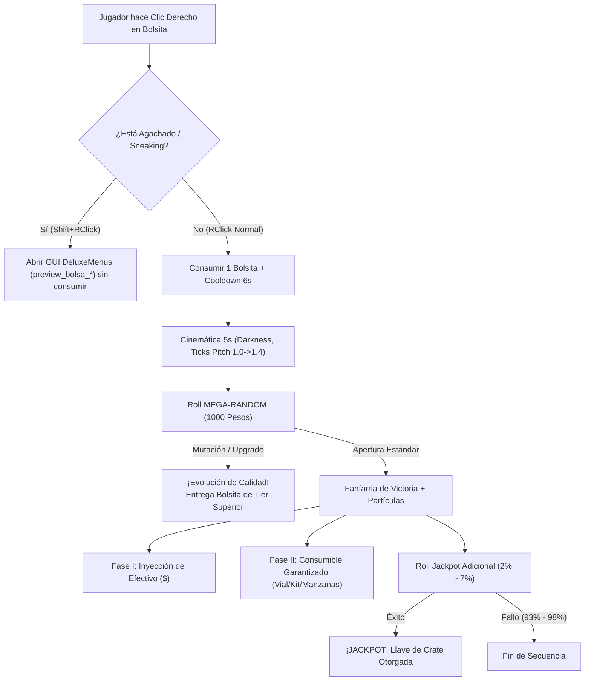

# Especificación Técnica: Sistema de Bundles de Recompensas (Bolsitas Test)

**Identidad del Módulo**: Sistema de Recompensas Interactivas en Mano (Bundles)  
**Versión de Minecraft**: Paper / Purpur 1.21.11  
**Plugins Motores**: `ExecutableItems` (Premium v7.26.5), `DeluxeMenus` (v1.14.1), `Vault` / `EssentialsX`, `ExcellentCrates`  
**Entorno de I+D**: `creator/lab/` en **ThunderCerebro**

---

## 1. Visión General y Filosofía de Diseño

El sistema de **Bundles de Recompensas** sustituye las mecánicas tradicionales y estáticas de "Crates / Ruletas de cofres" por un formato dinámico, interactivo y portable directamente en la mano del jugador, aprovechando el ítem vanilla `BUNDLE` introducido en Minecraft 1.21.

### Pilares Fundamentales:
1. **Inmersión Sensorial en Mano (5 Segundos)**: Al abrir la bolsa, no se abre un menú invasivo. El jugador experimenta una secuencia cinemática local de 50 ticks (5 segundos) con ceguera momentánea (`minecraft:darkness`), conteo decreciente de subtítulos con barras de progreso estilizadas, clicks mecánicos de bundle (`item.bundle.drop_contents`) y percusión de notas con pitch ascendente (1.0 $\rightarrow$ 1.4), culminando en fanfarria de victoria (`ui.toast.challenge_complete`, `player.levelup`, fuegos artificiales) y ráfaga de 4 tipos de partículas (`FIREWORK`, `TOTEM`, `END_ROD`, `VILLAGER_HAPPY`).
2. **Doble Activador (Apertura vs. Preview)**:
   - **Clic Derecho Normal (`ifSneaking: false`)**: Desencadena la apertura, consume el ítem (`usageModification: -1`) e inicia la secuencia de recompensas.
   - **Shift + Clic Derecho (`ifSneaking: true`)**: Abre de forma instantánea una interfaz gráfica de DeluxeMenus (`preview_bolsa_*`) con la tabla de probabilidades y recompensas sin consumir el ítem.
3. **Mecánica de Mutación / Upgrade Dinámico**: Cada bolsita tiene una probabilidad matemática de evolucionar a una calidad superior en lugar de dar premios de su nivel. Si la bolsa muta, se le entrega al jugador la bolsa del siguiente tier sin otorgar las recompensas del tier inferior.
4. **Doble Fase de Loot Garantizado + Jackpot Desacoplado**:
   - **Fase I**: Efectivo líquido (balance de economía Vault).
   - **Fase II**: Consumibles y recursos de alto valor (Viales de Almas, Kits, Horas de Fly, Manzanas Notch).
   - **Jackpot Independiente**: Un roll adicional con probabilidad baja para obtener llaves de Crates sin interferir con la fase base.

---

## 2. Jerarquía Canónica de Tiers (ThunderMC)

Siguiendo el estándar de calidades oficial de ThunderMC, se han definido 5 escalones de botín:

| Tier | Calidad | Material Vanilla | Color Hex / Formato | Estrellas | Factor / Rango Económico |
| :---: | :--- | :--- | :--- | :---: | :---: |
| **1** | **Súper** | `LIME_BUNDLE` | `&#3CDB10Súper` | `⭐` | $800 – $1.500 |
| **2** | **Rara** | `LIGHT_BLUE_BUNDLE` | `&#1DC8FFRara` | `⭐⭐` | $3.000 – $6.000 |
| **3** | **Épica** | `PURPLE_BUNDLE` | `&#732AE2Épica` | `⭐⭐⭐` | $8.000 – $15.000 |
| **4** | **Mítica** | `RED_BUNDLE` | `&#D02626Mítica` | `⭐⭐⭐⭐` | $20.000 – $35.000 |
| **5** | **Divina** | `YELLOW_BUNDLE` | `&#EFFF00Divina` | `⭐⭐⭐⭐⭐` | $40.000 – $60.000 |

---

## 3. Arquitectura del Motor de Probabilidad (MEGA-RANDOM)

El sistema de loot implementa una estructura matemática en `ExecutableItems` basada en **1.000 pesos totales** divididos entre **Mutaciones de Tier** y **Apertura Estándar (Fase I + Fase II)**.

### 3.1. Matriz de Mutaciones de Calidad

| Tier Origen | Peso Mutación Total | Distribución de Upgrades | Probabilidad Relativa de Mutación |
| :--- | :---: | :--- | :--- |
| **Súper** | **98 / 1.000 (9.8%)** | • Rara: 50 pesos • Épica: 28 pesos • Mítica: 15 pesos • Divina: 5 pesos | • 51.0% a Rara • 28.6% a Épica • 15.3% a Mítica • 5.1% a Divina |
| **Rara** | **70 / 1.000 (7.0%)** | • Épica: 50 pesos • Mítica: 15 pesos • Divina: 5 pesos | • 71.4% a Épica • 21.4% a Mítica • 7.2% a Divina |
| **Épica** | **65 / 1.000 (6.5%)** | • Mítica: 50 pesos • Divina: 15 pesos | • 76.9% a Mítica • 23.1% a Divina |
| **Mítica** | **50 / 1.000 (5.0%)** | • Divina: 50 pesos | • 100% a Divina |
| **Divina** | **0 / 1.000 (0.0%)** | *Sin upgrades (calidad máxima / cúspide).* | N/A |

---

## 4. Tablas Detalladas de Recompensas por Calidad

### 4.1. Bolsita Súper (`bundle_recompensas_super_test.yml`)
- **Material**: `LIME_BUNDLE`
- **Mutaciones (98 pesos / 9.8%)**: Rara (50), Épica (28), Mítica (15), Divina (5).
- **Apertura Regular (902 pesos / 90.2%)**:
  - **Efectivo $800 (451 pesos / 50% de la apertura)**:
    - + Vial de Almas x1 (181 pesos / 40.1%)
    - + Kit Súper x1 (158 pesos / 35.0%)
    - + Manzanas de Oro x4 (113 pesos / 25.0%)
  - **Efectivo $1.200 (315 pesos / 35% de la apertura)**:
    - + Vial de Almas x1 (126 pesos / 40.0%)
    - + Kit Súper x1 (110 pesos / 34.9%)
    - + Manzanas de Oro x4 (79 pesos / 25.1%)
  - **Efectivo $1.500 (136 pesos / 15% de la apertura)**:
    - + Vial de Almas x1 (54 pesos / 39.7%)
    - + Kit Súper x1 (47 pesos / 34.6%)
    - + Manzanas de Oro x4 (35 pesos / 25.7%)
- **Jackpot Desacoplado**: 2% Llave Crate Súper (`crates key give %player% super 1`).

---

### 4.2. Bolsita Rara (`bundle_recompensas_rara_test.yml`)
- **Material**: `LIGHT_BLUE_BUNDLE`
- **Mutaciones (70 pesos / 7.0%)**: Épica (50), Mítica (15), Divina (5).
- **Apertura Regular (930 pesos / 93.0%)**:
  - **Efectivo $3.000 (465 pesos / 50%)**:
    - + Vial de Almas x2 (186 pesos / 40.0%)
    - + Tótem de la Inmortalidad x1 (163 pesos / 35.0%)
    - + Kit Rara x1 (116 pesos / 25.0%)
  - **Efectivo $5.000 (325 pesos / 35%)**:
    - + Vial de Almas x2 (130 pesos / 40.0%)
    - + Tótem de la Inmortalidad x1 (114 pesos / 35.1%)
    - + Kit Rara x1 (81 pesos / 24.9%)
  - **Efectivo $6.000 (140 pesos / 15%)**:
    - + Vial de Almas x2 (56 pesos / 40.0%)
    - + Tótem de la Inmortalidad x1 (49 pesos / 35.0%)
    - + Kit Rara x1 (35 pesos / 25.0%)
- **Jackpot Desacoplado**: 3% Llave Crate Rara (`crates key give %player% rara 1`).

---

### 4.3. Bolsita Épica (`bundle_recompensas_epica_test.yml`)
- **Material**: `PURPLE_BUNDLE`
- **Mutaciones (65 pesos / 6.5%)**: Mítica (50), Divina (15).
- **Apertura Regular (935 pesos / 93.5%)**:
  - **Efectivo $8.000 (468 pesos / 50%)**:
    - + Manzana Dorada Encantada (Notch) x1 (187 pesos / 40.0%)
    - + Tótem de la Inmortalidad x2 (164 pesos / 35.0%)
    - + Kit Épica x1 (117 pesos / 25.0%)
  - **Efectivo $12.000 (327 pesos / 35%)**:
    - + Manzana Notch x1 (131 pesos / 40.0%)
    - + Tótem de la Inmortalidad x2 (114 pesos / 34.9%)
    - + Kit Épica x1 (82 pesos / 25.1%)
  - **Efectivo $15.000 (140 pesos / 15%)**:
    - + Manzana Notch x1 (56 pesos / 40.0%)
    - + Tótem de la Inmortalidad x2 (49 pesos / 35.0%)
    - + Kit Épica x1 (35 pesos / 25.0%)
- **Jackpot Desacoplado**: 4% Llave Crate Épica (`crates key give %player% epica 1`).

---

### 4.4. Bolsita Mítica (`bundle_recompensas_mitica_test.yml`)
- **Material**: `RED_BUNDLE`
- **Mutaciones (50 pesos / 5.0%)**: Divina (50).
- **Apertura Regular (950 pesos / 95.0%)**:
  - **Efectivo $20.000 (475 pesos / 50%)**:
    - + Fly Temporal 1 Hora (190 pesos / 40.0%)
    - + Manzana Notch x2 (166 pesos / 35.0%)
    - + Kit Mítica x1 (119 pesos / 25.0%)
  - **Efectivo $30.000 (332 pesos / 35%)**:
    - + Fly Temporal 1 Hora (133 pesos / 40.1%)
    - + Manzana Notch x2 (116 pesos / 34.9%)
    - + Kit Mítica x1 (83 pesos / 25.0%)
  - **Efectivo $35.000 (143 pesos / 15%)**:
    - + Fly Temporal 1 Hora (57 pesos / 39.9%)
    - + Manzana Notch x2 (50 pesos / 35.0%)
    - + Kit Mítica x1 (36 pesos / 25.1%)
- **Jackpot Desacoplado**: 5% Llave Crate Mítica (`crates key give %player% mitica 1`).

---

### 4.5. Bolsita Divina (`bundle_recompensas_legend_test.yml`)
- **Material**: `YELLOW_BUNDLE`
- **Mutaciones**: Ninguna (Calidad Cúspide).
- **Apertura Regular (1.000 pesos / 100%)**:
  - **Efectivo $40.000 (500 pesos / 50%)**:
    - + Fly Temporal 6 Horas (200 pesos / 40.0%)
    - + Manzana Notch x3 (175 pesos / 35.0%)
    - + Kit Divina x1 (125 pesos / 25.0%)
  - **Efectivo $50.000 (350 pesos / 35%)**:
    - + Fly Temporal 6 Horas (140 pesos / 40.0%)
    - + Manzana Notch x3 (123 pesos / 35.1%)
    - + Kit Divina x1 (87 pesos / 24.9%)
  - **Efectivo $60.000 (150 pesos / 15%)**:
    - + Fly Temporal 6 Horas (60 pesos / 40.0%)
    - + Manzana Notch x3 (53 pesos / 35.3%)
    - + Kit Divina x1 (37 pesos / 24.7%)
- **Jackpot Desacoplado**: 7% Llave Crate Divina (`crates key give %player% divina 1`).

---

## 5. Estado Actual del Proyecto y Archivos Existentes

| Componente | Archivo Físico | Estado | Descripción Técnica |
| :--- | :--- | :---: | :--- |
| **Bolsita Súper** | [`bundle_recompensas_super_test.yml`](file:///C:/Users/PC/Desktop/ThunderCerebro/creator/lab/bundle_recompensas_super_test.yml) | ✅ Completado (v5.1) | 2 activadores (`ifSneaking: false/true`), animaciones 5s, MEGA-RANDOM y jackpot 2%. |
| **Bolsita Rara** | [`bundle_recompensas_rara_test.yml`](file:///C:/Users/PC/Desktop/ThunderCerebro/creator/lab/bundle_recompensas_rara_test.yml) | ✅ Completado | Configuración de apertura completa. Falta vincular activador 2 con su preview GUI. |
| **Bolsita Épica** | [`bundle_recompensas_epica_test.yml`](file:///C:/Users/PC/Desktop/ThunderCerebro/creator/lab/bundle_recompensas_epica_test.yml) | ✅ Completado | Configuración de apertura completa. Falta vincular activador 2 con su preview GUI. |
| **Bolsita Mítica** | [`bundle_recompensas_mitica_test.yml`](file:///C:/Users/PC/Desktop/ThunderCerebro/creator/lab/bundle_recompensas_mitica_test.yml) | ✅ Completado | Configuración de apertura completa. Falta vincular activador 2 con su preview GUI. |
| **Bolsita Divina** | [`bundle_recompensas_legend_test.yml`](file:///C:/Users/PC/Desktop/ThunderCerebro/creator/lab/bundle_recompensas_legend_test.yml) | ✅ Completado | Configuración de apertura completa. Falta vincular activador 2 con su preview GUI. |
| **GUI Preview Súper** | [`preview_bolsa_super.yml`](file:///C:/Users/PC/Desktop/ThunderCerebro/creator/lab/preview_bolsa_super.yml) | ✅ Completado | DeluxeMenus 27 slots con desglose de mutaciones, dinero, consumibles y jackpot. |
| **Variable Pity** | [`pity_bundle_super.yml`](file:///C:/Users/PC/Desktop/ThunderCerebro/creator/lab/pity_bundle_super.yml) | 🟡 Prototipo | Variable numérica de jugador (`default: '0'`). Falta script de incremento/reset. |
| **Adopción Transversal** | `etiqueta_*`, `glow_*`, `chatcolor_*` | ✅ Activo | La cinemática de apertura de 50 ticks y el formato de lore han sido adoptados con éxito. |

---

## 6. Red Teaming: Riesgos Técnicos, Económicos y Modos de Fallo

| Área de Riesgo | Modo de Fallo en Producción | Severidad | Mitigación Implementada / Requerida |
| :--- | :--- | :---: | :--- |
| **Bucle de Mutación Infinita** | Si la probabilidad de mutar fuera demasiado alta o no tuviera consumo de ítem, los jugadores podrían acumular bolsas divinas indefinidamente a partir de bolsas baratas. | **FATAL** | Pesos cerrados en 1.000 y consumo instantáneo (`usageModification: -1`) al inicio del activador. |
| **Spam de Clics y Duplicación de Recompensas** | El jugador hace clic continuo durante los 50 ticks de animación, recibiendo múltiples drops por una sola bolsa consumida. | **ALTA** | `cooldown: 6` con mensaje de espera y `cancelEvent: true` en el evento de interacción. |
| **Interacción con Bloques / Colocación del Bundle** | En Minecraft vanilla, los bundles almacenan ítems al hacer click derecho en inventario o pueden interactuar con cofres/mesas de trabajo. | **MEDIA** | `cancel-item-place: true`, `cancel-item-craft: true` y `cancel-anvil: true`. |
| **Desbalance Económico (Hiperinflación)** | La inyección constante de efectivo líquido directo ($800 a $60.000) sin un sumidero equivalente devaluará la moneda del servidor. | **ALTA** | El dinero inyectado debe estar balanceado con precios de tiendas y requerimientos de rangos (`RankUp`). |
| **Falta de GUIs de Preview (Rara a Divina)** | Solo existe `preview_bolsa_super.yml`. Si el jugador hace Shift+Click en Rara, Épica, Mítica o Divina, no se abrirá ningún menú informativo. | **MEDIA** | Requiere crear y registrar `preview_bolsa_rara.yml`, `preview_bolsa_epica.yml`, `preview_bolsa_mitica.yml` y `preview_bolsa_divina.yml`. |

---

## 7. Roadmap y Próximos Pasos de Producción

1. **Creación de GUIs de Vista Previa Restantes**:
   - Modelar `preview_bolsa_rara.yml`, `preview_bolsa_epica.yml`, `preview_bolsa_mitica.yml` y `preview_bolsa_divina.yml` en DeluxeMenus manteniendo la estética y paleta canónica.
2. **Conexión del Activador 2 en Todos los Tiers**:
   - Añadir `activator2` con `ifSneaking: true` y comando `dm open preview_bolsa_<tier> %player%` en Rara, Épica, Mítica y Divina (idéntico a Súper v5.1).
3. **Mecánica Activa de Pity System**:
   - Enlazar la variable `pity_bundle_super` para que sume `+1` cada vez que el jugador no obtenga el premio máximo ni el jackpot, y fuerce una recompensa garantizada al alcanzar 50 aperturas consecutivas.
4. **Despliegue y Pruebas en Sandbox**:
   - Subir la versión completa al servidor de pruebas (`ymykh9qy.274758bd`) y testear tanto la apertura normal como el shift-click preview.
