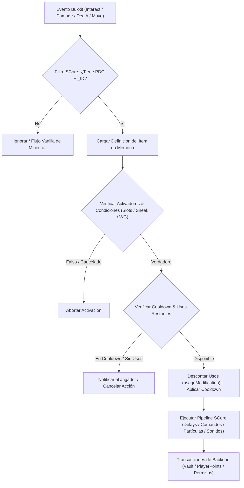
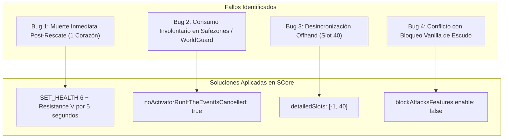

# ⚔️ Compendio Maestro: ExecutableItems (EI) en ThunderMC

**Documento**: Compendio Técnico Exhaustivo, Histórico de Pruebas y Registro de Bugs  
**Servidor**: ThunderMC Network (Minecraft 1.21.11 / Paper & Purpur)  
**Módulos Analizados**: `ExecutableItems` (Premium v7.26.5.17), `SCore` (v5.26.5.17), Integraciones (`DeluxeMenus`, `Vault`, `PlayerPoints`, `WorldGuard`, `AlonsoTags`, `FancyGlow`)  
**Entorno de Datos**: `ThunderCerebro/creator/lab/`, `wiki/` y Servidor Sandbox (`ymykh9qy.274758bd`)

---

## 🏛️ 1. Arquitectura y Funcionamiento Interno

ExecutableItems (EI) opera como un motor de scripting declarativo sobre la API de Bukkit/Paper mediante la inyección y lectura de metadatos NBT y claves en el contenedor persistente de datos (**PersistentDataContainer - PDC**).



### Componentes Críticos del Core:
1. **Identificación Inmutable**:
   - Claves PDC obligatorias: `executableitems:ei-id`, `executableitems:ei-usages`, `executableitems:ei-owner`.
   - **Garantía antifraude**: Previene que un jugador altere el objeto renombrándolo en un yunque vanilla o alterando lore externamente.
2. **Ciclo de Vida de los Activadores (`activators`)**:
   - `PLAYER_RIGHT_CLICK` / `PLAYER_LEFT_CLICK`: Interacciones en mano (diferenciando `ifSneaking: true/false`).
   - `PLAYER_BEFORE_DEATH`: Intercepción previa al despawn por daño mortal (mecanismo base de tótems y escudos salvavidas).
   - `PLAYER_HIT_PLAYER` / `PLAYER_RECEIVE_HIT`: Combate PvP / PvE.
   - `WALK` / `LOOP`: Monitoreo continuo (riesgo alto de MSPT si no se configuran con intervalos adecuados).
3. **Motor de Ejecución de Comandos SCore**:
   - Comandos nativos SCore: `DELAY_TICK <n>`, `SET_HEALTH <n>`, `TOTEM_ANIMATION`, `SEND_MESSAGE <txt>`, `PARTICLE <tipo>`, `RANDOM RUN: <n> ... RANDOM END`.
   - Comandos de servidor despachados hacia la consola o jugador (`minecraft:effect give`, `playerpoints:p give`, `dm open`).

---

## ⚙️ 2. Estándares YAML y Sintaxis de Configuración

Estructura canónica de un ítem ejecutable optimizado para el ecosistema 1.21.11:

```yaml
name: "&6&lNombre del Objeto"
lore:
  - "&7Descripción inmersiva del ítem."
  - ""
  - "&eActivador: &fClic Derecho"
material: BUNDLE
glow: false
disableStack: true
keepItemOnDeath: false
canBeUsedOnlyByTheOwner: false
storeItemInfo: false
unbreakable: true
usageFeatures:
  usage: 1           # 1 para consumibles únicos, -1 para infinitos
  isRefreshableClean: true
  usageLimit: -1
restrictions:
  locked-in-inventory: false

activators:
  activator0:
    name: "AperturaNormal"
    option: PLAYER_RIGHT_CLICK
    usageModification: -1
    cancelEvent: true
    noActivatorRunIfTheEventIsCancelled: true
    detailedSlots:
      - -1           # Mano principal
      - 40           # Mano secundaria (Offhand)
    cooldownFeatures:
      cooldown: 5
      displayCooldownMessage: true
    playerConditions:
      ifSneaking: false
    playerCommands:
      - "execute at %player% run playsound minecraft:item.bundle.drop_contents master %player% ~ ~ ~ 1.0 1.2"
      - "DELAY_TICK 10"
      - "SEND_MESSAGE &a¡Recompensa reclamada!"
```

---

## 🛡️ 3. El Gran Bug del Escudo / Tótem de Salvación (Análisis y Resolución)

Durante las pruebas de balance RPG y supervivencia en ThunderMC se detectaron fallos críticos al configurar escudos ejecutables (`SHIELD`) como dispositivos de salvación ante muerte (`PLAYER_BEFORE_DEATH`). 

Los ítems afectados e iterados fueron:
- [`escudoigneo.yml`](file:///C:/Users/PC/Desktop/ThunderCerebro/creator/lab/escudoigneo.yml)
- [`escudoreyvital.yml`](file:///C:/Users/PC/Desktop/ThunderCerebro/creator/lab/escudoreyvital.yml)
- [`escudoviviente.yml`](file:///C:/Users/PC/Desktop/ThunderCerebro/creator/lab/escudoviviente.yml)
- [`totemturco.yml`](file:///C:/Users/PC/Desktop/ThunderCerebro/creator/lab/totemturco.yml)

### Desglose de los 4 Problemas del Escudo y sus Soluciones:



### 1. Bug de Muerte Residual Inmediata (Instant Re-Death)
- **Causa**: Al ejecutarse el activador `PLAYER_BEFORE_DEATH` con `cancelEvent: true`, si la regeneración de vida inicial dejaba al jugador a 1 corazón (comportamiento vanilla por defecto o `SET_HEALTH 1`), cualquier tick de daño en curso en ese mismo milisegundo (ticks de fuego persistente, daño por veneno, remanente de caída o un combo de golpes continuos en PvP) liquidaba al jugador en el tick inmediatamente posterior al rescate. El escudo se consumía, pero el jugador moría igualmente.
- **Corrección**:
  ```yaml
  playerCommands:
    - TOTEM_ANIMATION
    # ARREGLO PROBLEMA 1: Vida base segura + Resistencia V (inmunidad 100% durante 5s)
    - SET_HEALTH 6
    - "minecraft:effect give %player% minecraft:resistance 5 4"
    - "minecraft:effect give %player% minecraft:regeneration 45 1"
    - "minecraft:effect give %player% minecraft:absorption 5 1"
    - "minecraft:effect give %player% minecraft:fire_resistance 80 0"
  ```

### 2. Bug de Consumo en Zonas Protegidas (WorldGuard / Safezones)
- **Causa**: Si un jugador recibía daño en una región protegida de WorldGuard con PvP deshabilitado o en zonas seguras donde otro plugin cancelaba el daño recibido, `PLAYER_BEFORE_DEATH` escuchaba el evento antes de que se formalizara la cancelación de terceros, gastando el escudo (`usageModification: -1`) innecesariamente sin que el jugador corriera peligro real.
- **Corrección**:
  ```yaml
  # ARREGLO PROBLEMA 2: No se gasta si WorldGuard u otro plugin ya canceló el evento
  noActivatorRunIfTheEventIsCancelled: true
  ```

### 3. Bug de Activación por Ranura (Main Hand vs. Offhand)
- **Causa**: Por defecto, ExecutableItems solo comprueba la mano principal (`slot: -1`) si no se define `detailedSlots`. Al ser un escudo, los usuarios lo equipaban instintivamente en la mano izquierda (`offhand` / `slot: 40`). En combates o caídas, el escudo en la mano secundaria no detectaba el evento y el jugador moría sin activarse el rescate.
- **Corrección**:
  ```yaml
  detailedSlots:
    - -1   # Mano principal
    - 40   # Mano secundaria (Offhand)
  ```

### 4. Conflicto con la Mecánica Vanilla de Bloqueo
- **Causa**: Al habilitar `blockAttacksFeatures` o `weaponFeatures.disableBlockingTime` dentro del archivo YAML de un escudo, SCore intentaba suplantar el listener de bloqueo nativo de Minecraft 1.21. Esto generaba trabas en la animación de agacharse, bloqueos fantasma y reinicios no deseados del cooldown del escudo.
- **Corrección**: Deshabilitar los módulos experimentales de bloqueo de SCore y dejar que el activador actúe puramente como seguro de vida pasivo:
  ```yaml
  blockAttacksFeatures:
    enable: false
  weaponFeatures:
    enable: false
    disableBlockingTime: 0
  ```

---

## 📦 4. Histórico de Pruebas y Sistemas Desarrollados en ThunderMC

A lo largo de las sesiones de I+D en `creator/lab/`, se han implementado múltiples familias de objetos sobre ExecutableItems:

### 4.1. Sistema de Bundles de Recompensas (Bolsitas v5.1)
Sustitución de las cajas tradicionales estáticas por sacos interactivos en mano (`BUNDLE` de Minecraft 1.21):
- **Tiers Canónicos**:
  1. **Súper** (`LIME_BUNDLE`): Rango $800 – $1.500 | Jackpot: 2% Crate Súper.
  2. **Rara** (`LIGHT_BLUE_BUNDLE`): Rango $3.000 – $6.000 | Jackpot: 3% Crate Rara.
  3. **Épica** (`PURPLE_BUNDLE`): Rango $8.000 – $15.000 | Jackpot: 4% Crate Épica.
  4. **Mítica** (`RED_BUNDLE`): Rango $20.000 – $35.000 | Jackpot: 5% Crate Mítica.
  5. **Divina** (`YELLOW_BUNDLE`): Rango $40.000 – $60.000 | Jackpot: 7% Crate Divina.
- **Cinemática Sensorial de 50 Ticks (5 Segundos)**: Efecto `darkness`, cuenta regresiva con barras de progreso en `subtitle`, sonido mecánico `item.bundle.drop_contents` con pitch ascendente (1.0 $\rightarrow$ 1.4), culminando en fanfarria (`ui.toast.challenge_complete`) y 4 tipos de partículas (`TOTEM`, `FIREWORK`, `END_ROD`, `VILLAGER_HAPPY`).
- **Doble Activador**:
  - `PLAYER_RIGHT_CLICK` normal (`ifSneaking: false`): Abre la bolsa y consume 1 uso.
  - `PLAYER_RIGHT_CLICK` con Shift (`ifSneaking: true`): Abre la interfaz GUI informativa de DeluxeMenus (`dm open preview_bolsa_*`) sin consumir el ítem.
- **Motor MEGA-RANDOM (1.000 Pesos)**:
  - Posibilidad matemática de **Mutación / Evolución de Calidad** (la bolsa evoluciona a la bolsa del tier superior en lugar de dar dinero).
  - Fase I: Inyección directa de saldo en Vault.
  - Fase II: Consumible garantizado (Viales de Almas, Kits, Tótems, Horas de Fly).
  - Roll desacoplado independiente de Jackpot de llaves.
- **Sistema de Pity (Piedad)**: Variable SCore de jugador (`pity_bundle_super`) para acumular aperturas fallidas y garantizar el premio mayor tras 50 intentos.

### 4.2. Viales de Almas (`vialdealmas.yml` 1 al 5)
- **Función**: Consumibles de economía alternativa para la tienda de almas (`/almas`).
- **Mecánica**: Secuencia de "liberación de almas" mediante `DELAY_TICK`, títulos dinámicos con símbolos tipográficos (`&3&k||||`), sonidos de amatista afinados progresivamente y bloque `RANDOM RUN` ponderado para inyectar almas mediante PlayerPoints (`playerpoints:p give %player% <cantidad>`).

### 4.3. Cosméticos Ejecutables
- **Etiquetas de Chat (`etiqueta_zzz.yml`, `etiqueta_off.yml`, `etiqueta_luna.yml`)**: Objetos ejecutables que al consumirse ejecutan la asignación de tags en `AlonsoTags`.
- **Glow y ChatColor Temporales (`glow_*`, `chatcolor_*`)**: Tintes y lanas que otorgan permisos temporales de 3 días (`lp user %player% permission settemp ... 3d`) con animaciones de apertura.

### 4.4. Consumibles y Frutas de Mazmorras
- **Archivos**: `mango.yml`, `manzana.yml`, `melocoton.yml`, `pera.yml`, `piña.yml`.
- **Mecánica**: Alimentos ejecutables con `foodFeatures` personalizados, otorgando buffs de velocidad, fuerza y resistencia temporales para el escalado RPG de las mazmorras.

---

## ⚠️ 5. Matriz de Riesgos Fatales y Red Teaming

| Vector de Riesgo | Causa Técnica | Severidad | Mitigación Implementada |
| :--- | :--- | :---: | :--- |
| **Exploit de Duplicación en Shulkers/Mochilas** | Plugins de mochilas o subastas que serializan el ítem en JSON/String pierden o clonan incorrectamente las claves PDC. | **FATAL** | Restringir el almacenamiento de ítems EI con activadores complejos en plugins de baúles externos sin soporte nativo de PDC. |
| **Degradación de MSPT por Spam de Comandos** | Ejecutar decenas de comandos por consola (`execute at`, `playsound`, `title`) en el hilo principal (`Server Thread`) durante aperturas masivas. | **ALTA** | Agrupar acciones en comandos compuestos (`+++`), limitar la frecuencia de clics con cooldowns estrictos (`cooldown: 5s`). |
| **Spam-Clicking durante Animaciones** | El usuario hace clic repetido mientras transcurren los `DELAY_TICK` de la cinemática. | **ALTA** | Descontar el ítem inmediatamente (`usageModification: -1`) al inicio del activador y aplicar `cancelEvent: true`. |
| **Bucle de Pity Infinito** | La variable de pity no se reseteaba tras otorgar la recompensa máxima por falta de comando de reinicio en el activador ganador. | **CRÍTICA** | Asegurar la instrucción `score variable set %player% pity_bundle_super 0` en todos los desenlaces máximos. |

---

## ⚖️ 6. Matriz de Decisión: ExecutableItems vs. Plugin Custom Propio

| Criterio | ExecutableItems + SCore | Plugin Custom Propio (`ThunderBundles.jar`) |
| :--- | :--- | :--- |
| **Velocidad de Iteración** | Inmediata (edición YAML + `/ei reload` en segundos). | Lenta (código Java, Gradle build, subida de JAR y reinicio). |
| **Carga en el Server Thread** | Media-Alta (analizador sintáctico de comandos de consola). | Nula (llamadas directas en memoria a la API de Paper/Vault). |
| **Lógica Matemática Compleja** | Limitada (pesos discretos, sin cálculos continuos). | Total (curvas logarítmicas de pity, aperturas en lote `/openall`). |
| **Estabilidad de NBT** | Altamente probada y mitigada por SSomar. | Riesgo de fallos si se producen cambios de versión en Paper. |

> **Criterio de Migración**: Mantenerse en ExecutableItems mientras el servidor se encuentre en fase de balance y pruebas. Dar el salto a un plugin custom propio únicamente si la concurrencia supera los **80-100 jugadores simultáneos** abriendo consumibles masivamente o si se requiere apertura masiva en lote (*Bulk Opening* de 64 bolsas en 1 tick).

---

## 📂 7. Inventario de Archivos en ThunderCerebro

- **Wiki Oficial**:
  - [`wiki/entities/thundermc/gameplay-mechanics/executableitems.md`](file:///C:/Users/PC/Desktop/ThunderCerebro/wiki/entities/thundermc/gameplay-mechanics/executableitems.md)
- **Escudos y Tótems**:
  - [`creator/lab/escudoigneo.yml`](file:///C:/Users/PC/Desktop/ThunderCerebro/creator/lab/escudoigneo.yml)
  - [`creator/lab/escudoreyvital.yml`](file:///C:/Users/PC/Desktop/ThunderCerebro/creator/lab/escudoreyvital.yml)
  - [`creator/lab/escudoviviente.yml`](file:///C:/Users/PC/Desktop/ThunderCerebro/creator/lab/escudoviviente.yml)
  - [`creator/lab/totemturco.yml`](file:///C:/Users/PC/Desktop/ThunderCerebro/creator/lab/totemturco.yml)
- **Bundles de Recompensas**:
  - [`creator/lab/bundle_recompensas_super_test.yml`](file:///C:/Users/PC/Desktop/ThunderCerebro/creator/lab/bundle_recompensas_super_test.yml)
  - [`creator/lab/bundle_recompensas_rara_test.yml`](file:///C:/Users/PC/Desktop/ThunderCerebro/creator/lab/bundle_recompensas_rara_test.yml)
  - [`creator/lab/bundle_recompensas_epica_test.yml`](file:///C:/Users/PC/Desktop/ThunderCerebro/creator/lab/bundle_recompensas_epica_test.yml)
  - [`creator/lab/bundle_recompensas_mitica_test.yml`](file:///C:/Users/PC/Desktop/ThunderCerebro/creator/lab/bundle_recompensas_mitica_test.yml)
  - [`creator/lab/bundle_recompensas_legend_test.yml`](file:///C:/Users/PC/Desktop/ThunderCerebro/creator/lab/bundle_recompensas_legend_test.yml)
- **Viales y Moneda**:
  - [`creator/lab/vialdealmas.yml`](file:///C:/Users/PC/Desktop/ThunderCerebro/creator/lab/vialdealmas.yml) (versiones 1 a 5)
  - [`creator/lab/bolsadedinero.yml`](file:///C:/Users/PC/Desktop/ThunderCerebro/creator/lab/bolsadedinero.yml) (versiones 1 a 5)
- **Consumibles de Mazmorra**:
  - `creator/lab/mango.yml`, `manzana.yml`, `melocoton.yml`, `pera.yml`, `piña.yml`
