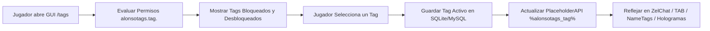

# 🏷️ AlonsoTags - Documentación Técnica

- **Categoría**: Cosméticos / Títulos & Tags Visuales de Chat/TAB
- **Versión Core Soportada**: Minecraft 1.8.x - 1.21.x (Paper / Purpur)
- **Desarrollador**: AlonsoAliaga
- **Dependencias**: PlaceholderAPI (Obligatoria), TAB / DecentHolograms / Vault (Opcionales)
- **Ruta de Configuración**: `plugins/AlonsoTags/`

---

## 🏛️ 1. Arquitectura y Funcionamiento Interno

AlonsoTags implementa un sistema modular de etiquetas cosméticas desbloqueables (Tags/Titles), serializando las selecciones de los usuarios en bases de datos SQLite/MySQL y exponiendo su salida a través del expansor de PlaceholderAPI para que plugins de chat (ZelChat), listas de jugadores (TAB) y hologramas puedan renderizarlas dinámicamente.



### Características Clave:
1. **Soporte Completo de Colores RGB y Gradientes**:
   - Integración nativa con formatos Hexadecimales (`#RRGGBB`) y compatibilidad con MiniMessage.
2. **Sincronización en Red (Bungee/Velocity Support)**:
   - Capacidad de compartir los tags equipados entre toda la red mediante base de datos MySQL compartida.
3. **Paginación Dinámica y Personalización de GUI**:
   - Soporte para categorías temáticas (Eventos, Rangos, Temporadas, Desafíos).

---

- **Parte de**: [[wiki/entities/thundermc/ecosistema-plugins|Ecosistema Plugins]] | [[wiki/synthesis/thundermc-master-synthesis|Síntesis Maestra]]
## ⚙️ 2. Configuración Crítica (`tags.yml`)

```yaml
Tags:
  trueno_legendario:
    display-name: "&6⚡ &e&lTRUENO &6⚡"
    tag: "&8[&6⚡ &e&lTRUENO &6⚡&8]"
    permission: "alonsotags.tag.trueno_legendario"
    slot: 10
    item:
      material: "BLAZE_ROD"
      custom-model-data: 0
      lore:
        - "&7Etiqueta exclusiva para los"
        - "&7veteranos de ThunderMC."
        - ""
        - "%status%" # Resuelto dinámicamente: Desbloqueado / Bloqueado
  veterano:
    display-name: "&b🛡️ VETERANO"
    tag: "&8[&b🛡️ VETERANO&8]"
    permission: "alonsotags.tag.veterano"
    slot: 11
    item:
      material: "DIAMOND_CHESTPLATE"
```

---

## 💻 3. Comandos y Jerarquía de Permisos

### Comandos Principales:
| Comando | Descripción | Permiso |
| :--- | :--- | :--- |
| `/tags` | Abre la interfaz gráfica de selección de tags. | `alonsotags.use` |
| `/tags set <tag>` | Equipa directamente una etiqueta por ID. | `alonsotags.set` |
| `/tags clear` | Desequipa la etiqueta activa actual. | `alonsotags.clear` |
| `/tags setplayer <jugador> <tag>` | Fuerza el equipamiento de un tag a un usuario. | `alonsotags.admin` |
| `/tags reload` | Recarga las definiciones de tags e interfaces. | `alonsotags.admin` |

### Jerarquía de Permisos:
- `alonsotags.admin`: Acceso completo a comandos de administración.
- `alonsotags.tag.*`: Desbloquea todas las etiquetas disponibles.
- `alonsotags.tag.<id>`: Permiso individual para desbloquear y equipar un tag específico.

---

## 🧩 4. Integración con PlaceholderAPI (PAPI)

| Placeholder | Descripción |
| :--- | :--- |
| `%alonsotags_tag%` | Muestra el tag activo del jugador con formato y colores completos. |
| `%alonsotags_tag_identifier%` | ID técnico del tag equipado (ej: `trueno_legendario`). |
| `%alonsotags_tag_custom_<id>%` | Muestra la representación formateada de un tag concreto. |
| `%alonsotags_tags_unlocked%` | Conteo de etiquetas desbloqueadas por el usuario. |

---

## 🛡️ 5. Modos de Fallo y Optimización

> [!TIP]
> **Espaciado Limpio en Chat cuando no hay Tag Equipado**:
> Si un jugador no tiene ningún tag seleccionado, `%alonsotags_tag%` devuelve un valor vacío `""`.
> Asegurarse de que el formato de ZelChat o TAB no agregue espacios o separadores adicionales cuando el valor sea nulo o vacío:
> ```yaml
> # Ejemplo en TAB / ZelChat
> format: "{#alonsotags_tag# != '' ? '%alonsotags_tag% ' : ''}%luckperms_prefix% %player%: %message%"
> ```

---

## Referencias Cruzadas
- [[wiki/entities/thundermc/core-infrastructure/tab|TAB]]
- [[wiki/entities/thundermc/chat-social/zelchat|ZelChat]]
- [[wiki/entities/thundermc/core-infrastructure/luckperms|LuckPerms]]
- [[wiki/entities/thundermc/ecosistema-plugins|Ecosistema Plugins]]
