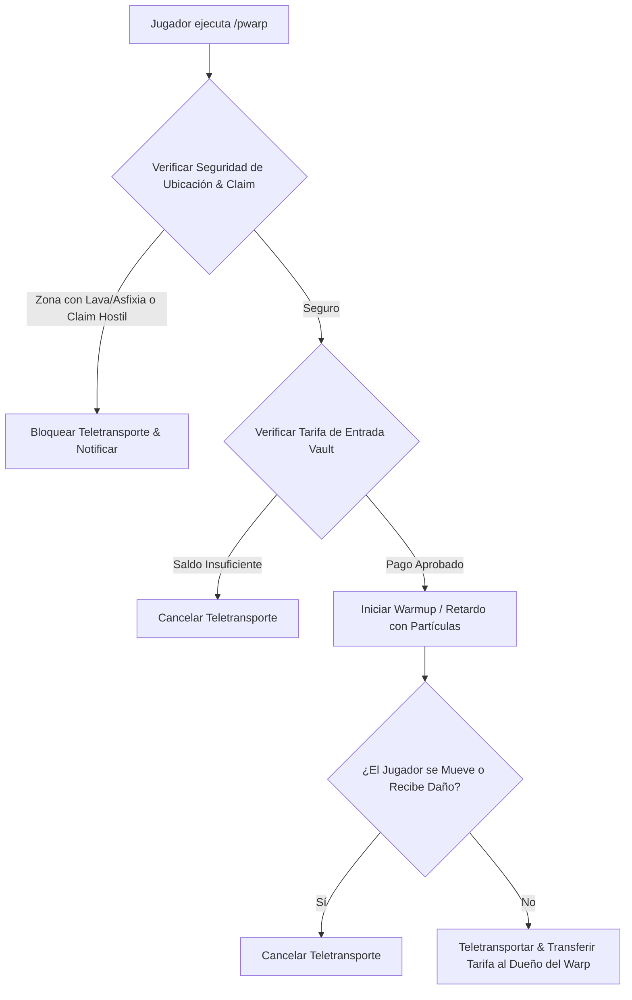

# 📍 PlayerWarps - Documentación Técnica

- **Categoría**: Teletransporte Social / Tiendas de Jugadores / Warps Públicos
- **Versión Core Soportada**: Minecraft 1.16.x - 1.21.x (Paper / Purpur)
- **Desarrollador**: OlzieDev
- **Dependencias**: Vault, PlaceholderAPI, WorldGuard, ProtectionStones
- **Ruta de Configuración**: `plugins/PlayerWarps/`

---

## 🏛️ 1. Arquitectura y Funcionamiento Interno

PlayerWarps permite a los usuarios publicar puntos de teletransporte públicos o privados con sistema de valoraciones (Ratings/Reviews), categorías (Tiendas, Granjas, Ciudades, Arenas), tarifas de entrada y verificación de seguridad de ubicación.



### Características Principales:
1. **Menús GUI Dinámicos**:
   - Paginación interactiva, ordenación por popularidad/visitas/valoración y filtrado por categorías.
2. **Sistema de Monetización y Visitas**:
   - Posibilidad de cobrar un precio en dinero o experiencia por cada teletransporte recibido, actuando como motor de economía para tiendas de jugadores.
3. **Control de Privacidad y Whitelists**:
   - Modo público, protegido por contraseña o restringido por lista blanca de amigos/clanes.

---

## ⚙️ 2. Configuración Crítica (`config.yml`)

```yaml
general:
  max-warps-default: 2
  teleport-delay-seconds: 3
  cancel-on-move: true
  cancel-on-damage: true

safety-checks:
  prevent-unsafe-teleports: true
  check-lava: true
  check-void: true
  check-suffocation: true
  respect-worldguard: true

economy:
  warp-creation-cost: 2500.0
  max-admission-fee: 500.0

limits-by-permission:
  playerwarps.limit.vip: 5
  playerwarps.limit.mvp: 10
  playerwarps.limit.elite: 20
```

---

## 💻 3. Comandos y Jerarquía de Permisos

### Comandos de Usuario y Administración:
| Comando | Descripción | Permiso |
| :--- | :--- | :--- |
| `/pwarp` o `/pw` | Abre la interfaz gráfica de warps públicos. | `playerwarps.use` |
| `/pw set <nombre>` | Crea un nuevo warp en la ubicación actual. | `playerwarps.set` |
| `/pw delete <nombre>` | Elimina un warp propio. | `playerwarps.delete` |
| `/pw cost <nombre> <monto>` | Asigna una tarifa de entrada para visitantes. | `playerwarps.cost` |
| `/pw password <nombre> <clave>` | Protege el warp con una clave de acceso. | `playerwarps.password` |
| `/pw category <nombre> <cat>` | Asigna una categoría (Tienda, Granja, etc.). | `playerwarps.category` |
| `/pw rate <nombre> <1-5>` | Califica un warp visitado. | `playerwarps.rate` |
| `/pw admin delete <nombre>` | Elimina cualquier warp por moderación. | `playerwarps.admin` |

### Jerarquía de Permisos:
- `playerwarps.admin`: Control total y moderación de warps.
- `playerwarps.bypass.delay`: Omite el tiempo de espera (Warmup) al teletransportarse.
- `playerwarps.bypass.cost`: Evita pagar costes de creación o tarifas de entrada.

---

## 🧩 4. Integración con PlaceholderAPI (PAPI)

| Placeholder | Descripción |
| :--- | :--- |
| `%playerwarps_total_warps%` | Cantidad total de warps registrados en el servidor. |
| `%playerwarps_player_count%` | Número de warps creados por el jugador. |
| `%playerwarps_player_max%` | Límite máximo de warps permitidos para su rango. |

---

## 🛡️ 5. Modos de Fallo y Trampas de Muerte (TP-Traps)

> [!CAUTION]
> **Exploit de TP-Traps (Trampas de Muerte / Caída al Vacío)**:
> Jugadores maliciosos pueden crear un warp público sobre pozos de lava, caídas letales o trampas con pistones para robar el loot de visitantes.
> **Mitigación**:
> 1. Mantener `safety-checks.prevent-unsafe-teleports: true`.
> 2. Activar la invulnerabilidad temporal post-teletransporte (`teleport-invulnerability-seconds: 3`).
> 3. Implementar un comando de reporte rápido (`/pw report <nombre>`).
