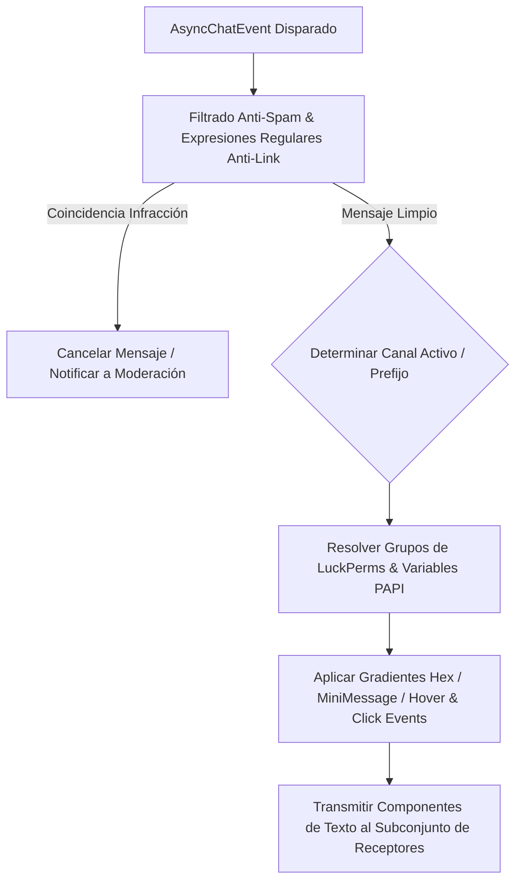

# 💬 ZelChat - Documentación Técnica

- **Categoría**: Gestión de Chat / Canales / Formato y Moderación
- **Versión Core Soportada**: Minecraft 1.16.x - 1.21.x (Paper / Purpur)
- **Desarrollador**: Zeltuv
- **Dependencias**: PlaceholderAPI, Vault, LuckPerms, ProtocolLib (Opcional)
- **Ruta de Configuración**: `plugins/ZelChat/`

---

## 🏛️ 1. Arquitectura y Funcionamiento Interno

ZelChat intercepta el evento `AsyncChatEvent` de Paper / Spigot, procesando el formato del mensaje, filtrando contenido malicioso mediante expresiones regulares (Anti-Spam / Anti-Ad) y distribuyendo el texto a canales específicos (Global, Local, Staff, Team).



### Características Principales:
1. **Canales de Conversación Nativos**:
   - **Global**: Transmisión a todo el servidor o red.
   - **Local**: Limitado por radio de bloques euclídeo (ej: 100 bloques).
   - **Staff Chat**: Canal privado para administradores con toggle (`/sc`).
   - **Team/Clan Chat**: Integración directa con ZelTeams.
2. **Interactividad Avanzada (Chat Components)**:
   - Soporte de tooltips emergentes (Hover Events) y acciones de clic (Run Command / Suggest Command / Open URL).
   - Menciones de jugadores (`@Nombre`) con notificación sonora y resaltado.
3. **Módulo de Muestra de Ítems e Inventario**:
   - Tags interactivos como `[item]`, `[inv]`, `[ender]` con vista previa en GUI para los receptores.

---

## ⚙️ 2. Configuración Crítica (`config.yml` / `formats.yml`)

```yaml
general:
  default-channel: "global"
  mention-sound: "BLOCK_NOTE_BLOCK_PLING"
  mention-color: "&e"

channels:
  global:
    format: "%luckperms_prefix% &f%player%: &7%message%"
    radius: -1 # Global
    permission: "zelchat.channel.global"
  local:
    format: "&7[Local] %luckperms_prefix% &f%player%: &f%message%"
    radius: 100 # 100 bloques
    permission: "zelchat.channel.local"
  staff:
    format: "&c[Staff] &f%player%: &e%message%"
    permission: "zelchat.staff"

anti-spam:
  cooldown-seconds: 2.0
  block-caps:
    enabled: true
    min-length: 6
    max-percentage: 60
  anti-link:
    enabled: true
    whitelist:
      - "thundermc.net"
      - "discord.gg/thundermc"
```

---

## 💻 3. Comandos y Jerarquía de Permisos

### Comandos Principales:
| Comando | Descripción | Permiso |
| :--- | :--- | :--- |
| `/chat mute` | Silencia el chat global del servidor temporalmente. | `zelchat.admin.mute` |
| `/chat clear` | Limpia las líneas visibles del chat para todos los jugadores. | `zelchat.admin.clear` |
| `/sc <mensaje>` | Envía un mensaje directo al canal interno de Staff. | `zelchat.staff` |
| `/channel <local/global>` | Cambia el canal activo del emisor. | `zelchat.channel.switch` |
| `/zelchat reload` | Recarga las plantillas de formato y filtros. | `zelchat.admin.reload` |

### Jerarquía de Permisos:
- `zelchat.admin`: Acceso completo a moderación y configuración.
- `zelchat.color`: Permite utilizar códigos de color estándar (`&a`, `&b`).
- `zelchat.hex`: Permite utilizar gradientes y códigos RGB MiniMessage.
- `zelchat.bypass.cooldown`: Elimina el retraso anti-spam entre mensajes.

---

## 🧩 4. Integración con PlaceholderAPI (PAPI)

| Placeholder | Descripción |
| :--- | :--- |
| `%zelchat_channel%` | Nombre del canal activo del jugador emisor. |
| `%zelchat_muted%` | Devuelve si el chat global se encuentra silenciado. |

---

## 🛡️ 5. Modos de Fallo y Seguridad

> [!CAUTION]
> **Lag por Parseo Masivo de PAPI en `AsyncChatEvent`**:
> El uso excesivo de placeholders pesados (por ejemplo, aquellos que realizan consultas SQL por cada mensaje enviado) puede provocar retrasos en la entrega de paquetes de chat.
> **Mitigación**: Usar placeholders basados en memoria local (LuckPerms caching) y evitar consultas asíncronas no cacheadas en el formato de chat.
