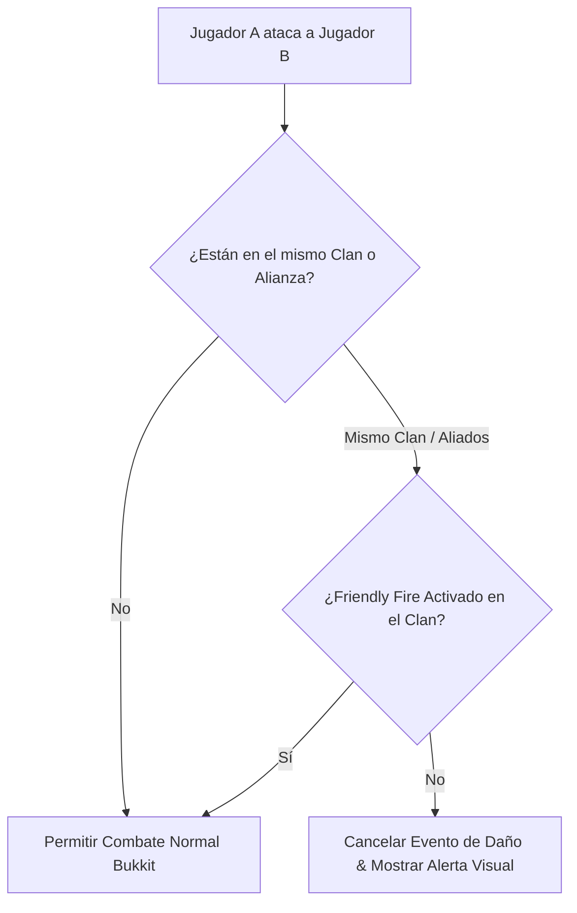

# 🛡️ ZelTeams - Documentación Técnica

- **Categoría**: Clanes / Equipos / Alianzas & PvP Social
- **Versión Core Soportada**: Minecraft 1.16.x - 1.21.x (Paper / Purpur)
- **Desarrollador**: Zeltuv
- **Dependencias**: Vault (Economía de Banco), PlaceholderAPI, ZelChat, UltimateKoth, WorldGuard
- **Ruta de Configuración**: `plugins/ZelTeams/`

---

## 🏛️ 1. Arquitectura y Funcionamiento Interno

ZelTeams implementa un sistema modular de agrupaciones de jugadores (Teams/Clans), gestionando relaciones de fuego amigo (Friendly Fire), alianzas, bancos compartidos, puntos de concentración (Team Home / Waypoints) y tablas de clasificación competitiva (KDR, Puntos KOTH).



### Características Principales:
1. **Jerarquías de Rango Internas**:
   - Leader (Líder), Co-Leader (Sublíder), Captain (Capitán), Member (Miembro), Recruit (Recluta) con permisos granulares (invitar, expulsar, retirar fondos del banco).
2. **Banco de Clan & Contabilidad Vault**:
   - Fondo monetario común para mejoras de clan (límite de miembros, multiplicadores de experiencia).
3. **Integración Directa de Chat y PvP**:
   - Canal de chat privado de clan (`/tc <mensaje>`) y canal de aliados (`/ac <mensaje>`).
   - Bloqueo de daño mutuo entre aliados y compañeros de equipo.

---

## ⚙️ 2. Configuración Crítica (`config.yml`)

```yaml
team-settings:
  max-name-length: 12
  min-name-length: 3
  name-regex: "^[a-zA-Z0-9_]+$"
  max-members-default: 8
  max-allies-default: 2

creation-cost: 5000.0 # Coste Vault para crear un clan
friendly-fire-default: false

upgrades:
  member-slots:
    tier-1: {cost: 10000, extra-slots: 2}
    tier-2: {cost: 25000, extra-slots: 4}
    tier-3: {cost: 50000, extra-slots: 6}

database:
  type: SQLITE # O MYSQL
  mysql:
    host: "127.0.0.1"
    port: 3306
    database: "zelteams"
    username: "minecraft"
    password: "password"
```

---

## 💻 3. Comandos y Jerarquía de Permisos

### Comandos de Clan:
| Comando | Descripción | Permiso |
| :--- | :--- | :--- |
| `/team create <nombre>` | Funda un nuevo clan. | `zelteams.use` |
| `/team invite <jugador>` | Invita a un jugador a unirse al clan. | `zelteams.use` |
| `/team join <clan>` | Acepta una invitación pendiente. | `zelteams.use` |
| `/team sethome` | Establece el punto de teletransporte de la base del clan. | `zelteams.home` |
| `/team home` | Teletransporta a la base del clan. | `zelteams.home` |
| `/team deposit <monto>` | Deposita dinero en la bóveda del clan. | `zelteams.bank` |
| `/team withdraw <monto>` | Retira dinero del banco (Líderes/Sublíderes). | `zelteams.bank` |
| `/team pvp` | Alterna el fuego amigo (Friendly Fire) entre miembros. | `zelteams.use` |
| `/team ally <clan>` | Envía o acepta solicitud de alianza formal. | `zelteams.ally` |
| `/team admin` | Panel de gestión y disolución forzosa para moderadores. | `zelteams.admin` |

### Jerarquía de Permisos:
- `zelteams.admin`: Gestión administrativa de clanes y eliminación de datos.
- `zelteams.use`: Acceso a la suite básica de comandos de clanes.
- `zelteams.bypass.cost`: Creación y mejora de clanes sin costo económico.

---

## 🧩 4. Integración con PlaceholderAPI (PAPI)

| Placeholder | Descripción |
| :--- | :--- |
| `%zelteams_name%` | Nombre del clan al que pertenece el jugador (o "Sin Clan"). |
| `%zelteams_tag%` | Tag formateado del clan con colores. |
| `%zelteams_role%` | Rango jerárquico dentro del clan (Líder, Miembro, etc.). |
| `%zelteams_members_online%` | Número de miembros conectados en el momento. |
| `%zelteams_bank%` | Saldo actual depositado en la bóveda del equipo. |
| `%zelteams_kdr%` | Ratio de Asesinatos/Muertes acumulado del clan. |

---

## 🛡️ 5. Modos de Fallo y Prevención de Exploits

> [!WARNING]
> **Exploit de Evasión de Combate con `/team home`**:
> Jugadores intentando huir de zonas de combate o eventos KOTH mediante el teletransporte a la base de clan.
> **Mitigación**: Configurar un retardo de teletransporte (Warmup de 5 segundos) y vincularlo con `PvPManager` para cancelar `/team home` si el jugador está en combate (`in-combat: cancel`).
