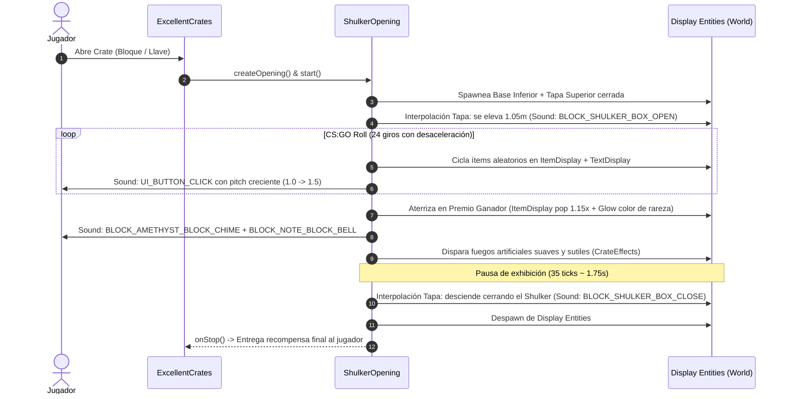

# CrateEffects (Addon Desacoplado de Efectos & Apertura Shulker para ExcellentCrates)

**Módulo**: Addons & Cosméticos ThunderMC  
**Target**: Paper 1.21.11 / Geyser & Floodgate (Java Native First)  
**Dependencias**: `ExcellentCrates-6.6.1`, `nightcore-2.14.0`, Paper API 1.21.1, JOML 1.10.8  
**Repositorio / Ubicación**: `creator/lab/CrateEffects/` -> `creator/output/plugins/CrateEffects-1.0.0.jar`

---

## 1. Propósito y Filosofía de Aislamiento
Plugin desacoplado creado para dos propósitos complementarios:
1. **Motor Celebratorio Post-Recompensa**: Fuegos artificiales suaves, sonido envolvente y confeti seguro sin daño de impacto.
2. **Motor de Apertura Shulker Box (CS:GO Roll)**: Animación custom in-world registrada como `OpeningProvider` (`Id: shulker_box`) en ExcellentCrates usando **Display Entities** (`BlockDisplay`, `ItemDisplay`, `TextDisplay`).

---

## 2. Animación Shulker Box CS:GO Roll (`shulker_box`)



### Componentes Display:
- **Base Inferior (`BlockDisplay`)**: Shulker Box sincronizada con el **Crate Item** configurado en ExcellentCrates (`ItemProvider`, ej. `minecraft:red_shulker_box`), con dimensiones $1.0 \times 0.5 \times 1.0$ ancladas al grid exacto.
- **Tapa Superior (`BlockDisplay`)**: Shulker Box con interpolación fluida a 60 FPS cliente. Al abrir se traslada de $y=0.50$ a $y=1.60$ (la parte superior alcanza $y=2.10$), y al terminar regresa a $y=0.50$ sellando la caja.
- **Tira de Ruleta CS:GO de 3 Ítems**:
  - **Ítem Central (`rewardDisplay`)**: Ubicado en el hueco interior flotante ($y=1.05$), escala $0.85$, con `Billboard.CENTER`. Durante la ruleta se muestra limpio sin glow. Al detenerse y aterrizar en el ganador final, escala a $1.18$ y se activa su glow (`setGlowing(true)` con `setGlowColorOverride`) con el color de su rareza para la celebración.
  - **Ítem Izquierdo (`leftDisplay`)**: Objeto que acaba de pasar, desplazado lateralmente $-0.55\,\text{m}$ y $+0.12\,\text{m}$ hacia el fondo, con tamaño sutilmente reducido (escala $0.38$) y luminosidad atenuada (`Brightness(4,4)`).
  - **Ítem Derecho (`rightDisplay`)**: Próximo objeto entrante, desplazado lateralmente $+0.55\,\text{m}$ y $+0.12\,\text{m}$ hacia el fondo, con tamaño sutilmente reducido (escala $0.38$) y luminosidad atenuada (`Brightness(4,4)`).
  - Al proclamar al ganador, los ítems laterales se contraen a escala $0.0$ en 6 ticks.
- **Fuegos Artificiales y Partículas Clímax**:
  - Un único cohete blanco puro (`Color.WHITE`, tipo `BALL`, sin estela ni parpadeo) con daño anulado.
  - Partículas reducidas a un estallido sutil de 6 chispas blancas (`Particle.FIREWORK`), eliminando la saturación visual previa.
- **Textos Flotantes Elevados (con holgura por encima de la tapa superior a $y=2.10$)**:
  - **Línea 1 (`nameDisplay`)**: A $y=2.75$, título ampliado a escala $1.30$, **sin background** (`ARGB 0,0,0,0`), con los colores y degradados nativos del ítem.
  - **Línea 2 (`subtitleDisplay`)**: A $y=2.38$, muestra únicamente la probabilidad calculada (`&7Probabilidad: &e[Prob]%`), a escala $0.85$ y con **background negro traslúcido** (`ARGB 140, 20, 20, 25`).
- **Celebración Única**: `RewardEffectListener` filtra las cajas con animación `shulker_box`, de modo que los fuegos artificiales se disparan una única vez en el clímax de la ruleta (`displayWinner`) y no se duplican al entregar el ítem.

---

## 3. Comandos de Administración
- `/crateeffects test [rareza]`: Prueba la fanfarria de fuegos artificiales sutiles en la posición del jugador.
- `/crateeffects testshulker [crate_id]`: Ejecuta la animación completa de Shulker Box CS:GO sin gastar llaves (ej: `/crateeffects testshulker mitica`).
- `/crateeffects reload`: Recarga caliente de `config.yml`.

---

## 4. Activación en Crates de ExcellentCrates
Para asignar esta animación a cualquier caja (ej. `plugins/ExcellentCrates/crates/mitica.yml`):
```yaml
Animation:
  Enabled: true
  Id: shulker_box
```

---

## 5. Arquitectura de Desvanecimiento de Bloque y Parseo de Textos

### 5.1 Desvanecimiento del Bloque Físico (*Client-Side Swap*)
- **Detección**: Identifica `source.getBlock()`, `player.getTargetBlockExact()` o el bloque más cercano configurado en `Block.Positions`.
- **Desvanecimiento Atómico**: Envía `player.sendBlockChange(loc, Material.AIR.createBlockData())` en tick 0, y refuerza en los ticks 1 y 2 (venciendo el paquete de confirmación post-interacción que envía Paper tras procesar el clic derecho).
- **Mantenimiento**: Durante `STATE_OPENING` y `STATE_SPINNING`, refuerza el bloque como `AIR` en los clientes cada 5 ticks.
- **Restauración Atómica**: Al cerrarse la tapa del Shulker en `onStop()`, envía `sendBlockChange` con el `originalBlockData` exacto (preservando rotación, estado y facing) y restaura el holograma original.

### 5.2 Deserialización de Nombres de Recompensa (Adventure 1.21)
- **Extracción de Contenido Real**: Si el `preview` de la recompensa es una cabeza o bloque genérico sin metadatos, inspecciona los ítems reales en `ItemReward.getItems()` para obtener el `ItemStack` auténtico.
- **Nativo Primero**: Si el ítem posee `displayName()` o `itemName()` nativo de Adventure Component, se utiliza directamente sin conversión a texto.
- **Normalización MiniMessage + Legacy**: Si proviene de string serializado por NightCore, convierte códigos `&`/`§` a tags estándar de MiniMessage y deserializa mediante `MiniMessage.miniMessage().deserialize()`.
- **Fallback Regex Hex**: En caso de tags no estándar, un convertidor por expresiones regulares transforma `<#RRGGBB>` en `§x§R§R§G§G§B§B` y elimina etiquetas residuales de cierre `</...>`, garantizando que jamás aparezcan códigos visibles en pantalla.

