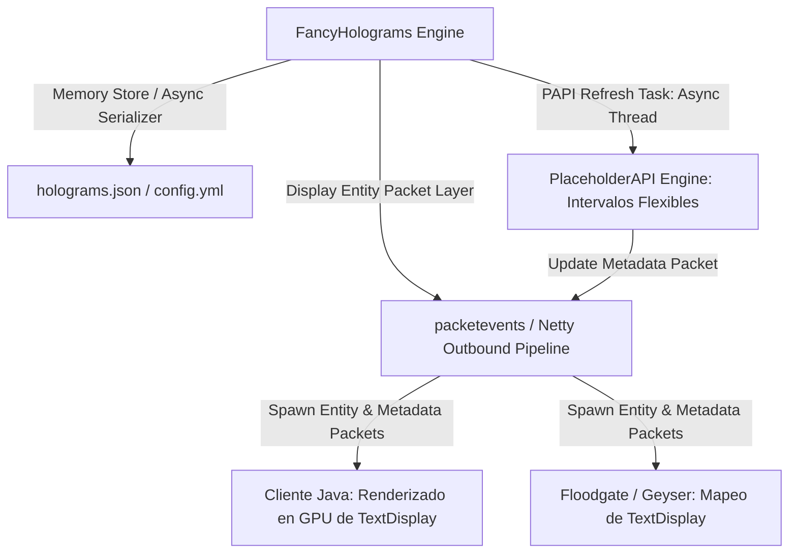

# 📖 FancyHolograms (2.9.1+)

- **Categoría**: Display Entities / Hologramas de Alto Rendimiento
- **Servidor**: ThunderMC Survival 1.21.11 (Paper build 126+)
- **Desarrollador**: FancyInnovations (Oliver Berg)
- **Dependencias**: Paper 1.19.4+ (Nativo 1.21.11 Display Entities API)
- **Documentación Oficial**: [fancyinnovations.com/docs/minecraft-plugins/fancyholograms](https://fancyinnovations.com/docs/minecraft-plugins/fancyholograms)

---

## 🎯 1. Propósito & Visión General
**FancyHolograms** es el motor moderno de hologramas basado en las nuevas **Display Entities** de Minecraft (`TextDisplay`, `ItemDisplay`, `BlockDisplay`). Sustituye por completo los sistemas heredados basados en armaduras invisibles (`ArmorStands`) o paquetes NMS de `Slime/WitherSkull`.

Al delegar el renderizado, interpolación, escalado 3D, sombras y fondos semitransparentes directamente al motor gráfico del cliente a través de `TextDisplay`, FancyHolograms reduce a prácticamente cero la sobrecarga del servidor en colisiones de entidades, ticking y serialización masiva de chunks.

---

- **Parte de**: [[wiki/entities/thundermc/ecosistema-plugins|Ecosistema Plugins]] | [[wiki/synthesis/thundermc-master-synthesis|Síntesis Maestra]]
## 🏗️ 2. Arquitectura Interna & Funcionamiento



### 2.1 Componentes Principales
1. **Modelos Display Entities Nativo**:
   - **`TextHologram`**: Emplea `TextDisplayEntity`. Soporta billboarding (`CENTER`, `FIXED`, `HORIZONTAL`, `VERTICAL`), color de fondo ARGB con opacidad, sombras de texto, alineación (`LEFT`, `CENTER`, `RIGHT`), y transformaciones de matriz (escala X/Y/Z, rotación).
   - **`ItemHologram`**: Emplea `ItemDisplayEntity`. Renderiza modelos de items flotantes o giratorios en 3D (`transform: GUI, GROUND, HEAD, FIXED`).
   - **`BlockHologram`**: Emplea `BlockDisplayEntity`. Renderiza bloques visuales sin colisión para decoración o pedestales.
2. **Ciclo de Actualización Asíncrono de Placeholders**:
   - En lugar de actualizar todo el texto en cada tick (20 Hz), cada línea con placeholders de PAPI se actualiza en intervalos parametrizables (`update-interval-in-seconds`), ejecutando el parseo fuera del `Server Thread` y enviando únicamente paquetes delta de metadatos (`ClientboundSetEntityDataPacket`).
3. **Visibilidad Dinámica y Rango de Visión**:
   - `visibility_distance`: Controla la distancia de renderizado de la entidad display en bloques.
   - `linked_with_player`: Hologramas que muestran información personalizada por jugador (e.g. stats personales, balance, misiones activas).

---

## ⌨️ 3. Comandos Completos y Sintaxis

| Comando | Alias | Argumentos | Descripción | Nivel de Acceso |
|---|---|---|---|---|
| `/hologram create` | `/holo create` | `<nombre> [tipo: TEXT\|ITEM\|BLOCK]` | Crea un nuevo holograma en la posición exacta del jugador. | Admin |
| `/hologram remove` | `/holo remove` | `<nombre>` | Elimina un holograma existente de la memoria y el almacenamiento. | Admin |
| `/hologram edit` | `/holo edit` | `<nombre>` | Abre el menú GUI interactivo para editar todas las propiedades del holograma. | Admin |
| `/hologram edit <nombre> add-line` | `/holo edit ...` | `<texto>` | Añade una línea de texto al final del holograma. | Admin |
| `/hologram edit <nombre> set-line` | `/holo edit ...` | `<índice> <texto>` | Reemplaza una línea de texto específica (1-indexed). | Admin |
| `/hologram edit <nombre> remove-line`| `/holo edit ...` | `<índice>` | Elimina la línea en el índice indicado. | Admin |
| `/hologram edit <nombre> billboard` | `/holo edit ...` | `<CENTER\|FIXED\|HORIZONTAL\|VERTICAL>` | Ajusta el modo de rotación/enfrentamiento al jugador. | Admin |
| `/hologram edit <nombre> scale` | `/holo edit ...` | `<x> <y> <z>` | Ajusta la escala tridimensional del holograma. | Admin |
| `/hologram edit <nombre> background`| `/holo edit ...` | `<color_hex_o_argb\|default\|transparent>`| Configura el fondo detrás del texto. | Admin |
| `/hologram edit <nombre> shadow` | `/holo edit ...` | `<true\|false>` | Activa o desactiva la sombra en los caracteres de texto. | Admin |
| `/hologram edit <nombre> see-through`| `/holo edit ...` | `<true\|false>` | Permite ver el texto del holograma a través de paredes sólidas. | Admin |
| `/hologram edit <nombre> update-interval` | `/holo edit ...` | `<segundos>` | Intervalo en segundos para refrescar placeholders de PAPI. | Admin |
| `/hologram teleport` | `/holo tp` | `<nombre>` | Teletransporta al jugador hasta las coordenadas del holograma. | Admin |
| `/hologram move-here` | `/holo movehere`| `<nombre>` | Mueve el holograma a la posición actual del jugador. | Admin |
| `/hologram reload` | `/holo reload` | Ninguno | Recarga los archivos de configuración y regenera los hologramas. | Admin |

---

## 🔑 4. Árbol de Permisos

| Permiso | Descripción | Por Defecto |
|---|---|---|
| `fancyholograms.admin` | Acceso universal a todos los comandos de FancyHolograms. | `op` / `luckperms.group.admin` |
| `fancyholograms.command.create` | Permiso específico para instanciar nuevos hologramas. | `op` |
| `fancyholograms.command.edit` | Permiso para editar líneas y propiedades visuales. | `op` |
| `fancyholograms.command.remove` | Permiso para eliminar hologramas. | `op` |
| `fancyholograms.command.teleport`| Permiso para teletransportarse a un holograma existente. | `op` |
| `fancyholograms.command.reload` | Permiso para ejecutar `/holo reload`. | `op` |

---

## 🧩 5. Placeholders & Soporte MiniMessage

FancyHolograms soporta de manera nativa tanto el formato de color heredado (`&a`, `&c`, `&x&f&f...`) como la especificación moderna de **Kyori Adventure / MiniMessage**:

- Gradientes: `<gradient:#55cdfc:#f7a8b8:#ffffff>Texto de Bienvenida</gradient>`
- Formato enriquecido: `<rainbow>Rango Especial</rainbow>`, `<hover:show_text:'Info extra'>`, `<bold>`, `<italic>`.
- Placeholders universales de PlaceholderAPI (`%vault_eco_balance%`, `%luckperms_primary_group_name%`, `%topper_name_minas_blocks%`).

---

## ⚡ 6. Optimización de Rendimiento & Configuración

1. **Configuración de `update-interval-in-seconds`**:
   - Para hologramas informativos estáticos (normas del servidor, tutoriales de spawn), establecer `update-interval-in-seconds: -1` o `0` (desactiva el refresco de placeholders y ahorra procesamiento por completo).
   - Para tablas de clasificación (Leaderboards de minas o dinero), definir un intervalo de `15` a `60` segundos:
     ```yaml
     update-interval-in-seconds: 30
     ```
2. **Distancia de Visibilidad (`visibility-distance`)**:
   - Ajustar `visibility-distance: 24` en zonas con alta densidad de jugadores (Spawn, Tienda Central) para no saturar el canal de red de los clientes de bajos recursos.
3. **Cero Impacto de Ticks en Entidades**:
   - A diferencia de los ArmorStands antiguos que ejecutan cálculos de gravedad, colisiones con flechas e interacciones cada tick, las Display Entities en FancyHolograms operan en modo pasivo sin tickear en el servidor.

---

## ⚠️ 7. Modos de Fallo, Vulnerabilidades & Exploits en 1.21.11

> [!WARNING]
> **Desincronización en Clientes Bedrock (Floodgate / Geyser)**
> Las Display Entities de 1.21 requieren que Geyser traduzca correctamente los paquetes de matrices de escala y fondos de texto. Si se usan matrices de transformación no proporcionales o colores ARGB extremos, algunos clientes Bedrock pueden renderizar el texto desalineado o invertido.

### Mitigaciones Críticas:
- **Sobrecarga por Placeholders Pesados**: Evitar el uso de placeholders que realicen consultas a bases de datos remotas en intervalos de menos de 1 segundo dentro de hologramas con muchos observadores.
- **Persistencia en `holograms.json`**: Asegurar backups periódicos del archivo `holograms.json` antes de realizar migraciones masivas de mundos o cambios de coordenadas en el spawn.

---

## Referencias Cruzadas
- [[wiki/entities/thundermc/core-infrastructure/placeholderapi|PlaceholderAPI]]
- [[wiki/entities/thundermc/core-infrastructure/fancynpcs|FancyNpcs]]
- [[wiki/entities/thundermc/ecosistema-plugins|Ecosistema Plugins]]
