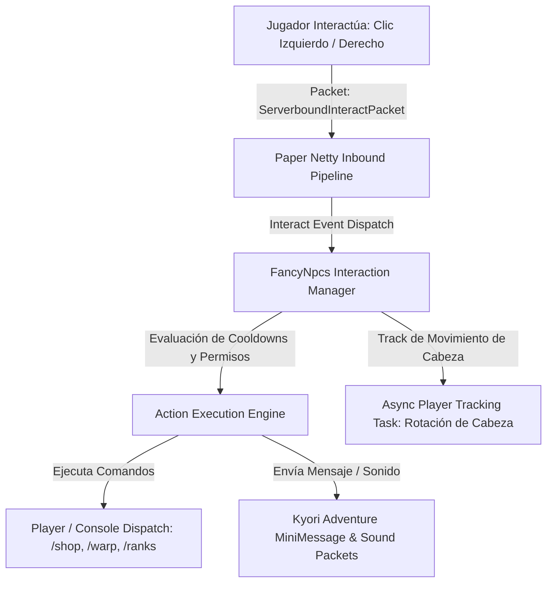

# 📖 FancyNpcs (2.9.2.349+)

- **Categoría**: NPC Engine / Interactividad Basada en Paquetes
- **Servidor**: ThunderMC Survival 1.21.11 (Paper build 126+)
- **Desarrollador**: FancyInnovations (Oliver Berg)
- **Dependencias**: Paper 1.20+ / 1.21.11, Display Entities & Packet-Level NPCs
- **Documentación Oficial**: [fancyinnovations.com/docs/minecraft-plugins/fancynpcs](https://fancyinnovations.com/docs/minecraft-plugins/fancynpcs)

---

## 🎯 1. Propósito & Visión General
**FancyNpcs** es una alternativa ultraligera y moderna a los clásicos sistemas de NPCs pesados (como Citizens). Genera NPCs basados enteramente en **paquetes de red del lado del cliente** (`Virtual Packet-Based Player/Mob Entities`) y **Display Entities**.

Al no existir como entidades vivas persistentes registradas en el `WorldServer` de Minecraft, los NPCs de FancyNpcs no tienen IA vanilla que consuma ciclos de CPU, no generan colisiones físicas innecesarias, no cargan chunks en memoria y no pueden ser empujados, asesinados o bugeados por mecánicas de juego estándar.

---

- **Parte de**: [[wiki/entities/thundermc/ecosistema-plugins|Ecosistema Plugins]] | [[wiki/synthesis/thundermc-master-synthesis|Síntesis Maestra]]
## 🏗️ 2. Arquitectura Interna & Funcionamiento



### 2.1 Componentes Principales
1. **Virtual Entity Tracking**:
   - Para cada jugador que entra en el radio de visión (`visibility_distance`), el plugin envía un paquete sintético `ClientboundPlayerInfoUpdatePacket` y `ClientboundAddEntityPacket`.
   - Cuando el jugador se aleja, se despacha `ClientboundRemoveEntitiesPacket`, liberando los recursos del cliente.
2. **Skin Fetching & Caching System**:
   - Descarga asíncrona de texturas y firmas de skins desde la API de Mojang y repositorios de SkinsRestorer/Mineskin.
   - Almacenamiento local en caché para evitar bloqueos por rate-limiting de Mojang (HTTP 429).
3. **Action & Trigger Pipeline**:
   - Asignación de acciones encadenadas ante clanes de interacción:
     - `COMMAND`: Ejecuta comando como Jugador o como Consola con sustitución de variables `%player%`.
     - `MESSAGE`: Envía mensaje formateado con MiniMessage.
     - `SERVER`: Envía al jugador a otro servidor de la network (BungeeCord/Velocity).
     - `SOUND`: Reproduce un efecto sonoro posicional.
4. **Display Entity Equipment & Glowing**:
   - Soporta personalización de armaduras completas (casco, peto, pantalones, botas), items en mano principal/secundaria y efectos de brillo coloreado (`glow_color`).

---

## ⌨️ 3. Comandos Completos y Sintaxis

| Comando | Alias | Argumentos | Descripción | Nivel de Acceso |
|---|---|---|---|---|
| `/npc create` | `/fancynpc create` | `<nombre> [tipo: PLAYER\|ZOMBIE\|SKELETON\|...]` | Crea un NPC en la posición y orientación del jugador. | Admin |
| `/npc remove` | `/fancynpc remove` | `<nombre>` | Elimina un NPC existente de forma permanente. | Admin |
| `/npc skin` | `/fancynpc skin` | `<nombre> <jugador\|url\|mineskin>` | Aplica una textura de skin al NPC por nombre de cuenta o URL. | Admin |
| `/npc displayName`| `/fancynpc name` | `<nombre> <texto>` | Configura el nombre visible sobre la cabeza del NPC (soporta MiniMessage y colores). | Admin |
| `/npc type` | `/fancynpc type` | `<nombre> <EntityType>` | Cambia la entidad base del NPC (e.g. ALLAY, VILLAGER, IRON_GOLEM). | Admin |
| `/npc turnToPlayer`| `/fancynpc turn`| `<nombre> <true\|false>` | Activa o desactiva que el NPC gire la cabeza para seguir la mirada del jugador. | Admin |
| `/npc action` | `/fancynpc action` | `<nombre>` | Abre el editor GUI interactivo de acciones al hacer clic. | Admin |
| `/npc action add` | `/fancynpc action`| `<nombre> <LEFT_CLICK\|RIGHT_CLICK> <tipo> <valor>` | Añade una acción manual (`CONSOLE_COMMAND`, `PLAYER_COMMAND`, `MESSAGE`). | Admin |
| `/npc equipment` | `/fancynpc equip` | `<nombre> <MAIN_HAND\|OFF_HAND\|HEAD\|CHEST\|LEGS\|FEET> <material>` | Equipa un ítem o armadura en el slot especificado. | Admin |
| `/npc glowing` | `/fancynpc glow` | `<nombre> <color\|none>` | Aplica resplandor coloreado (`AQUA`, `GOLD`, `RED`, etc.) al contorno del NPC. | Admin |
| `/npc moveHere` | `/fancynpc move` | `<nombre>` | Teletransporta al NPC a la posición actual del administrador. | Admin |
| `/npc reload` | `/fancynpc reload`| Ninguno | Recarga los archivos de configuración de NPCs y skins de caché. | Admin |

---

## 🔑 4. Árbol de Permisos

| Permiso | Descripción | Por Defecto |
|---|---|---|
| `fancynpcs.admin` | Acceso universal para crear, editar y eliminar NPCs. | `op` / `luckperms.group.admin` |
| `fancynpcs.command.create` | Permiso para instanciar NPCs con `/npc create`. | `op` |
| `fancynpcs.command.edit` | Permiso para editar skins, acciones y equipamiento. | `op` |
| `fancynpcs.command.remove` | Permiso para borrar NPCs existentes. | `op` |
| `fancynpcs.command.reload` | Permiso para recargar la configuración del plugin. | `op` |
| `fancynpcs.interact` | Permite a los usuarios interactuar con NPCs y disparar acciones. | `true` (jugadores) |

---

## 🧩 5. Placeholders & Ejemplos de Configuración de Acciones

FancyNpcs soporta placeholders de PAPI en los nombres de display y en la ejecución de comandos.

### Ejemplo de Configuración en `npcs.yml`:
```yaml
npcs:
  npc_tienda:
    name: "<gradient:#ffaa00:#ff5500><bold>TIENDA PRINCIPAL</bold></gradient>"
    type: PLAYER
    skin: "MHF_Chest"
    turn_to_player: true
    visibility_distance: 32
    glowing_color: "GOLD"
    actions:
      RIGHT_CLICK:
        - action_type: PLAYER_COMMAND
          value: "shop"
      LEFT_CLICK:
        - action_type: MESSAGE
          value: "<yellow>Haz clic derecho para abrir el menú de la tienda.</yellow>"
```

---

## ⚡ 6. Optimización de Rendimiento & Buenas Prácticas

1. **Eliminación del Overhead de Ticks de Entidad**:
   - A diferencia de mobs reales que calculan pathfinding de 20 veces por segundo, FancyNpcs solo recalcula la rotación de cabeza (`pitch/yaw`) de forma asíncrona para jugadores a menos de `visibility_distance` bloques.
2. **Ajuste de `visibility_distance`**:
   - Para hubs de spawn concurridos, establecer `visibility_distance: 24` o `30`. Esto ahorra miles de paquetes `ClientboundSetEntityDataPacket` por minuto cuando hay 50+ jugadores moviéndose simultáneamente.
3. **Caché de Skins Offline**:
   - FancyNpcs guarda en disco el JSON con las propiedades Base64 de la textura. Si la API de Mojang se cae, los NPCs mantienen sus skins sin fallar.

---

## ⚠️ 7. Modos de Fallo, Vulnerabilidades & Exploits en 1.21.11

> [!CAUTION]
> **Exploit de Ejecución de Comandos con Privilegios de Consola**
> Si se configura una acción con `action_type: CONSOLE_COMMAND` y se utiliza un placeholder de entrada no sanitizada (e.g. `%player%` manipulado en proxys o comandos que permiten inyección de espacios), un usuario malicioso podría forzar la ejecución de comandos de consola arbitrarios.

### Mitigaciones Críticas:
- **Validación de Parámetros**: Solo usar `%player%` para sustituir el nombre de usuario limpio (`player.getName()`).
- **Spam Click Protection**: FancyNpcs incorpora un cooldown interno anti-spam de interacción (`interaction_cooldown: 0.5s`) para evitar que jugadores con macros saturen los menús GUI o sobrecarguen la consola con ejecuciones repetitivas.

---

## Referencias Cruzadas
- [[wiki/entities/thundermc/core-infrastructure/fancyholograms|FancyHolograms]]
- [[wiki/concepts/deluxemenus_standards|Estándares DeluxeMenus]]
- [[wiki/entities/thundermc/ecosistema-plugins|Ecosistema Plugins]]
