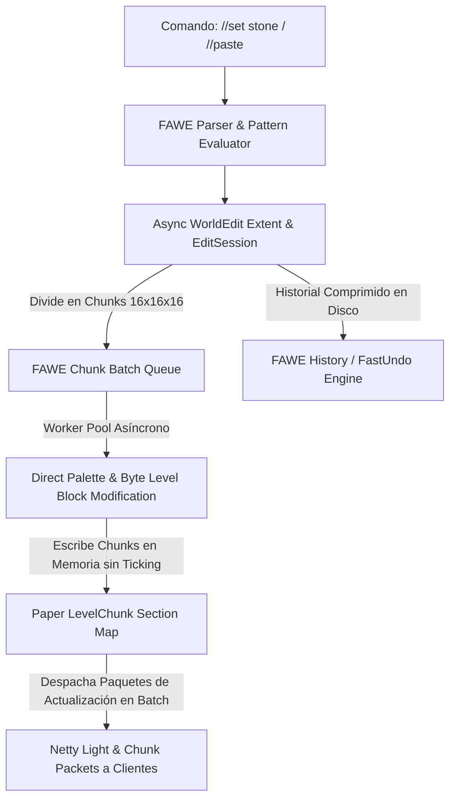

# 📖 FastAsyncWorldEdit (FAWE - 2.15.0+)

- **Categoría**: Edición Masiva de Bloques, Administración & Generación Asíncrona
- **Servidor**: ThunderMC Survival 1.21.11 (Paper build 126+)
- **Desarrollador**: IntellectualSites
- **Dependencias**: Paper 1.21+ / WorldEdit Core
- **Integraciones Clave**: WorldGuard, ProtectionStones, CoreProtect, PlotSquared

---

## 🎯 1. Propósito & Visión General
**FastAsyncWorldEdit (FAWE)** es la implementación ultrarrápida y asíncrona del clásico WorldEdit. Reemplaza el pipeline síncrono de manipulación de bloques bloque-por-bloque del motor vanilla por un sistema de **buffers de chunks directos**, acceso a bajo nivel a nivel de paleta de bloques NMS y procesamiento multi-hilo en segundo plano.

Permite pegar esquemáticas masivas (`.schem`), rellenar millones de bloques (`//set`, `//replace`) y realizar operaciones complejas de terreno sin provocar caídas de TPS, congelaciones del servidor (`lag spikes`) ni desbordamientos de memoria RAM (`OutOfMemoryError`).

---

## 🏗️ 2. Arquitectura Interna & Pipeline Asíncrono



### 2.1 Componentes Principales
1. **`EditSession` Asíncrona**:
   - Cada operación de edición se encapsula en una `EditSession`. En lugar de llamar a `world.setType()` en el hilo principal, FAWE agrupa los cambios en secciones de chunk (`ChunkSection`) y los escribe directamente en las paletas de bloques mediante subprocesos asíncronos (`FAWE-Worker-Thread`).
2. **Control de Memoria & Watchdog Integrado**:
   - FAWE monitoriza continuamente la memoria libre en la JVM (`max-memory-percent: 95%`). Si una operación excede el umbral seguro, pausa automáticamente el pegado o lo vuelca a disco temporal en lugar de permitir un crash de JVM.
3. **Mecanismo de Deshacer Comprimido (`FastUndo`)**:
   - Los rollbacks de `//undo` no se guardan en RAM en bruto. Se comprimen mediante algoritmos Zstandard/LZ4 y se guardan temporalmente en disco, permitiendo deshacer operaciones de cientos de millones de bloques con bajo consumo de memoria.
4. **Protección de Regiones In-Game**:
   - Integración nativa con **WorldGuard** y **ProtectionStones**: Impide que jugadores o builders sin permisos editen bloques dentro de reclamos de otros usuarios aunque usen comandos de WorldEdit.

---

## ⌨️ 3. Comandos Principales y Sintaxis

| Comando | Sintaxis | Descripción |
|---|---|---|
| `//wand` | `//wand` | Entrega el hacha de selección de regiones (pos1 / pos2). |
| `//set` | `//set <patrón>` | Rellena la región seleccionada con el bloque o mezcla indicada (e.g. `//set 70%stone,30%andesite`). |
| `//replace` | `//replace [de] <a_patrón>` | Reemplaza bloques específicos dentro de la selección. |
| `//copy` / `//cut`| `//copy [-e]` / `//cut [-e]` | Copia o corta la selección al portapapeles (flag `-e` incluye entidades). |
| `//paste` | `//paste [-a] [-o]` | Pega el portapapeles (`-a` ignora aire, `-o` usa el punto de origen original). |
| `//schem load` | `//schem load <nombre>` | Carga una esquemática desde `plugins/FastAsyncWorldEdit/schematics/`. |
| `//schem save` | `//schem save <nombre>` | Guarda la selección actual como archivo `.schem`. |
| `//undo` / `//redo`| `//undo [veces]` / `//redo` | Deshace o rehace la última operación de bloques. |
| `//sphere` / `//cyl`| `//sphere <patrón> <radio>` | Genera esferas, cilindros o pirámides geométricas. |
| `//brush` | `//brush <sphere\|smooth\|paint> <radio>` | Asigna un pincel de edición a la herramienta sostenida. |
| `//mask` | `//mask <patrón>` | Aplica una máscara para que el pincel solo afecte a ciertos bloques. |
| `/fawe cancel` | `/fawe cancel [jugador]` | Cancela inmediatamente una operación de edición en curso que esté saturando la cola. |

---

## 🔑 4. Árbol de Permisos & Control de Cuotas

| Permiso | Descripción | Nivel de Seguridad |
|---|---|---|
| `worldedit.*` | Acceso irrestricto a todos los comandos y pinceles de WorldEdit. | Crítico (Superadmin / Builders) |
| `worldedit.wand` | Permite obtener y usar la herramienta hacha de selección. | Medio (Builders) |
| `worldedit.region.*` | Permiso para manipular selecciones (`//set`, `//replace`, `//walls`). | Medio (Builders) |
| `worldedit.schematic.*`| Permiso para cargar y guardar esquemáticas. | Alto (Admin / Lead Builder) |
| `worldedit.brush.*` | Permiso para usar pinceles de terraformación. | Medio (Builders) |
| `fawe.admin` | Acceso a comandos de gestión de colas, memoria y `/fawe cancel`. | Alto (Admin) |
| `fawe.bypass.regions` | Permite ignorar las restricciones de regiones de WorldGuard. | Crítico (Solo Owner) |

---

## ⚡ 6. Optimización de Rendimiento & Configuración

1. **Configuración de Límites por Jugador (`limits` en `config.yml`)**:
   - Limitar la cantidad máxima de bloques modificables por operación para constructores estándar:
     ```yaml
     limits:
       max-blocks-changed:
         default: 1000000 # 1 millón de bloques máx
         builder: 5000000
       max-memory-percent: 90
       queue-target: 64
     ```
2. **Descarga de Iluminación (`lighting`)**:
   - Configurar `lighting.mode: 2` (calcula la luz del entorno en segundo plano de forma asíncrona mediante StarLight/Paper Light Engine), evitando retrasos al pegar estructuras oscuras.
3. **Gestión de Entidades al Pegar**:
   - Utilizar siempre `//paste -e:false` a menos que sea imprescindible transferir entidades, evitando la saturación de marcos de items o armor stands en áreas compactas.

---

## ⚠️ 7. Modos de Fallo, Vulnerabilidades & Exploits en 1.21.11

> [!CAUTION]
> **Ataque de Denegación de Servicio por Cálculos Complejos de Pincel o Esferas Gigantes**
> Ejecutar un comando como `//sphere stone 500` genera miles de millones de operaciones matemáticas que pueden desbordar los buffers de cola y agotar el heap de Java si los límites de FAWE no están estrictamente activados.

### Mitigaciones Críticas:
- **Restricción de Comandos de Cálculo Pesado**: Desactivar o restringir con LuckPerms comandos como `//calc`, `//eval`, `//solve` (pueden ejecutar expresiones matemáticas no seguras en JVM).
- **Control de Permisos a Jugadores No-Staff**: Garantizar que ningún usuario normal posea permisos de WorldEdit en el mundo de supervivencia, ya que permitiría traspasar protecciones de cofres y reclamos.
