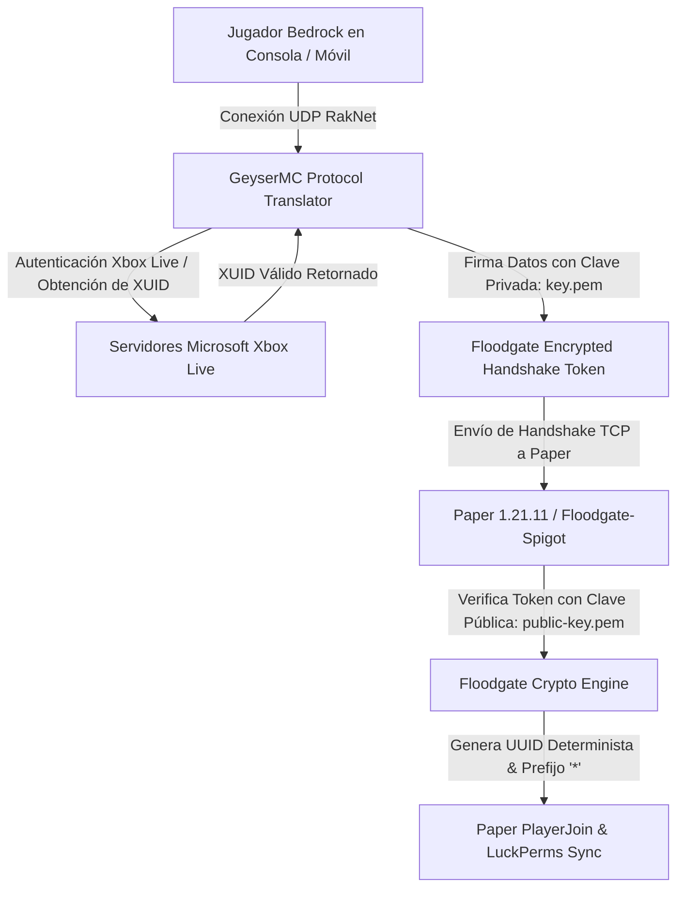

# 📖 Floodgate (2.2.3+)

- **Categoría**: Crossplay Authentication / Geyser Bedrock Bridge
- **Servidor**: ThunderMC Survival 1.21.11 (Paper build 126+)
- **Desarrollador**: GeyserMC Project
- **Dependencias**: Geyser (Proxy/Spigot) / SkinsRestorer
- **Protocolo**: Cifrado Asimétrico RSA / Token de Autenticación de Cuentas Microsoft Bedrock

---

## 🎯 1. Propósito & Visión General
**Floodgate** es el componente de autenticación híbrida que permite a los jugadores de **Minecraft Bedrock Edition** (móviles iOS/Android, consolas Xbox/PlayStation/Nintendo Switch y Windows 10/11) unirse al servidor Java de ThunderMC **sin requerir una cuenta Java Edition comprada**.

Floodgate genera un UUID determinista v0/v4 basado en el XUID (Xbox User ID) único del jugador y firma criptográficamente su sesión en el proxy/servidor, eliminando la necesidad de verificación online contra los servidores de autenticación de Java (Yggdrasil), al tiempo que garantiza la imposibilidad de usurpación de identidad ("Identity Spoofing").

---

## 🏗️ 2. Arquitectura Interna & Proceso de Autenticación

### 2.1 Componentes Principales
1. **RSA Key Pair Cryptography**:
   - Geyser y Floodgate comparten un par de claves criptográficas (`key.pem` o `public-key.pem`).
   - Geyser cifra la información del jugador (XUID, nombre de usuario Bedrock, datos de pantalla y lenguaje) y Floodgate la valida en el servidor Spigot/Paper sin consultar a Mojang Yggdrasil.
2. **Formato de Prefijo & Identidad**:
   - Por defecto añade un prefijo configurable (habitualmente `.` o `*`, e.g. `*NotchBedrock`) para evitar colisiones con nombres de usuarios Java existentes.
   - Genera UUIDs especiales del tipo: `00000000-0000-0000-xxxx-xxxxxxxxxxxx` derivados del XUID.
3. **Mapeo de Formularios Nativos (Cumulus Forms)**:
   - Permite que plugins de Java abran interfaces gráficas táctiles nativas de Bedrock (`SimpleForm`, `ModalForm`, `CustomForm`) en lugar de depender únicamente de cofres GUI virtuales con click events.
4. **Traducción de Skins Dinámica**:
   - Extrae la textura y geometría 3D personalizada de los avatares Bedrock y las envía a los clientes Java mediante SkinsRestorer.

---

## ⌨️ 3. Comandos Completos y Sintaxis

| Comando | Alias | Argumentos | Descripción | Nivel de Acceso |
|---|---|---|---|---|
| `/floodgate link` | `/linkaccount` | Ninguno | Inicia el proceso de vinculación de la cuenta Bedrock actual con una cuenta Java. | Jugador |
| `/floodgate unlink` | `/unlinkaccount`| Ninguno | Desvincula la cuenta Bedrock de la cuenta Java asociada. | Jugador |
| `/floodgate link-code` | `/linkcode` | `<code>` | Introduce el código de vinculación generado por Global Linking Server. | Jugador |
| `/floodgate dump` | `/fge dump` | Ninguno | Genera un reporte técnico de depuración con el estado de claves y conectividad. | Admin |
| `/floodgate reload` | `/fge reload` | Ninguno | Recarga los archivos de configuración y certificados criptográficos. | Admin |

---

## 🔑 4. Árbol de Permisos

| Permiso | Descripción | Por Defecto |
|---|---|---|
| `floodgate.admin` | Permite gestionar configuraciones y diagnósticos de Floodgate. | `op` / `luckperms.group.admin` |
| `floodgate.command.link` | Permiso para vincular cuentas Bedrock y Java. | `true` (todos) |
| `floodgate.command.unlink`| Permiso para desvincular cuentas. | `true` (todos) |

---

## 🧩 5. Placeholders PAPI Integrados

Floodgate proporciona variables específicas para detectar clientes Bedrock y personalizar menús o mensajes:

| Placeholder | Descripción | Ejemplo de Salida |
|---|---|---|
| `%floodgate_is_bedrock%` | Devuelve `true` si el jugador está jugando desde Bedrock (consola/móvil). | `true` / `false` |
| `%floodgate_device_os%` | Sistema operativo del dispositivo (`Android`, `iOS`, `Xbox`, `PS4`, `Win10`, `Switch`). | `Android` |
| `%floodgate_ui_profile%` | Tipo de interfaz utilizada (`Classic` o `Pocket`). | `Pocket` |
| `%floodgate_input_mode%` | Modo de control del jugador (`Touch`, `Controller`, `Keyboard/Mouse`). | `Touch` |
| `%floodgate_xuid%` | ID numérico global de Xbox Live del jugador. | `2535456789012345` |

---

## ⚡ 6. Optimización de Rendimiento & Buenas Prácticas

1. **Gestión de Formularios en Clientes Móviles**:
   - Emplear menús GUI simples en `/shop` y `/ah` para evitar desincronizaciones táctiles en dispositivos con pantallas pequeñas.
2. **Sincronización con LuckPerms**:
   - Se recomienda asignar un grupo contextual en LuckPerms para usuarios Bedrock (`luckperms_is_bedrock`) si se desean personalizar kits o controles específicos.
3. **Cero Impacto de CPU**:
   - La verificación criptográfica RSA se ejecuta en un microsegundo durante el evento `AsyncPlayerPreLoginEvent` antes de que el jugador entre al mundo, sin afectar los TPS del servidor.

---

## ⚠️ 7. Modos de Fallo, Vulnerabilidades & Exploits en 1.21.11

> [!CAUTION]
> **Riesgo de Fuga de la Clave Criptográfica (`key.pem`)**
> El archivo `key.pem` debe mantenerse estrictamente confidencial y coincidir exactamente entre la instancia de Geyser y el servidor Paper. Si un tercero obtiene acceso a `key.pem`, puede generar paquetes de inicio de sesión falsificados y personificar a cualquier jugador Bedrock sin necesidad de contraseña.

### Mitigaciones Críticas:
- **Protección de Permisos en `key.pem`**: Asegurar que solo el usuario del sistema host tenga acceso de lectura a la carpeta de configuración.
- **Nombres de Jugador con Caracteres Inválidos**: Floodgate sanea automáticamente caracteres que no son legales en el protocolo Java (espacios en nombres de Xbox Gamertags son reemplazados por guiones bajos `_` o prefijos definidos).
