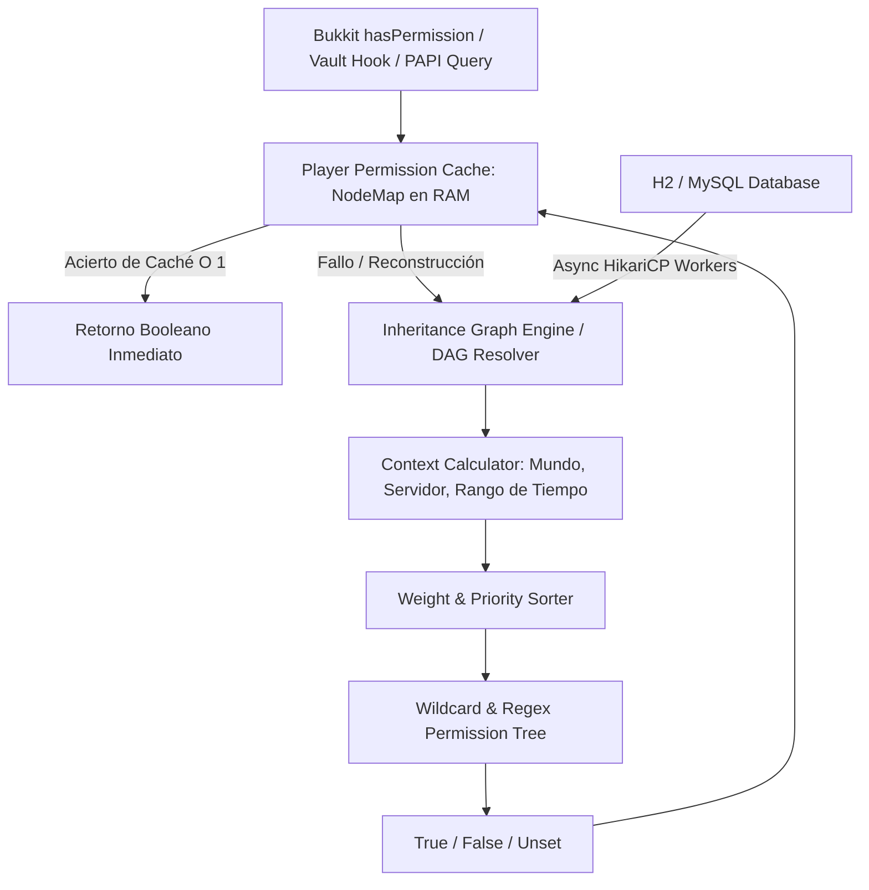

# 📖 LuckPerms (5.5.42+)

- **Categoría**: Permisos, Jerarquías de Rangos & Seguridad Centralizada
- **Servidor**: ThunderMC Survival 1.21.11 (Paper build 126+)
- **Almacenamiento**: H2 Local / MySQL Remoto (HikariCP Connection Pool)
- **Integraciones Clave**: Vault, PlaceholderAPI, TAB, ZelChat, EssentialsX, CoreProtect

---

## 🎯 1. Propósito & Visión General
**LuckPerms** es el sistema definitivo de gestión de permisos, grupos, herencias, metadatos (prefijos/sufijos) y contextos espaciales/temporales para Minecraft. Sustituye arquitecturas obsoletas de permisos mediante un diseño basado en grafos dirigidos acíclicos (DAG) de herencia, cálculo asíncrono no bloqueante en memoria RAM con caché de árbol de permisos (`PermissionTree`), y sincronización instantánea multiserver vía mensajería Redis/SQL.

---

## 🏗️ 2. Arquitectura Interna & Motor de Permisos

### 2.1 Componentes Principales
1. **Node & Context Engine**:
   - Cada permiso es un `Node` inmutable que encapsula: `Key` (e.g. `essentials.fly`), `Value` (`true/false`), `Expiry` (marca Unix para permisos temporales), y un conjunto de `ContextSet` (e.g. `world=world_nether`, `server=survival`).
2. **Inheritance & Tracks (Jerarquías y Ascensos)**:
   - Los grupos pueden heredar permisos y metadatos de otros grupos mediante nodos `group.<nombre>`.
   - Las **Tracks** (e.g. `staff`, `donador`, `rangos_survival`) definen rutas de ascenso lineales para `/lp user <jugador> promote <track>` y `/lp user <jugador> demote <track>`.
3. **Metadata & Prefix Stacking**:
   - Permite apilar prefijos y sufijos mediante pesos (`weight`). El grupo con mayor peso determina el prefijo principal mostrado en chat, tablist y nametags.
4. **Web Editor & Bytecode Inspection**:
   - `/lp editor` serializa el estado completo de permisos a una sesión segura encriptada con token temporal en `luckperms.net`, permitiendo edición gráfica web masiva sin tocar archivos YAML a mano.

---

## ⌨️ 3. Comandos Completos y Sintaxis

### 3.1 Gestión de Usuarios
| Comando | Sintaxis | Descripción |
|---|---|---|
| `/lp user info` | `/lp user <jugador> info` | Muestra grupos, metadatos y contextos del usuario. |
| `/lp user permission set` | `/lp user <jugador> permission set <nodo> [true\|false] [contextos]` | Asigna o deniega un nodo de permiso específico. |
| `/lp user permission unset`| `/lp user <jugador> permission unset <nodo> [contextos]` | Elimina un nodo de permiso del usuario. |
| `/lp user parent add` | `/lp user <jugador> parent add <grupo> [contextos]` | Añade al usuario a un grupo secundario. |
| `/lp user parent set` | `/lp user <jugador> parent set <grupo>` | Establece el grupo principal del usuario (reemplaza anteriores). |
| `/lp user parent remove` | `/lp user <jugador> parent remove <grupo>` | Remueve al usuario de un grupo específico. |
| `/lp user parent addtemp` | `/lp user <jugador> parent addtemp <grupo> <duración>` | Asigna un rango VIP temporal (e.g. `30d`, `12h`). |
| `/lp user meta setprefix` | `/lp user <jugador> meta setprefix <peso> "<prefijo>"` | Asigna un prefijo personalizado con prioridad de peso. |
| `/lp user promote` | `/lp user <jugador> promote <track>` | Asciende al jugador al siguiente escalón de una ruta. |
| `/lp user demote` | `/lp user <jugador> demote <track>` | Degrada al jugador en una ruta. |

### 3.2 Gestión de Grupos
| Comando | Sintaxis | Descripción |
|---|---|---|
| `/lp creategroup` | `/lp creategroup <nombre> [peso]` | Crea un nuevo grupo de permisos con un peso de herencia. |
| `/lp deletegroup` | `/lp deletegroup <nombre>` | Elimina un grupo de forma permanente. |
| `/lp group info` | `/lp group <grupo> info` | Muestra permisos, herencias y metadatos de un grupo. |
| `/lp group permission set`| `/lp group <grupo> permission set <nodo> [true\|false]` | Asigna un nodo de permiso a todo el grupo. |
| `/lp group parent add` | `/lp group <grupo> parent add <otro_grupo>` | Hereda todos los permisos de otro grupo base. |
| `/lp group meta setprefix`| `/lp group <grupo> meta setprefix <peso> "<prefijo>"` | Establece el prefijo formal del rango. |

### 3.3 Herramientas de Red & Diagnóstico
| Comando | Sintaxis | Descripción |
|---|---|---|
| `/lp editor` | `/lp editor [usuarios\|grupos]` | Genera una URL de sesión para el editor visual web. |
| `/lp verbose` | `/lp verbose <on\|off\|record> [filtro]` | Monitoriza en tiempo real cada verificación de permiso ejecutada. |
| `/lp tree` | `/lp tree [filtro]` | Muestra el árbol jerárquico de todos los permisos registrados por los plugins. |
| `/lp sync` | `/lp sync` | Sincroniza permisos desde la base de datos SQL/H2 forzando recarga de caché. |

---

## 🔑 4. Árbol de Permisos & Seguridad Administrativa

| Permiso | Descripción | Nivel de Seguridad |
|---|---|---|
| `luckperms.*` | Acceso irrestricto a todo el motor de LuckPerms (superadmin). | Crítico (Solo Consola / Owner) |
| `luckperms.editor` | Permiso para generar enlaces del editor web `/lp editor`. | Alto (Owner / Developer) |
| `luckperms.user.info` | Permite consultar permisos de un usuario. | Medio (Staff / Mod) |
| `luckperms.user.promote` | Permite ascender jugadores en tracks específicos. | Medio (Admin) |
| `luckperms.group.listmembers`| Permite listar miembros de un rango `/lp group <g> listmembers`. | Staff |

---

## 🧩 5. Placeholders PAPI Integrados

LuckPerms expone variables de alto rendimiento mediante la expansión `LuckPerms`:

| Placeholder | Descripción | Ejemplo de Salida |
|---|---|---|
| `%luckperms_primary_group_name%` | Nombre del grupo principal del jugador. | `vip_plus` |
| `%luckperms_prefix%` | Prefijo resuelto con herencias y pesos de color. | `&6[VIP+] ` |
| `%luckperms_suffix%` | Sufijo resuelto del jugador. | ` &e⚡` |
| `%luckperms_has_permission_<nodo>%`| Devuelve `true` o `false` si el jugador tiene el nodo. | `true` |
| `%luckperms_in_group_<grupo>%` | Devuelve `yes` o `no` si pertenece al grupo. | `yes` |
| `%luckperms_expiry_time_<nodo/grupo>%` | Tiempo restante para que expire un rango temporal. | `14d 6h` |

---

## ⚡ 6. Optimización de Rendimiento & Configuración

1. **Configuración de `storage-method`**:
   - Para un servidor individual Paper 1.21.11, usar `storage-method: H2` (almacenamiento embebido de alto rendimiento en disco local con caché LRU).
   - Para una red vinculada por proxy Bungee/Velocity, usar `storage-method: MySQL` o `MariaDB` con `messaging-service: redis` o `sql` para invalidación instantánea de caché sin locks.
2. **Wildcard & Regex Processing**:
   - Mantener `include-global: true` y evitar registrar permisos con comodines excesivos como `*` a grupos de usuarios normales, ya que ralentiza la resolución del árbol.
3. **Caché en RAM**:
   - LuckPerms almacena el mapa de permisos ya computado en estructuras concurrentes en memoria RAM. El impacto en el `Server Thread` por cada chequeo `player.hasPermission()` es **< 0.001ms** (tiempo constante $O(1)$).

---

## ⚠️ 7. Modos de Fallo, Vulnerabilidades & Exploits en 1.21.11

> [!CAUTION]
> **Peligro de Escalada de Privilegios mediante Wildcard Inadvertido (`*`)**
> Otorgar permisos como `essentials.*` o `worldedit.*` a rangos de moderación o donadores concede automáticamente comandos destructivos ocultos como `/sudo`, `/eval`, `/stop` o `/delworld`.

### Mitigaciones Críticas:
- **Principio de Menor Privilegio**: Asignar permisos explícitos individualmente en lugar de comodines globales.
- **Negación Explícita de Nodos Críticos**: Si se utiliza herencia amplia, anteponer nodos en falso (e.g. `essentials.sudo: false`, `minecraft.command.op: false`).
- **Seguridad en Editor Web**: Las sesiones generadas por `/lp editor` caducan en 30 minutos y requieren confirmación con código de seguridad en la consola del servidor antes de aplicar cambios en producción.
