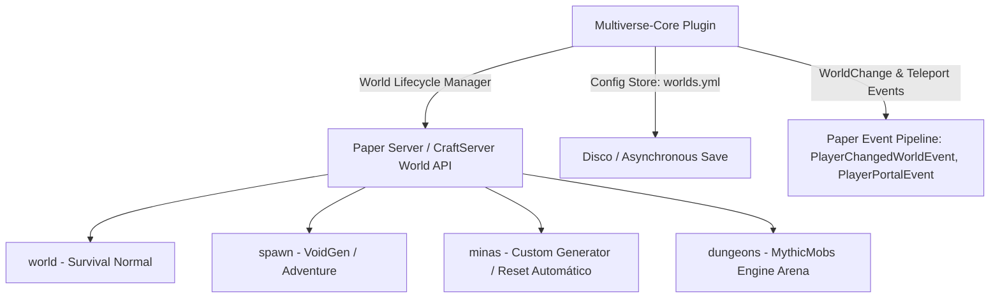

# 📖 Multiverse-Core (5.5.2+)

- **Categoría**: Gestión y Aislamiento de Mundos Multi-Dimensión
- **Servidor**: ThunderMC Survival 1.21.11 (Paper build 126+)
- **Dependencias**: Ninguna (Integraciones opcionales: Multiverse-Inventories, Multiverse-Portals, Multiverse-NetherPortals, WorldGuard)
- **Mundos Gestionados en ThunderMC**: `world` (Survival Overworld), `world_nether` (Survival Nether), `world_the_end` (Survival End), `spawn` (Lobby/Spawn Principal), `minas` (Mundo de Minería/CataMines), `dungeons` (Mazmorras & MythicMobs Bosses), `eventos` (KOTH/Torneos)

---

## 🎯 1. Propósito & Visión General
**Multiverse-Core** es el estándar de la industria para la instanciación, importación, configuración y ciclo de vida de múltiples mundos simultáneos dentro de una única instancia de Paper. Permite definir de forma granular y desacoplada por cada dimensión parámetros como modo de juego, dificultad, generadores de mundo custom (e.g. `VoidGen`), escalado de coordenadas de portal, reaparición forzada (`respawnWorld`), y control de flags de criaturas pacíficas y hostiles.

---

## 🏗️ 2. Arquitectura Interna & Funcionamiento



### 2.1 Componentes Principales
1. **`MVWorldManager`**:
   - Gestiona el registro, carga dinámica (`loadWorld`), descarga de memoria (`unloadWorld`), clonación (`cloneWorld`) y eliminación en disco (`deleteWorld`).
   - Mapea propiedades NBT del mundo (`level.dat`) con la configuración persistente en `worlds.yml`.
2. **`MultiverseWorld` Wrapper**:
   - Objeto encapsulador sobre la instancia de `org.bukkit.World` que expone propiedades extendidas: `entryFee`, `hunger`, `hidden`, `autoLoad`, `bedRespawn`, `keepSpawnInMemory`.
3. **`Destination Engine` (Motor de Destinos)**:
   - Resuelve cadenas de texto de destino complejas (`e:world:x,y,z:pitch:yaw`, `w:world`, `p:portal`, `pl:player`).
4. **`SafeTeleporter`**:
   - Algoritmo de validación de bloque de destino que comprueba si la posición es segura (sin asfixia en bloques sólidos ni lava) antes de emitir el paquete de teletransporte al cliente.

---

## ⌨️ 3. Comandos Completos y Sintaxis

| Comando | Alias | Argumentos | Descripción | Nivel de Acceso |
|---|---|---|---|---|
| `/mv create` | `/mvc` | `<nombre> <NORMAL|NETHER|END> [-s semilla] [-g generador]` | Genera un nuevo mundo con el tipo de entorno y generador indicado. | Admin |
| `/mv import` | `/mvi` | `<nombre_carpeta> <NORMAL|NETHER|END> [-g generador]` | Importa una carpeta de mundo existente en la raíz del servidor. | Admin |
| `/mv load` | `/mvl` | `<nombre_mundo>` | Carga un mundo descargado en la memoria activa del servidor. | Admin |
| `/mv unload` | `/mvu` | `<nombre_mundo>` | Descarga un mundo activo de la memoria liberando chunks y entidades. | Admin |
| `/mv delete` | `/mvd` | `<nombre_mundo>` | Elimina completamente el mundo y su carpeta de disco (irreversible). | Consola / Admin |
| `/mv clone` | `/mvclone` | `<mundo_origen> <mundo_destino>` | Clona un mundo íntegro a una nueva carpeta. | Admin |
| `/mv tp` | `/mvtp` | `[jugador] <destino>` | Teletransporta a un jugador a un mundo, coordenada o entidad. | Staff / Admin |
| `/mv set spawn` | `/mvss` | Ninguno | Fija el punto de reaparición exacto del mundo actual en la posición del jugador. | Admin |
| `/mv modify set` | `/mvm set` | `<propiedad> <valor> [mundo]` | Modifica un atributo en runtime (`gamemode`, `difficulty`, `pvp`, `animals`, `monsters`). | Admin |
| `/mv modify add` | `/mvm add` | `<valor> <lista> [mundo]` | Añade elementos a listas blancas/negras de bloques o criaturas. | Admin |
| `/mv modify clear` | `/mvm clear` | `<lista> [mundo]` | Limpia una lista de configuración de un mundo. | Admin |
| `/mv info` | `/mvi` | `[mundo] [página]` | Muestra detalles técnicos, generador, chunks cargados y reglas del mundo. | Staff / Admin |
| `/mv list` | `/mvl` | Ninguno | Lista todos los mundos registrados y su estado (cargado/descargado). | Staff / Admin |
| `/mv reload` | `/mvr` | Ninguno | Recarga el archivo de configuración `config.yml` y `worlds.yml`. | Admin |

---

## 🔑 4. Árbol de Permisos

| Permiso | Descripción | Por Defecto |
|---|---|---|
| `multiverse.core.teleport.self.<mundo>` | Permiso para teletransportarse a sí mismo a un mundo específico. | `op` |
| `multiverse.core.teleport.other.<mundo>` | Permiso para teletransportar a otros jugadores a un mundo. | `op` |
| `multiverse.core.create` | Permiso para crear nuevos mundos con `/mv create`. | `op` |
| `multiverse.core.import` | Permiso para importar carpetas con `/mv import`. | `op` |
| `multiverse.core.modify` | Permiso para alterar propiedades de mundos con `/mv modify`. | `op` |
| `multiverse.core.list.worlds` | Permiso para ver la lista de mundos registrados `/mv list`. | `luckperms.group.staff` |
| `multiverse.core.info` | Permiso para inspeccionar la configuración de un mundo con `/mv info`. | `luckperms.group.staff` |
| `multiverse.core.spawn.self` | Permiso para regresar al spawn del mundo actual vía `/mv spawn`. | `true` |
| `multiverse.core.exempt.portalfee` | Exime de cualquier tarifa monetaria/item al cambiar de mundo. | `op` |

---

## 🧩 5. Placeholders PAPI Integrados

| Placeholder | Descripción | Ejemplo de Salida |
|---|---|---|
| `%multiverse_world_alias%` | Alias formateado con color del mundo actual del jugador. | `&a&lSUPERVIVENCIA` |
| `%multiverse_world_name%` | Nombre interno del mundo de la carpeta. | `world_nether` |
| `%multiverse_world_color%` | Código de color asignado al mundo en `worlds.yml`. | `DARK_RED` |
| `%multiverse_world_pvp%` | Estado de PvP del mundo (`true` / `false`). | `true` |
| `%multiverse_world_difficulty%` | Dificultad del mundo (`PEACEFUL`, `EASY`, `NORMAL`, `HARD`). | `HARD` |

---

## ⚡ 6. Optimización de Rendimiento & Configuración

1. **Desactivar `keepSpawnInMemory: false` en mundos secundarios**:
   - En mundos como `minas`, `dungeons` o `eventos`, mantener los chunks del spawn cargados permanentemente consume entre 50 y 200 MB de RAM y ciclos de tick de entidades innecesarios.
   - **Ajuste en `worlds.yml`**:
     ```yaml
     minas:
       keepSpawnInMemory: false
       autoLoad: true
     ```
2. **`autoPurge: false`**:
   - Desactivar la purga automática de entidades si se utiliza Paper con límites agresivos en `paper-world-defaults.yml`, evitando conflictos de ticks.
3. **Control del Spawn de Criaturas Pasivas**:
   - En mundos de lobby/spawn, definir `spawn: false` y `exceptions: []` en `animals` y `monsters` para evitar que el servidor gaste tiempo en el ciclo de mob spawning.

---

## ⚠️ 7. Modos de Fallo, Vulnerabilidades & Exploits en 1.21.11

> [!WARNING]
> **Exploit de Vinculación de Portales del Nether (Coordinate Scaling Glitch)**
> En servidores con mundos custom, si la propiedad `scale` no está bien definida (1:8 en Nether vanilla), un jugador puede crear un portal en coordenadas límite y aparecer dentro de regiones protegidas del Spawn o zonas no deseadas en el Overworld.

### Mitigaciones Críticas:
- **Respawn Loops & Caída al Vacío**: Asegurar que `respawnWorld` apunte siempre a un mundo válido (`spawn` o `world`). Si un mundo es eliminado y jugadores tenían su cama allí, ocurrirá un NPE o caída continua en el vacío (`VoidSpawn` debe estar activo como red de seguridad).
- **Consumo Excesivo de Memoria por Mundos Huérfanos**: Nunca dejar mundos temporales de eventos cargados en memoria. Descargar con `/mv unload <mundo>` tan pronto termine el evento.
