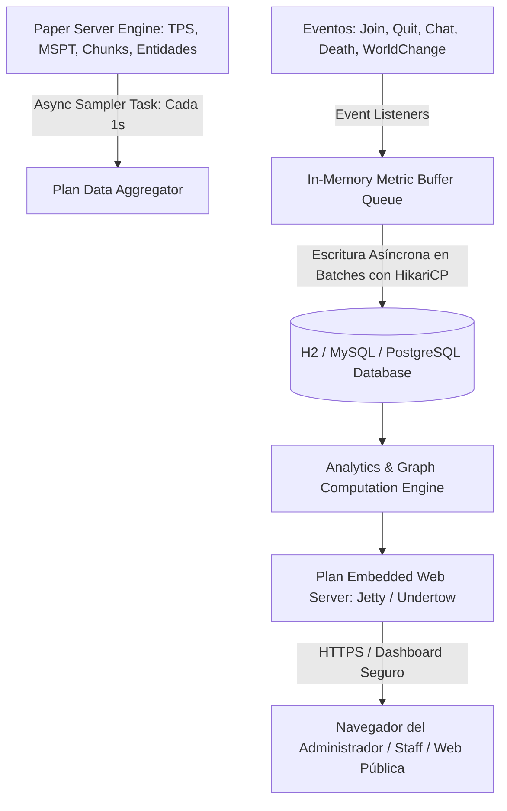

# 📖 Player Analytics (Plan - 5.8+)

- **Categoría**: Analítica de Rendimiento, Retención de Jugadores & Servidor Web Interno
- **Servidor**: ThunderMC Survival 1.21.11 (Paper build 126+)
- **Desarrollador**: Vankka / AuroraLS3
- **Base de Datos**: H2 Local / MySQL / SQLite / PostgreSQL
- **Integraciones Clave**: Paper TPS/MSPT Metrics, LuckPerms, Vault, LiteBans, Geyser/Floodgate, Buycraft/Tebex

---

## 🎯 1. Propósito & Visión General
**Plan (Player Analytics)** es la plataforma de telemetría, métricas y analítica forense en tiempo real para servidores de Minecraft. Despliega un servidor web embebido ligero (HTTP/HTTPS) que proporciona paneles de control visuales interactivos con gráficos sobre:
- Rendimiento del hardware y del motor (TPS, MSPT, uso de RAM, consumo de CPU por tick, tiempos de carga de chunks).
- Métricas de comunidad (jugadores únicos diarios/mensuales, retención D1/D7/D30, horas pico de conexión, tiempo de juego promedio, procedencia geográfica por país).
- Perfiles individuales de jugadores (historial de IPs seguras, sanciones, ingresos por tienda, sesiones de juego y coordenadas de actividad).

---

## 🏗️ 2. Arquitectura Interna & Pipeline de Telemetría



### 2.1 Componentes Principales
1. **Asynchronous Telemetry Sampler**:
   - Muestrea las métricas de rendimiento del servidor cada segundo de forma no invasiva, leyendo el array de `tickTimes` del servidor Paper para calcular el MSPT medio y percentiles (P95, P99).
2. **Batch Persistence Engine**:
   - Las sesiones de los jugadores y las coordenadas de muerte/actividad no se escriben en disco al momento; se acumulan en colas en memoria RAM y se sincronizan a la base de datos cada 30-60 segundos en transacciones agrupadas (batching) para evitar I/O bottlenecks.
3. **Embedded Web Server**:
   - Integra un servidor web standalone que opera en un puerto independiente (por defecto `8804` o asignado por Bloom Host) con soporte para certificados SSL/TLS, autenticación de dos factores (2FA) y roles de acceso web diferenciados (`web_user`, `web_admin`).
4. **GDPR / Anonimización de Datos**:
   - Modos de privacidad configurables para anonimizar direcciones IP y datos sensibles de geolocalización cumpliendo normativas internacionales de protección de datos.

---

## ⌨️ 3. Comandos Completos y Sintaxis

| Comando | Alias | Argumentos | Descripción | Nivel de Acceso |
|---|---|---|---|---|
| `/plan` | Ninguno | Ninguno | Muestra el enlace web al panel de control general del servidor. | Staff / Admin |
| `/plan player` | `/player` | `<jugador>` | Genera el enlace web al reporte analítico individual del jugador. | Staff / Admin |
| `/plan register` | Ninguno | `<contraseña>` | Registra una cuenta de usuario web para acceder al panel con seguridad. | Staff / Admin |
| `/plan server` | Ninguno | `[nombre_servidor]` | Muestra el enlace a las gráficas técnicas de rendimiento de la máquina. | Admin |
| `/plan qlook` | Ninguno | `<jugador>` | Muestra un resumen rápido in-game en el chat con estadísticas clave del usuario. | Staff |
| `/plan reload` | Ninguno | Ninguno | Recarga los archivos de configuración y reinicia el servidor web interno. | Admin |
| `/plan backup` | Ninguno | Ninguno | Ejecuta una copia de seguridad en caliente de la base de datos de métricas. | Admin |

---

## 🔑 4. Árbol de Permisos

| Permiso | Descripción | Por Defecto |
|---|---|---|
| `plan.admin` | Acceso irrestricto a todos los comandos de administración, recarga y exportación. | `op` / `luckperms.group.admin` |
| `plan.server` | Permite consultar las gráficas de rendimiento del servidor. | `luckperms.group.staff` |
| `plan.player.self` | Permite a los usuarios consultar sus propias estadísticas web. | `true` |
| `plan.player.other` | Permite al staff inspeccionar perfiles analíticos de otros jugadores. | `luckperms.group.staff` |
| `plan.register` | Permite registrar cuentas de acceso web. | `luckperms.group.staff` |

---

## 🧩 5. Placeholders PAPI Integrados

Plan expone variables analíticas para ser utilizadas en menús de perfil, scoreboards o tablists:

| Placeholder | Descripción | Ejemplo de Salida |
|---|---|---|
| `%plan_player_playtime%` | Tiempo total de juego acumulado por el jugador. | `48h 22m` |
| `%plan_player_sessions%` | Número total de sesiones iniciadas por el usuario. | `142` |
| `%plan_player_afk_time%` | Tiempo total pasado en estado AFK. | `3h 10m` |
| `%plan_player_activity_index%`| Porcentaje de regularidad / retención en los últimos 30 días. | `85.4%` |
| `%plan_server_tps_last_minute%`| Promedio real de TPS del último minuto medido por Plan. | `20.00` |

---

## ⚡ 6. Optimización de Rendimiento & Configuración

1. **Configuración de Almacenamiento en Bases de Datos**:
   - En `plugins/Plan/config.yml`, para servidores en producción con cientos de usuarios únicos, se recomienda configurar `Database.Type: MySQL` o `MariaDB` en un servidor SQL separado, evitando que la base de datos H2 crezca indefinidamente en el disco del servidor de juegos.
2. **Ajuste del Servidor Web Interno**:
   - Configurar el puerto web en el rango asignado por el host:
     ```yaml
     Webserver:
       Port: 8804
       Internal_IP: "0.0.0.0"
       SSL:
         Certificate_Path: ""
         Key_Path: ""
     ```
3. **Retención Histórica de Datos (`Data_retention`)**:
   - Configurar purga automática de datos de rendimiento de alta frecuencia mayores a 60 días para mantener las tablas optimizadas e índices compactos.

---

## ⚠️ 7. Modos de Fallo, Vulnerabilidades & Exploits en 1.21.11

> [!CAUTION]
> **Exposición Pública No Autenticada del Panel Web**
> Si se desactiva la autenticación web (`Webserver.Security.Require_login: false`) en servidores con IP pública, cualquier usuario en Internet puede escanear el puerto web de Plan y acceder a datos privados como geolocalizaciones de IP, rangos, historiales de chat y registros de transacciones.

### Mitigaciones Críticas:
- **Forzar Inicio de Sesión Obligatorio**: Mantener siempre `Require_login: true` en `config.yml`.
- **Uso de HTTPS / Reverse Proxy**: Desplegar un proxy inverso Nginx/Cloudflare con certificado SSL o utilizar la integración SSL de Plan para cifrar las contraseñas del panel web en tránsito.
