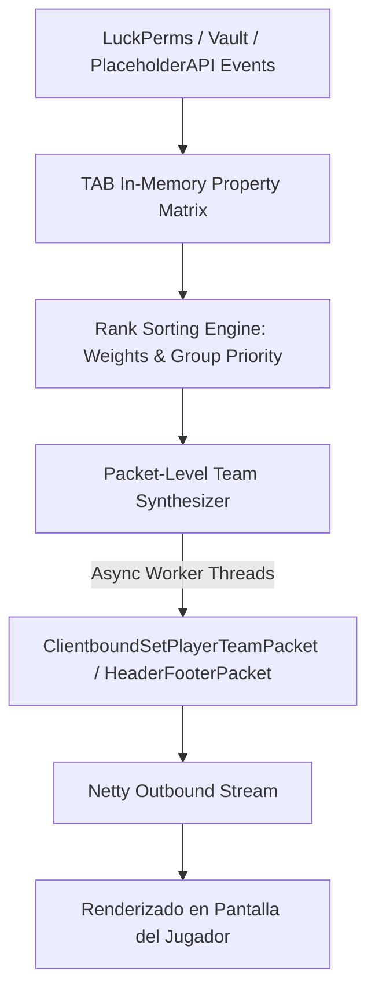

# 📖 TAB (5.5.0+)

- **Categoría**: Interfaz Visual / Tablist, Nametags, Scoreboard & BossBar
- **Servidor**: ThunderMC Survival 1.21.11 (Paper build 126+)
- **Desarrollador**: NEZNAMY
- **Dependencias**: PlaceholderAPI (Recomendada), LuckPerms / Vault
- **Modo de Operación**: Manejo Asíncrono de Paquetes Netty sin Scoreboard Teams Reales

---

## 🎯 1. Propósito & Visión General
**TAB** es el motor líder de renderizado visual para la lista de jugadores (`Tablist / Header & Footer`), etiquetas sobre la cabeza (`Nametags`), tabla lateral de puntuación (`Scoreboard`), barra superior de eventos (`BossBar`) y textos flotantes de acción (`ActionBar`).

A diferencia de plugins heredados que saturaban el sistema de equipos del marcador de Minecraft (`Scoreboard Teams`), TAB gestiona paquetes virtuales directos de `ClientboundSetPlayerTeamPacket` y `ClientboundTabListPacket`, garantizando ordenamiento alfabético y por jerarquía de rangos estricto, compatibilidad total con colores RGB/Hexadecimales, MiniMessage y cero conflictos con sistemas de colisiones de entidades o invisibilidad.

---

## 🏗️ 2. Arquitectura Interna & Pipeline de Paquetes



### 2.1 Componentes Principales
1. **Virtual Team Sorting Engine**:
   - Asigna nombres de equipo sintéticos de 4 letras (e.g. `a_01_Owner`, `b_02_Admin`, `z_99_Usuario`) en base al peso de LuckPerms para forzar el ordenamiento en el Tablist sin que los plugins del servidor se enteren.
2. **Nametag & Collision Controller**:
   - Gestiona de forma granular el prefijo, sufijo, visibilidad del nombre (`always`, `never`, `hideForOtherTeams`) y la regla de empuje/colisión física entre jugadores (`push: auto`, `never`).
3. **Scoreboard Engine Asíncrono**:
   - Renderizado de líneas dinámicas con condicionales avanzadas (e.g. mostrar un Scoreboard diferente en el spawn, en mazmorras o durante combate PvP).
   - Prevención de parpadeo (`anti-flicker`): Solo envía paquetes cuando el valor de un placeholder cambia realmente.
4. **BossBar & Announcement System**:
   - Barras de progreso superiores de múltiples colores (`BLUE`, `RED`, `GREEN`, `PURPLE`) y estilos (`PROGRESS`, `NOTCHED_6`, `NOTCHED_12`) con anuncios rotativos.

---

## ⌨️ 3. Comandos Completos y Sintaxis

| Comando | Alias | Argumentos | Descripción | Nivel de Acceso |
|---|---|---|---|---|
| `/tab reload` | Ninguno | Ninguno | Recarga los archivos `config.yml`, `groups.yml` y `scoreboard.yml`. | Admin |
| `/tab parse` | Ninguno | `<jugador> <placeholder>` | Comprueba el valor resuelto y tiempo de respuesta de un placeholder en TAB. | Staff / Admin |
| `/tab debug` | Ninguno | `[jugador]` | Muestra diagnósticos de grupo detectado, prefijo asignado, equipo y paquetes enviados. | Staff / Admin |
| `/tab cpu` | Ninguno | Ninguno | Monitoriza el uso exacto de CPU y milisegundos de procesamiento de cada módulo de TAB. | Admin |
| `/tab scoreboard` | `/tab sb` | `[on\|off\|toggle]` | Activa o desactiva la visualización de la tabla lateral para el jugador. | Jugador |
| `/tab scoreboard show` | `/tab sb show` | `<nombre_scoreboard> [jugador]` | Fuerza la visualización de un scoreboard temporal a un usuario. | Staff / Admin |
| `/tab bossbar` | `/tab bb` | `[toggle]` | Alterna la visualización de las barras de BossBar superiores. | Jugador |
| `/tab nametag preview` | Ninguno | Ninguno | Spawnea un clon visual para previsualizar los cambios de nametag en tercera persona. | Admin |

---

## 🔑 4. Árbol de Permisos

| Permiso | Descripción | Por Defecto |
|---|---|---|
| `tab.admin` | Acceso completo a todos los comandos de depuración y recarga de TAB. | `op` / `luckperms.group.admin` |
| `tab.bypass` | Exime al jugador de restricciones visuales o forzados de Scoreboard. | `op` |
| `tab.scoreboard.toggle`| Permite a los usuarios ocultar/mostrar su scoreboard con `/tab sb`. | `true` (jugadores) |
| `tab.bossbar.toggle` | Permite a los usuarios ocultar/mostrar bossbars con `/tab bb`. | `true` (jugadores) |
| `tab.group.<grupo>` | Permiso opcional para forzar asignación de grupo si no se usa LuckPerms. | `op` |

---

## 🧩 5. Placeholders PAPI & Propiedades Especiales

TAB expone variables internas optimizadas y consume todas las de PlaceholderAPI:

| Placeholder | Descripción | Ejemplo de Salida |
|---|---|---|
| `%tab_placeholder_<nombre>%` | Consulta el valor cacheado internamente por el motor de TAB. | `120ms` |
| `%tab_group%` | Grupo detectado para el jugador por TAB. | `admin` |
| `%tab_nametag_prefix%` | Prefijo actual de la etiqueta sobre la cabeza. | `&c[Admin] ` |
| `%tab_nametag_suffix%` | Sufijo actual de la etiqueta. | ` &6⚡` |
| `%tab_scoreboard_visible%` | Estado de visibilidad del scoreboard (`true` / `false`). | `true` |

---

## ⚡ 6. Optimización de Rendimiento & Configuración

1. **Configuración de Frecuencias de Refresco (`refresh-intervals`)**:
   - En `config.yml`, no refrescar placeholders estáticos a 50ms. Asignar frecuencias proporcionadas:
     ```yaml
     placeholder-refresh-intervals:
       default-refresh-interval: 500 # 500ms
       server:
         "%server_uptime%": 1000
         "%server_tps_1%": 2000
       player:
         "%player_ping%": 1000
         "%vault_eco_balance%": 1000
     ```
2. **Uso de `/tab cpu` para Auditorías**:
   - Ejecutar periódicamente `/tab cpu` en horas punta. Si un módulo consume > 1.0% de CPU, identificar qué placeholder de terceros está provocando retrasos.
3. **Cero Sobrecarga de Scoreboard Teams Vanilla**:
   - Al usar inyección de paquetes, no se generan entidades de scoreboard en los archivos del mundo (`data/scoreboard.dat`), evitando la corrupción de datos del mapa.

---

## ⚠️ 7. Modos de Fallo, Vulnerabilidades & Exploits en 1.21.11

> [!WARNING]
> **Límite de Longitud de Caracteres en Clientes Antiguos (1.8 - 1.12)**
> Si se utiliza ViaVersion y jugadores se conectan desde 1.8.9, los nametags que excedan 16 caracteres totales (prefijo + nombre + sufijo) pueden provocar desconexiones del cliente (`Internal Exception: String too big`).

### Mitigaciones Críticas:
- **Activar `compatibility-mode` en Nametags**: TAB cuenta con recorte inteligente de caracteres automático para clientes antiguos (`truncate-nametags-for-legacy-clients: true`).
- **Conflictos con Otros Scoreboards**: Asegurar que ningún otro plugin (como EssentialsX o plugins de clanes) tenga activado su propio scoreboard para evitar parpadeos visuales en el cliente.
