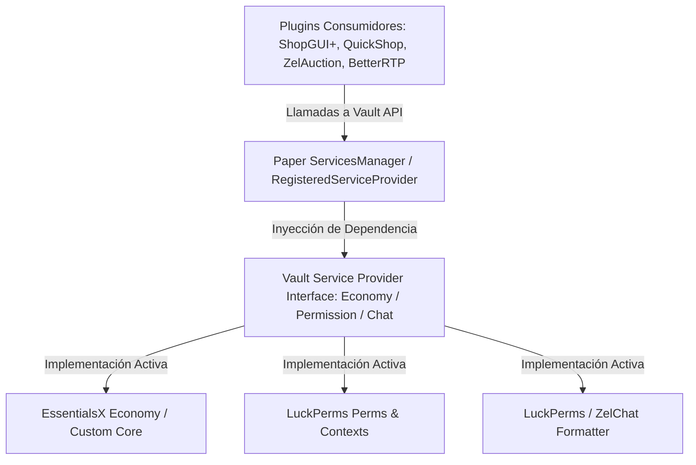

# 📖 VaultUnlocked / Vault (1.7.3+ / 2.x)

- **Categoría**: Core API / Abstraction Layer & Service Provider Interface (SPI)
- **Servidor**: [[wiki/entities/thundermc|ThunderMC Survival 1.21.11]]
- **Parte de**: [[wiki/entities/thundermc/ecosistema-plugins|Ecosistema de Plugins ThunderMC]] | [[wiki/synthesis/thundermc-master-synthesis|Síntesis Maestra]]
- **Dependencias**: Ninguna (Core Provider)
- **Implementaciones Integradas**: [[wiki/entities/thundermc/core-infrastructure/luckperms|LuckPerms]], [[wiki/entities/thundermc/economy-progression/shopguiplus|ShopGUIPlus]], [[wiki/entities/thundermc/economy-progression/quickshop-hikari|QuickShop-Hikari]], [[wiki/entities/thundermc/economy-progression/playerpoints|PlayerPoints]], [[wiki/entities/thundermc/chat-social/zelteams|ZelTeams]], [[wiki/entities/thundermc/economy-progression/zelauction|ZelAuction]], [[wiki/entities/thundermc/chat-social/zelchat|ZelChat]]

---

## 🎯 1. Propósito & Visión General
**VaultUnlocked** (y su especificación canónica Vault) actúa como la capa de abstracción estándar (Service Broker) para el ecosistema de Bukkit/Paper. Desacopla por completo los plugins consumidores de economía, permisos y chat (como tiendas, casas de subastas, protecciones y minas) de los plugins proveedores de lógica (`Economy Provider`, `Permission Provider`, `Chat Provider`).

En Minecraft 1.21.11, VaultUnlocked moderniza la API histórica de Vault añadiendo compatibilidad completa con UUIDs asíncronos, mitigación de llamadas síncronas bloqueantes al hilo principal (`Server Thread`), soporte extendido de nombres de moneda en singular/plural con formato transaccional decimal seguro (`BigDecimal`), y eliminación de métodos deprecados de la era pre-UUID.

---

## 🏗️ 2. Arquitectura Interna & Funcionamiento

### 2.1 Componentes Principales
1. **`net.milkbowl.vault.economy.Economy`**:
   - Interfaz de operaciones monetarias: `getBalance(OfflinePlayer)`, `has(OfflinePlayer, double)`, `withdrawPlayer(OfflinePlayer, double)`, `depositPlayer(OfflinePlayer, double)`.
   - Soporte para transacciones bancarias (`createBank`, `getBankBalance`, `bankDeposit`) y control de fracciones decimales (`fractionalDigits`).
2. **`net.milkbowl.vault.permission.Permission`**:
   - Abstracción de permisos basada en grupos y nodos: `has(Player, String)`, `playerAddGroup(World, OfflinePlayer, String)`, `getPrimaryGroup(World, OfflinePlayer)`.
   - Delegado en runtime al `LuckPermsVaultHook` para traducción bidireccional inmediata.
3. **`net.milkbowl.vault.chat.Chat`**:
   - Manejo de metadatos contextuales: `getPlayerPrefix(World, OfflinePlayer)`, `getPlayerSuffix(World, OfflinePlayer)`, metadatos clave-valor.
4. **Service Registration Mechanism**:
   - Se registra en el `org.bukkit.plugin.ServicesManager` de Paper con prioridad `ServicePriority.High` o `ServicePriority.Normal`.
   - Garantiza que al recargar o reiniciar un proveedor (e.g. EssentialsX o LuckPerms), el proveedor del servicio (`Economy.class`) se actualice dinámicamente sin romper las referencias de los plugins de tiendas.

---

## ⌨️ 3. Comandos Completos y Sintaxis

| Comando | Alias | Argumentos | Descripción | Nivel de Acceso |
|---|---|---|---|---|
| `/vault-info` | `/vault`, `/vinfo` | Ninguno | Muestra el estado del motor Vault, proveedores de Economía, Permisos y Chat cargados. | Admin / Staff |
| `/vault-convert` | `/vconvert` | `<from_plugin> <to_plugin>` | Ejecuta la migración de balances entre dos proveedores de economía registrados (si soportado). | Consola / Admin |

---

## 🔑 4. Árbol de Permisos

| Permiso | Descripción | Por Defecto |
|---|---|---|
| `vault.admin` | Acceso al comando `/vault-info` y diagnósticos de servicios. | `op` / `luckperms.group.admin` |
| `vault.update` | Recibir notificaciones in-game sobre versiones desactualizadas de Vault. | `op` |

---

## 🧩 5. Placeholders PAPI Integrados

Vault registra de forma nativa variables a través de la expansión oficial `Vault` (`/papi ecloud download Vault`):

| Placeholder | Descripción | Ejemplo de Salida |
|---|---|---|
| `%vault_eco_balance%` | Balance monetario del jugador formateado. | `15,450.50` |
| `%vault_eco_balance_raw%` | Balance numérico exacto sin comas ni formato. | `15450.50` |
| `%vault_eco_balance_formatted%` | Balance con sufijo compacto (k, M, B). | `15.45k` |
| `%vault_prefix%` | Prefijo de LuckPerms resuelto por Vault. | `&8[&bVIP&8]` |
| `%vault_suffix%` | Sufijo de LuckPerms resuelto por Vault. | `&7⚔` |
| `%vault_group%` | Grupo principal del usuario según Vault. | `vip` |
| `%vault_rank%` | Nombre legible del grupo o display name de rango. | `VIP` |

---

## ⚡ 6. Optimización de Rendimiento & Buenas Prácticas

1. **Evitar I/O Bloqueante en el hilo principal**:
   - Ciertos plugins antiguos invocaban `Economy#getBalance(String username)` que obligaba a Paper a resolver el UUID del jugador contra `usercache.json` o la API de Mojang en el hilo principal.
   - **Regla de oro**: Siempre utilizar métodos basados en `Economy#getBalance(OfflinePlayer player)` o `UUID`.
2. **Caché en Memoria de Balances**:
   - Configurar EssentialsX / el Economy Provider para mantener balances en memoria RAM y sincronizar a disco/MySQL de forma asíncrona mediante batches.
3. **Manejo de Transacciones Concurrentes**:
   - Evitar transacciones en bucles masivos (e.g. compras automáticas o payouts de minas en `CataMines`/`Jobs`) sin consolidar. Utilizar pagos en bloque para evitar contención de locks en el proveedor de economía.

---

## ⚠️ 7. Modos de Fallo, Vulnerabilidades & Exploits en 1.21.11

> [!CAUTION]
> **Riesgo de Duplicación por Inconsistencia Transaccional (Race Conditions)**
> Si un plugin ejecuta transacciones asíncronas sin sincronización (`synchronized` o atomic wrappers) mientras el jugador retira dinero rápidamente mediante dos menús GUI simultáneos (e.g. `/ah` y `/shop`), puede ocurrir un race condition donde el balance se verifique dos veces antes de aplicar el débito.

### Mitigaciones Clave:
- **Respuesta de Transacción Transaccional**: Comprobar siempre el enum `EconomyResponse.ResponseType` (`SUCCESS`, `FAILURE`, `NOT_IMPLEMENTED`).
- **Protección contra Números Negativos o `NaN` / `Infinity`**: Validar que cualquier input de usuario parseado a double no sea `Double.NaN`, `Double.POSITIVE_INFINITY` o valores `< 0.0`.
- **Desincronización por Soft Reload (`/reload`)**: Ejecutar `/reload` en Paper rompe el enlace de `ServicesManager` de Vault con los listeners de eventos. Se prohíbe taxativamente el uso de `/reload`; se deben usar reinicios completos o comandos de recarga dedicados (`/lp reload`, `/ess reload`).
