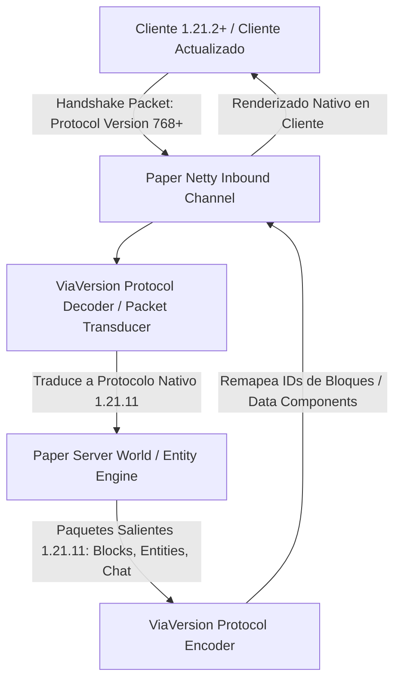

# 📖 ViaVersion (5.11.0+)

- **Categoría**: Compatibilidad de Red / Multi-Version Protocol Translation
- **Servidor**: ThunderMC Survival 1.21.11 (Paper build 126+)
- **Dependencias**: Ninguna (Módulo Core de Protocolo en Servidor/Proxy)
- **Familia de Addons Opcionales**: ViaBackwards (conexión de versiones anteriores), ViaRewind (versiones 1.8), ViaFabricPlus

---

## 🎯 1. Propósito & Visión General
**ViaVersion** es el framework de traducción de protocolos de red para Minecraft. Permite que clientes de versiones más recientes (e.g. Minecraft 1.21.2, 1.21.3, 1.22+) se conecten y jueguen de forma transparente en un servidor cuya versión nativa es **1.21.11**, realizando una transformación bidireccional de paquetes en tiempo real sobre el pipeline de Netty.

Traduce IDs de bloques, entidades, partículas, sonidos, pantallas de interfaz (GUIs), protocolos de chat/MiniMessage y estructuras NBT/Data Components para que el cliente receptor y el servidor entiendan exactamente la misma semántica del juego.

---

- **Parte de**: [[wiki/entities/thundermc/ecosistema-plugins|Ecosistema Plugins]] | [[wiki/synthesis/thundermc-master-synthesis|Síntesis Maestra]]
## 🏗️ 2. Arquitectura Interna & Pipeline de Netty



### 2.1 Componentes Principales
1. **Pipeline Injection (Netty Channel Handlers)**:
   - ViaVersion se inyecta dinámicamente en el socket de Netty inmediatamente después de la fase de handshake inicial. Intercepta los canales `decoder` y `encoder` sin generar copias intermedias de memoria (zero-copy buffer slicing).
2. **Data Component & Registry Remapping**:
   - Con la introducción de los **Data Components** en 1.20.5+ y 1.21+, ViaVersion mapea las nuevas estructuras de metadatos de ítems (componentes de comida, durabilidad, pociones, modelos custom) hacia las representaciones de la versión del cliente.
3. **Entity Metadata & Sound Remapper**:
   - Si una versión superior añade nuevas animaciones o tipos de partículas que no existen en el servidor, ViaVersion las sustituye por la partícula más cercana para evitar que el cliente arroje un `DecoderException` y se desconecte.

---

## ⌨️ 3. Comandos Completos y Sintaxis

| Comando | Alias | Argumentos | Descripción | Nivel de Acceso |
|---|---|---|---|---|
| `/viaversion list` | `/via list`, `/vv list` | Ninguno | Muestra cuántos jugadores están conectados en cada versión de protocolo. | Staff / Admin |
| `/viaversion pps` | `/via pps` | Ninguno | Muestra la tasa de paquetes por segundo (Packets Per Second) recibidos de cada cliente. | Admin |
| `/viaversion dump` | `/via dump` | Ninguno | Genera un volcado exhaustivo del estado del servidor, plugins de red y proxies en Pastebin. | Admin |
| `/viaversion displayleaks`| `/via displayleaks`| Ninguno | Alterna la visualización de posibles fugas de memoria en buffers de Netty. | Developer / Admin |
| `/viaversion reload` | `/via reload` | Ninguno | Recarga los archivos de configuración `config.yml`. | Admin |

---

## 🔑 4. Árbol de Permisos

| Permiso | Descripción | Por Defecto |
|---|---|---|
| `viaversion.admin` | Acceso a comandos de diagnóstico, listas de versiones y recargas `/viaversion`. | `op` / `luckperms.group.admin` |
| `viaversion.update` | Recibir alertas en el chat cuando haya nuevas actualizaciones del protocolo en Modrinth/Hangar. | `op` |

---

## 🧩 5. Placeholders PAPI Integrados

ViaVersion expone variables a través de la expansión de PAPI (o bridge interno):

| Placeholder | Descripción | Ejemplo de Salida |
|---|---|---|
| `%viaversion_player_protocol_version%` | Número de protocolo de la versión del cliente. | `768` |
| `%viaversion_player_protocol_name%` | Nombre legible de la versión del juego del cliente. | `1.21.2` |

---

## ⚡ 6. Optimización de Rendimiento & Configuración

1. **Gestión de Paquetes por Segundo (`max-pps`)**:
   - En `plugins/ViaVersion/config.yml`, configurar límites de seguridad para mitigar ataques de denegación de servicio por envío masivo de paquetes de movimiento o clics:
     ```yaml
     max-pps: 800
     max-pps-kick-msg: "Has sido desconectado por enviar paquetes inusualmente rápido."
     tracking-warning-pps: 600
     ```
2. **Desactivar Bloques No Utilizados (`serverside-blockconnections`)**:
   - Si se usa Paper con optimizaciones nativas de bloques, desactivar `serverside-blockconnections: false` para ahorrar cálculos de conexión de vallas, paneles de cristal y escaleras en el servidor.
3. **Cero Sobrecarga de Ticks**:
   - Toda la transformación de paquetes se ejecuta en los hilos de red de Netty (`Netty Epoll / NIO EventLoopGroup`), sin interferir con el hilo de juego principal (`Server Thread`).

---

## ⚠️ 7. Modos de Fallo, Vulnerabilidades & Exploits en 1.21.11

> [!WARNING]
> **Desincronización de Animaciones de Combate y Wind Charges**
> En versiones recientes de 1.21 (como la introducción de cargas de viento / Wind Charges y Mazas / Maces), clientes con versiones diferentes pueden experimentar ligeras discrepancias en el cálculo de knockback o partículas si el cliente envía paquetes de interacción con predicción local agresiva.

### Mitigaciones Críticas:
- **Mantener ViaVersion Siempre Actualizado**: Cada actualización menor de Minecraft introduce cambios en los Data Components. Actualizar el JAR con cada nueva release para evitar caídas de clientes por paquetes malformados.
- **Protección contra Paquetes Malformados de NBT**: ViaVersion valida el tamaño y profundidad de árboles NBT antes de entregarlos al motor de Paper, evitando exploits de congelación de clientes ("Book & Quill / Chunk Ban").

---

## Referencias Cruzadas
- [[wiki/entities/thundermc/core-infrastructure/floodgate|Floodgate]]
- [[wiki/entities/thundermc/ecosistema-plugins|Ecosistema Plugins]]
