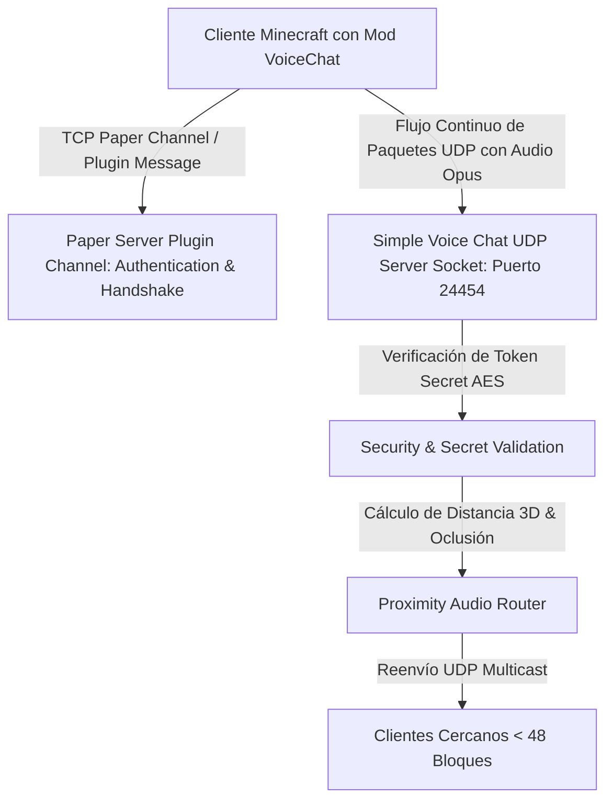

# 📖 Simple Voice Chat (2.6.21+)

- **Categoría**: Inmersión / Proximity Voice Chat & Red UDP
- **Servidor**: ThunderMC Survival 1.21.11 (Paper build 126+)
- **Dependencias**: Ninguna (Plugin standalone en servidor; Mod de cliente opcional Fabric/Forge/NeoForge/Quilt para escuchar/hablar)
- **Protocolo de Red**: Socket UDP Independiente (Opus Audio Codec + AES Encryption)
- **Documentación Oficial**: [voicechat.henkelmax.de](https://voicechat.henkelmax.de/docs/)

---

## 🎯 1. Propósito & Visión General
**Simple Voice Chat** proporciona comunicación de voz posicional 3D en tiempo real (chat de proximidad) dentro de Minecraft. Calcula la posición espacial del jugador (`X, Y, Z`, rotación de cabeza y oclusión por bloques) y modula el volumen, reverberación y atenuación de audio en función de la distancia euclidiana y el entorno. Incluye soporte para canales grupales con contraseña, radio/walkie-talkies (vía plugins/addons), micrófonos de evento y registro de espectador.

---

- **Parte de**: [[wiki/entities/thundermc/ecosistema-plugins|Ecosistema Plugins]] | [[wiki/synthesis/thundermc-master-synthesis|Síntesis Maestra]]
## 🏗️ 2. Arquitectura Interna & Protocolo de Red



### 2.1 Componentes Principales
1. **Flujo Dual (TCP + UDP)**:
   - **Canal de Control TCP (Bukkit Plugin Messaging)**: Negocia el handshake inicial, envía la clave secreta efímera de sesión (`Secret`), el puerto UDP asignado y el estado de silenciado/ensordecido.
   - **Canal de Audio UDP**: Transmite frames de audio comprimidos en **Opus** (20ms por paquete) directamente sobre el puerto UDP configurado (por defecto `24454`), sin saturar el hilo principal de Paper ni los buffers de Netty.
2. **Encriptación de Audio**:
   - Cada paquete UDP está cifrado utilizando **AES-GCM (128-bit)** con una clave generada dinámicamente durante el handshake TCP. Esto impide sniffing de paquetes y ataques de retransmisión de audio.
3. **Cálculo de Atenuación Posicional**:
   - Curva de atenuación exponencial/logarítmica calculada en base al parámetro `max_voice_distance` (por defecto 48 bloques).
   - Simulación de oclusión acústica (`crouch_distance_multiplier`, atenuación a través de muros sólidos).

---

## ⌨️ 3. Comandos Completos y Sintaxis

| Comando | Alias | Argumentos | Descripción | Nivel de Acceso |
|---|---|---|---|---|
| `/voicechat test` | `/vc test` | `[puerto]` | Realiza un test de loopback UDP para comprobar si el puerto está abierto y accesible externamente. | Admin / Consola |
| `/voicechat hide` | `/vc hide` | Ninguno | Oculta los iconos de estado de micrófono/altavoz de la interfaz. | Jugador |
| `/voicechat show` | `/vc show` | Ninguno | Muestra nuevamente los iconos de estado en pantalla. | Jugador |
| `/voicechat mute` | `/vc mute` | `<jugador>` | Silencia por completo a un jugador en el chat de voz a nivel de servidor. | Staff / Admin |
| `/voicechat unmute` | `/vc unmute` | `<jugador>` | Restablece los permisos de voz a un jugador silenciado. | Staff / Admin |
| `/voicechat connection` | `/vc connection` | `[jugador]` | Muestra diagnósticos de conexión UDP (RTT, paquetes perdidos, latencia, códec). | Staff / Admin |
| `/voicechat reload` | `/vc reload` | Ninguno | Recarga la configuración del archivo `voicechat-server.properties`. | Admin |

---

## 🔑 4. Árbol de Permisos

| Permiso | Descripción | Por Defecto |
|---|---|---|
| `voicechat.connect` | Permite al jugador autenticarse y conectarse al servidor de voz UDP. | `true` |
| `voicechat.speak` | Permite transmitir voz a través del micrófono. | `true` |
| `voicechat.listen` | Permite escuchar la voz de otros jugadores cercanos. | `true` |
| `voicechat.groups` | Permite crear y unirse a grupos de voz aislados (canales privados). | `true` |
| `voicechat.priority` | Concede prioridad de voz (su volumen reduce automáticamente el de otros hablantes). | `op` / Staff |
| `voicechat.admin` | Acceso a comandos de administración, silenciado global y diagnósticos `/vc`. | `op` |
| `voicechat.broadcast` | Permite transmitir voz a todos los jugadores del servidor sin importar la distancia. | `op` |

---

## 🧩 5. Placeholders PAPI Integrados

| Placeholder | Descripción | Ejemplo de Salida |
|---|---|---|
| `%voicechat_is_connected%` | Devuelve si el jugador tiene el mod instalado y está conectado a la voz. | `true` / `false` |
| `%voicechat_is_muted%` | Indica si el jugador está silenciado por el servidor. | `false` |
| `%voicechat_is_deafened%` | Indica si el jugador tiene los auriculares silenciados voluntariamente. | `false` |
| `%voicechat_group%` | Nombre del canal grupal al que pertenece el jugador (o vacío si no tiene). | `Team Alfa` |
| `%voicechat_group_type%` | Tipo de grupo (`OPEN`, `ISOLATED`, `NORMAL`). | `NORMAL` |

---

## ⚡ 6. Optimización de Rendimiento & Configuración

1. **Configuración de Puerto UDP en Hosting Compartido**:
   - En entornos como Bloom Host (`MIA-251006.bloom.host`), el puerto de voz no puede ser el default `24454` a menos que esté expresamente asignado.
   - En `plugins/voicechat/voicechat-server.properties`:
     ```properties
     port=25575 # Puerto UDP asignado por el host
     bind_address=0.0.0.0
     max_voice_distance=48.0
     voice_chat_distance=48.0
     keep_alive=3000
     min_packet_threshold=20
     ```
2. **Ajuste de Bitrate de Audio (Calidad vs Ancho de Banda)**:
   - Configurar `voice_quality=NORMAL` o `voice_quality=HIGH` (24kbps a 32kbps). Bitrates superiores a 48kbps saturan las conexiones móviles de jugadores en Bedrock/Wi-Fi sin mejora perceptual clara.
3. **Limpieza de Hilos Netty**:
   - El socket UDP opera en un pool de hilos asíncronos (`VoiceChatServerThread`). Impacto en el tick rate (`MSPT`) del servidor es **< 0.05ms**.

---

## ⚠️ 7. Modos de Fallo, Vulnerabilidades & Exploits en 1.21.11

> [!IMPORTANT]
> **Bloqueo por Firewall UDP / Puerto Inaccesible**
> El síntoma clásico donde los jugadores ven el icono de micrófono tachado o con un enchufe desconectado se debe a que el puerto UDP no está abierto en el cortafuegos del host, o a que el `bind_address` apunta a una IP local errónea.

### Mitigaciones Críticas:
- **Evasión de Mutes mediante Re-login**: La tabla de mutes de Simple Voice Chat se guarda por UUID en `mutes.json`. Integrar con sistemas de moderación centralizados (`LiteBans`) si se desea silenciar automáticamente a usuarios sancionados.
- **Ataques de Flood UDP / DoS de Audio**: El servidor descarta automáticamente datagramas UDP que no incluyan un token AES válido o cuya tasa de frames supere 50 paquetes/segundo por cliente.

---

## Referencias Cruzadas
- [[wiki/entities/thundermc/infraestructura-hardware|Infraestructura Hardware]]
- [[wiki/entities/thundermc/ecosistema-plugins|Ecosistema Plugins]]
