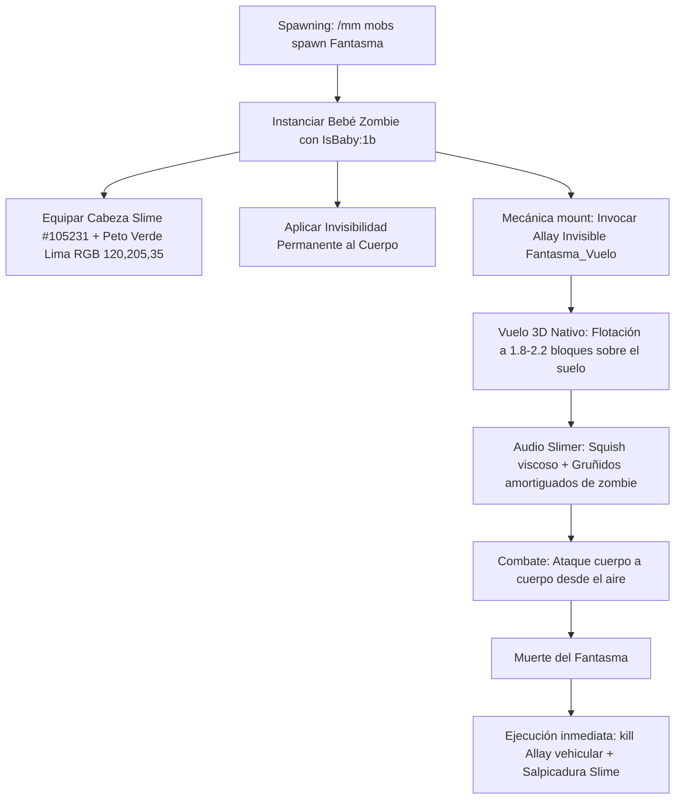

# 🎃 Evento de Halloween — Mobs Personalizados (ThunderMC 1.21.11)

- **Categoría**: Eventos Estacionales / MythicMobs
- **Versión de Minecraft**: 1.21.11 (Paper / Purpur)
- **Plugin Motor**: MythicMobs v5.11+ (Compatible vanilla, sin dependencias de LibsDisguises)
- **Archivos de Configuración**:
  - Mob: `creator/output/configs/MythicMobs/fantasma_halloween.yml` -> Servidor: `plugins/MythicMobs/mobs/fantasma.yml`
  - Ítems: `creator/output/configs/MythicMobs/fantasma_items_halloween.yml` -> Servidor: `plugins/MythicMobs/items/fantasma_items.yml`
- **Término Clave Operativo**: Cuando el Sr Ramos mencione **"evento de halloween mobs"**, se refiere a este ecosistema y en particular al **Fantasma Viscoso (Slimer)**.

---

## 👻 1. Entidad: Fantasma Viscoso (Slimer)

El **Fantasma Viscoso** es un mob aéreo hostil diseñado para eventos de Halloween, ambientado visual y acústicamente en el concepto de "Slimer" (Cazafantasmas / Ectoplasma).



---

## ⚙️ 2. Especificación Técnica y Arquitectura

### 2.1 Por qué no se usó un Vex directo
En Minecraft Java vanilla, el renderizador de cliente (`VexRenderer`) carece de `ArmorFeatureRenderer` y `CustomHeadLayer`. Si a un Vex se le equipa armadura o cabezas, el cliente vanilla no las dibuja. 

### 2.2 Solución Arquitectónica (Bebé Zombie + Motor Allay)
1. **Rider / Jinete (`Fantasma`)**:
   - Base `Type: ZOMBIE` con inyección de NBT nativo `IsBaby: 1b` y `Scale: 1.0` (tamaño bebé vanilla estándar).
   - Efecto `INVISIBILITY` permanente con partículas ocultas.
   - Cabeza personalizada de Slime (`ID: 105231` de Minecraft-Heads) con textura Base64 incrustada.
   - Túnica de cuero en `CHEST` teñida en verde lima viscoso (`RGB: 120, 205, 35`).
   - Ranuras `LEGS` y `FEET` en `AIR`: la mitad inferior del cuerpo desaparece completamente, dando la apariencia de un torso y cabeza espectral que flotan en el aire.
2. **Vehículo / Motor de Vuelo (`Fantasma_Vuelo`)**:
   - Base `Type: ALLAY` invisible (`INVISIBILITY`), silencioso (`Silent: true`) e invulnerable.
   - Proporciona la cinemática de vuelo 3D nativa, aleteo suave y sustentación constante a la altura de los ojos del jugador (~1.8 a 2.2 bloques).
3. **Muerte Sincronizada del Vehículo**:
   - En Minecraft, el evento `dismount` se dispara antes de `~onDeath`, invalidando targeters como `@Vehicle`.
   - Para eliminar el Allay invisible sin dejarlo vagando en el mundo, `Fantasma` ejecuta en `~onDeath`:
     ```yaml
     - remove @Children ~onDeath
     - command{c="execute at <caster.uuid> run kill @e[type=allay,distance=..3,limit=1]";sender=console} @self ~onDeath
     ```

---

## 🎨 3. Datos de Textura y Audio

| Parámetro | Valor Técnico |
| :--- | :--- |
| **Cabeza** | Slime (#105231 de minecraft-heads.com) |
| **Hash Mojang** | `59e8891c4a62b6ab7c3b8bf0053406a11324f9549c27033a3491a501e92fc197` |
| **Base64** | `eyJ0ZXh0dXJlcyI6eyJTS0lOIjp7InVybCI6Imh0dHA6Ly90ZXh0dXJlcy5taW5lY3JhZnQubmV0L3RleHR1cmUvNTllODg5MWM0YTYyYjZhYjdjM2I4YmYwMDUzNDA2YTExMzI0Zjk1NDljMjcwMzNhMzQ5MWE1MDFlOTJmYzE5NyJ9fX0=` |
| **Color Armadura** | RGB `120, 205, 35` (Lima Ectoplásmico) |
| **Partículas** | `ITEM_SLIME` (goteo sutil durante el vuelo y explosión x25 al morir) + `SNEEZE` |
| **Audio** | `entity.slime.squish`, `entity.zombie.ambient` (pitch 1.7), `entity.slime.hurt`, `entity.slime.death`, `entity.slime.attack` |

---

## 🛠️ 4. Comandos de Administración

* Invocar el mob:
  ```text
  /mm mobs spawn Fantasma [cantidad] [mundo,x,y,z]
  ```
* Recargar configuración:
  ```text
  /mm reload
  ```

---

## Referencias Cruzadas
- [[wiki/entities/thundermc/gameplay-mechanics/mythicmobs|MythicMobs]]
- [[wiki/entities/thundermc/mobs-mazmorras|Mobs de Mazmorras]]
- [[wiki/synthesis/thundermc-master-synthesis|Síntesis Maestra]]
