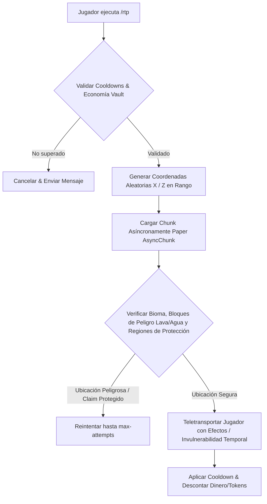

# 🌀 BetterRTP - Documentación Técnica

- **Categoría**: Teletransporte Aleatorio & Exploración de Mundos
- **Versión Core Soportada**: Minecraft 1.8.x - 1.21.x (Paper / Purpur)
- **Desarrollador**: RonanPlugins
- **Dependencias**: PaperLib / Paper Async Chunk API, WorldGuard, GriefPrevention, PlaceholderAPI, Vault
- **Ruta de Configuración**: `plugins/BetterRTP/`

---

## 🏛️ 1. Arquitectura y Funcionamiento Interno

BetterRTP implementa un algoritmo de búsqueda de ubicaciones seguras utilizando **Carga Asíncrona de Chunks (Paper AsyncChunk Loading)** para evitar bloquear el hilo principal del servidor durante la búsqueda en coordenadas lejanas.



### Características Principales:
1. **Detección Inteligente de Suelo Seguro**:
   - Descarta automáticamente océanos, lagos de lava, vacío, bloques de fuego y hojas de árboles no seguras.
2. **Compatibilidad con WorldBorder y Mundos Personalizados**:
   - Ajusta dinámicamente los radios mínimos y máximos según los bordes de Vanilla o plugins de bordes.
3. **Soporte de Zonas y Mundos Múltiples**:
   - Configuración individual por mundo (`world`, `world_nether`, `world_the_end`) y por grupos de permisos (ej: mayor radio para rangos VIP).

---

## ⚙️ 2. Configuración Crítica (`config.yml`)

```yaml
Settings:
  LanguageFile: "en.yml"
  Auto-Update: false
  Use-Async: true # CRÍTICO: Utilizar Async Chunks en Paper 1.21.x
  Respect-WorldGuard: true
  Respect-GriefPrevention: true
  Respect-Towny: true

Default:
  UseWorldBorder: false
  MaxRadius: 10000
  MinRadius: 500
  CenterX: 0
  CenterZ: 0
  Price: 100 # Coste económico vía Vault
  Cooldown: 300 # 5 minutos
  MaxAttempts: 32 # Intentos máximos de búsqueda segura

CustomWorlds:
  - world:
      UseWorldBorder: false
      MaxRadius: 8000
      MinRadius: 1000
      Price: 0
      Cooldown: 120
  - world_nether:
      MaxRadius: 3000
      MinRadius: 500
      Price: 250
      Cooldown: 600

BlacklistedBlocks:
  - LAVA
  - WATER
  - AIR
  - VOID
  - BEDROCK
  - CACTUS
  - POWDER_SNOW
```

---

## 💻 3. Comandos y Jerarquía de Permisos

### Comandos Principales:
| Comando | Descripción | Permiso |
| :--- | :--- | :--- |
| `/rtp` | Teletransporta al jugador a una ubicación aleatoria segura. | `betterrtp.use` |
| `/rtp world <mundo>` | Teletransporta dentro de un mundo específico. | `betterrtp.world.<mundo>` |
| `/rtp player <jugador> [mundo]` | Teletransporta forzadamente a otro jugador. | `betterrtp.player` |
| `/rtp reload` | Recarga las configuraciones del plugin. | `betterrtp.reload` |
| `/rtp info` | Muestra el estado y estadísticas de búsqueda. | `betterrtp.admin` |

### Jerarquía de Permisos:
- `betterrtp.admin`: Acceso a administración y configuración de zonas.
- `betterrtp.bypass.cooldown`: Elimina el tiempo de espera entre teletransportes.
- `betterrtp.bypass.economy`: Permite ejecutar RTP gratis sin costo de Vault.
- `betterrtp.bypass.hunger`: Evita el consumo de hambre al teletransportarse.

---

## 🧩 4. Integración con PlaceholderAPI (PAPI)

| Placeholder | Descripción |
| :--- | :--- |
| `%betterrtp_cooldown%` | Tiempo restante de cooldown formateado para el jugador. |
| `%betterrtp_cooldown_raw%` | Tiempo de espera en segundos exactos (entero). |
| `%betterrtp_price%` | Coste económico actual para el mundo en el que se encuentra. |

---

## 🛡️ 5. Modos de Fallo, Exploits y Optimización

> [!CAUTION]
> **Sobrecarga de Generación de Terreno (Chunk Generation Lag Spike)**:
> Si el radio de RTP supera el área precargada del mapa (Chunk Pregeneration con Chunky), cada RTP forzará la generación de nuevos chunks en el disco, causando picos de GC y caídas bruscas de TPS.
> **Mitigación**:
> 1. Pre-generar previamente los mundos con `chunky start`.
> 2. Mantener `MaxRadius` estrictamente dentro del radio de chunks pregenerados.

> [!WARNING]
> **Exploit de Asfixia en Nether / Techo de Nether**:
> En mundos del Nether, búsquedas no calibradas pueden colocar al jugador sobre el techo de bedrock (Y > 127).
> **Mitigación**: Definir `MaxY: 120` y `MinY: 30` en la configuración específica de `world_nether`.
