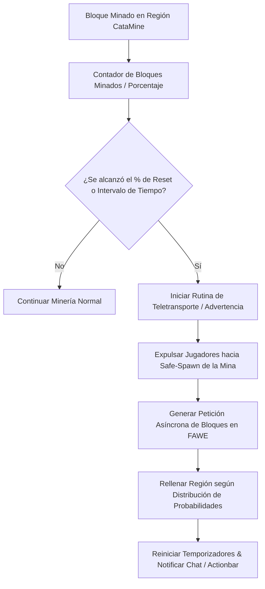

# ⛏️ CataMines - Documentación Técnica

- **Categoría**: Minería Automatizada / Regeneración de Recursos
- **Versión Core Soportada**: Minecraft 1.16.x - 1.21.x (Paper / Purpur)
- **Desarrollador**: CataPlugins
- **Dependencias**: WorldEdit / FastAsyncWorldEdit (FAWE), PlaceholderAPI, Vault
- **Ruta de Configuración**: `plugins/CataMines/`

---

## 🏛️ 1. Arquitectura y Funcionamiento Interno

CataMines gestiona regiones volumétricas delimitadas para la regeneración y control de minas públicas o privadas, delegando la modificación de bloques a FastAsyncWorldEdit (FAWE) para evitar bloqueos en el hilo principal (Server Thread).



### Mecánicas Principales:
1. **Regeneración Asíncrona Multi-Hilo**:
   - Utiliza la API de FAWE (`EditSession`) para colocar miles de bloques por segundo sin caídas de TPS.
2. **Condiciones de Reseteo Flexibles**:
   - Reseteo por intervalo de tiempo cronometrado (cron / temporizador en segundos).
   - Reseteo por porcentaje de vaciado (ej: cuando se haya picado el 70% de la mina).
3. **Control de Composición Proporcional**:
   - Soporte para declarar porcentajes exactos de menas, bloques decorativos y bloques con comandos embebidos.

---

## ⚙️ 2. Configuración Crítica (`mines/mina_publica.yml`)

```yaml
id: "mina_publica"
display-name: "&b&lMina Pública de Recursos"
region:
  world: "world"
  min-point: {x: 100, y: 50, z: 100}
  max-point: {x: 150, y: 70, z: 150}
  teleport-point: {x: 125.5, y: 72.0, z: 95.5, yaw: 0.0, pitch: 0.0}

reset:
  timed-reset: true
  interval-seconds: 1800 # 30 minutos
  percentage-reset: true
  reset-percentage: 65.0 # Si se mina el 65% de bloques

composition:
  STONE: 60.0
  COAL_ORE: 18.0
  IRON_ORE: 12.0
  GOLD_ORE: 5.0
  DIAMOND_ORE: 3.5
  ANCIENT_DEBRIS: 1.5

notifications:
  broadcast-warnings: [60, 30, 10, 5, 3, 2, 1]
  warning-message: "&e[Mina] &fLa mina se reiniciará en &c{seconds} segundos&f."
  reset-message: "&a[Mina] &f¡La mina ha sido regenerada con éxito!"
```

---

## 💻 3. Comandos y Jerarquía de Permisos

### Comandos de Gestión:
| Comando | Descripción | Permiso |
| :--- | :--- | :--- |
| `/cm create <nombre>` | Crea una mina con la selección actual de WorldEdit. | `catamines.admin.create` |
| `/cm reset <nombre>` | Fuerza el reseteo instantáneo de una mina. | `catamines.admin.reset` |
| `/cm setteleport <nombre>` | Establece el punto de expulsión segura de la mina. | `catamines.admin.setteleport` |
| `/cm setcomposition <nombre>` | Abre el editor GUI de composición de bloques. | `catamines.admin.composition` |
| `/cm list` | Lista todas las minas activas y su tiempo restante. | `catamines.user.list` |
| `/cm panel` | Abre el panel GUI interactivo de administración. | `catamines.admin.gui` |

### Jerarquía de Permisos:
- `catamines.admin`: Acceso completo a todas las funciones de administración.
- `catamines.bypass.teleport`: Evita ser teletransportado fuera de la mina durante el reset.

---

## 🧩 4. Integración con PlaceholderAPI (PAPI)

| Placeholder | Descripción |
| :--- | :--- |
| `%catamines_timeleft_<nombre>%` | Tiempo restante para el próximo reseteo programado. |
| `%catamines_percentage_<nombre>%` | Porcentaje de bloques minados actualmente. |
| `%catamines_blocksleft_<nombre>%` | Número total de bloques restantes antes del reseteo. |

---

## 🛡️ 5. Modos de Fallo y Prevención de Exploits

> [!CAUTION]
> **Exploit de Sofocación de Jugadores durante el Reset**:
> Si el safe-spawn no está definido o coincide dentro de la caja volumétrica de regeneración, los jugadores quedarán atrapados dentro de los bloques sólidos al reiniciar.
> **Mitigación**: Siempre configurar `teleport-point` en una plataforma elevada externa y verificar `safe-teleport: true`.

> [!WARNING]
> **Pico de Lag por Fallo en Integración FAWE**:
> Si FAWE no está presente o se produce un fallback al Bukkit Block Setter tradicional, el reseteo de minas grandes (> 100,000 bloques) congelará el hilo principal.
> **Mitigación**: Asegurarse de que FAWE esté cargado como dependencia primaria en el servidor.
