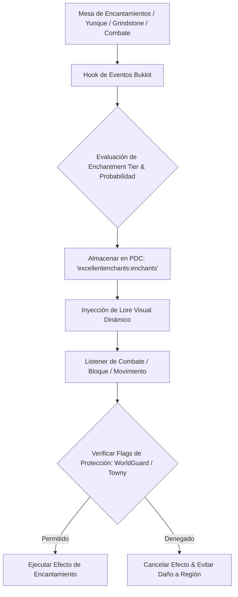

# 🌟 ExcellentEnchants - Documentación Técnica

- **Categoría**: Mecánicas RPG / Encantamientos Personalizados
- **Versión Core Soportada**: Minecraft 1.20.x - 1.21.x (Paper / Purpur)
- **Desarrollador / Core**: NightExpress / NightCore
- **Dependencias**: NightCore (Obligatoria), ProtocolLib, PlaceholderAPI, WorldGuard
- **Ruta de Configuración**: `plugins/ExcellentEnchants/`

---

## 🏛️ 1. Arquitectura y Funcionamiento Interno

ExcellentEnchants se integra directamente con el subsistema de encantamientos de Spigot/Paper, extendiendo la clase `Enchantment` y registrando listeners asíncronos y síncronos optimizados.



### Características Principales:
1. **Tipos de Encantamientos (Tiers)**:
   - **Simple / Normal**: Mejoras de calidad de vida (Telepatía, Smelting automático).
   - **Excelente / Raro**: Habilidades de combate elemental (Llamas astrales, Congelación, Drenaje de vida).
   - **Legendario / Mítico**: Destrucción en área (Túnel 3x3, Tormenta eléctrica, Agujeros negros).
   - **Maldiciones (Curses)**: Encantamientos negativos de balanceo.
2. **Distribución Vanilla-Friendly**:
   - Integración nativa con la Mesa de Encantamientos (Enchanting Table), Yunques, Loot de estructuras del mundo (dungeons, end cities) y aldeanos libreros.
3. **Mapeo Visual Limpio**:
   - Actualización dinámica del Lore para evitar duplicaciones o residuos de texto tras desencantar en afiladoras (Grindstones).

---

- **Parte de**: [[wiki/entities/thundermc/ecosistema-plugins|Ecosistema Plugins]] | [[wiki/synthesis/thundermc-master-synthesis|Síntesis Maestra]]
## ⚙️ 2. Configuración Crítica

### Ejemplo de Configuración de Encantamiento (`enchants/telepathy.yml`):
```yaml
id: "telepathy"
name: "&6Telepatía"
description:
  - "&7Transfiere automáticamente los bloques"
  - "&7minados directamente a tu inventario."
max-level: 1
tier: "rare"
conflicts:
  - "silk_touch"
item-targets:
  - "PICKAXE"
  - "SHOVEL"
  - "AXE"
table:
  enabled: true
  min-cost: 20
  weight: 50
villager:
  enabled: true
loot:
  enabled: true
  chance: 15.0
```

---

## 💻 3. Comandos y Jerarquía de Permisos

### Comandos Principales:
| Comando | Descripción | Permiso |
| :--- | :--- | :--- |
| `/ee book <encantamiento> <nivel> [jugador]` | Entrega un libro de encantamiento específico. | `excellentenchants.admin` |
| `/ee enchant <encantamiento> <nivel>` | Aplica el encantamiento directamente al ítem en mano. | `excellentenchants.admin` |
| `/ee list` | Muestra todos los encantamientos registrados y sus estados. | `excellentenchants.user` |
| `/ee reload` | Recarga las configuraciones y tiers sin reiniciar. | `excellentenchants.admin` |

### Jerarquía de Permisos:
- `excellentenchants.admin`: Control total de comandos administrativos y bypass.
- `excellentenchants.enchant.<id>`: Permiso para aplicar o recibir dicho encantamiento.
- `excellentenchants.bypass.cost`: Bypass de niveles de experiencia al usar yunques.

---

## 🧩 4. Integración con PlaceholderAPI (PAPI)

| Placeholder | Descripción |
| :--- | :--- |
| `%excellentenchants_enchantments_count%` | Cantidad total de encantamientos personalizados activos en el ítem sostenido. |
| `%excellentenchants_enchantment_level_<id>%` | Nivel del encantamiento específico en el ítem principal. |
| `%excellentenchants_tier_color_<id>%` | Color asociado al Tier del encantamiento. |

---

## 🛡️ 5. Modos de Fallo, Exploits y Optimización

> [!WARNING]
> **Exploit de Minería en Área (VeinMiner / Tunnel) en Claims**:
> Los encantamientos que rompen múltiples bloques (`Blast`, `VeinMiner`) deben verificar permisos de `WorldGuard` o `ProtectionStones` por cada bloque individual para evitar grieffing en claims vecinos.
> **Mitigación**: Activar `worldguard-hook: true` en `config.yml` y validar el evento `BlockBreakEvent` con el plugin de protección activo.

> [!TIP]
> **Optimización de Desencantado en Grindstones**:
> Asegurar que la opción `clean-empty-lore` esté habilitada para evitar desincronizaciones visuales de Lore en clientes Bedrock (vía Floodgate).

---

## Referencias Cruzadas
- [[wiki/entities/thundermc/gameplay-mechanics/executableitems|ExecutableItems]]
- [[wiki/entities/thundermc/gameplay-mechanics/itemedit|ItemEdit]]
- [[wiki/entities/thundermc/gameplay-mechanics/mythicmobs|MythicMobs]]
- [[wiki/entities/thundermc/ecosistema-plugins|Ecosistema Plugins]]
