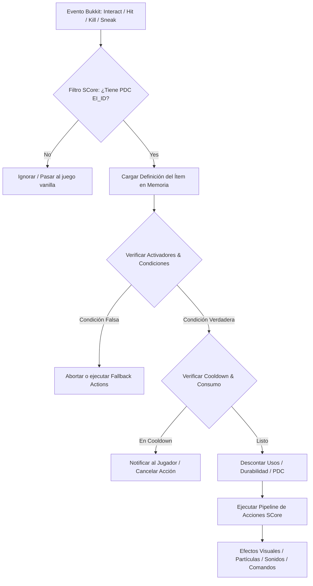

# ⚔️ ExecutableItems (EI) - Documentación Técnica

- **Categoría**: Jugabilidad / RPG / Custom Items
- **Versión Core Soportada**: Minecraft 1.21.x (Paper / Purpur)
- **Desarrollador / Framework**: Ssomar / SsomarCore (SCore)
- **Dependencias**: SCore (Obligatoria), ProtocolLib, PlaceholderAPI, Vault, WorldGuard (Opcionales)
- **Ruta de Configuración**: `plugins/ExecutableItems/items/`

---

## 🏛️ 1. Arquitectura y Funcionamiento Interno

ExecutableItems (EI) implementa un motor de scripting declarativo sobre ítems de Bukkit/Paper basado en la API de **PersistentDataContainer (PDC)** y metadatos NBT personalizados.



### Componentes Clave:
1. **Identificación Inmutable**:
   - Cada ítem instanciado contiene claves en el `PersistentDataContainer` (`executableitems:ei-id`, `executableitems:ei-usages`, `executableitems:ei-owner`).
   - Evita la falsificación mediante renombrado en yunques vanilla gracias a la validación estricta de PDC.
2. **Sistema de Activadores (Activators)**:
   - `PLAYER_RIGHT_CLICK`, `PLAYER_LEFT_CLICK`, `PLAYER_HIT_PLAYER`, `PLAYER_KILL_PLAYER`, `PROJECTILE_HIT_PLAYER`, `INVENTORY_CLICK`, `LOOP`, `WALK`, `SNEAK`, entre otros.
3. **Engine de Comandos & Acciones SCore**:
   - Soporta acciones inline como: `SENDMESSAGE`, `DAMAGE`, `HEAL`, `TELEPORT`, `SPAWN_PARTICLE`, `STRIKE_LIGHTNING`, `EXECUTE_AT`.

---

## ⚙️ 2. Configuración Crítica y Sintaxis YAML

Ejemplo de ítem avanzado configurado bajo estándares de producción para 1.21.x:

```yaml
name: "&6&lEspada del Trueno Ancestral"
lore:
  - "&7Forjada con energía de plasma divino."
  - ""
  - "&eHabilidad Pasiva: &fSobrecarga"
  - "&7Golpear enemigos invoca rayos en área."
  - "&cCooldown: &f5s"
  - ""
  - "&8ID: &7thunder_sword"
material: NETHERITE_SWORD
glow: true
disableStack: true
unbreakable: true
hideEnchantments: true
customModelData: 10001
usage: 0 # 0 = infinito
dropOptions:
  glowDrop: true
  glowDropColor: "GOLD"
  displayNameDrop: true

activators:
  activator_0:
    name: "ThunderStrike_OnHit"
    activator: PLAYER_HIT_PLAYER
    cooldownOptions:
      cooldown: 5
      isCooldownParallel: false
      enableVisualCooldown: true
    conditions:
      ifTargetBlockType:
        blocks: []
      ifSneaking: false
      ifTargetNotEntity:
        - ARMOR_STAND
    commands:
      - "STRIKE_LIGHTNING {target_x} {target_y} {target_z}"
      - "DAMAGE {target} 8.0"
      - "PARTICLE FLASH {target_x} {target_y} {target_z} 10 0.5 0.5 0.5 0.1"
      - "SENDMESSAGE {player} &e¡Has desatado la &6Sobrecarga Eléctrica&e sobre &f{target}&e!"
      - "SENDMESSAGE {target} &c¡Has recibido un impacto de &6Sobrecarga Eléctrica&c!"
```

---

## 💻 3. Comandos y Jerarquía de Permisos

### Comandos de Administración & Operación:
| Comando | Descripción |
| :--- | :--- |
| `/ei create <id>` | Abre el editor GUI interactivo para crear un nuevo ítem. |
| `/ei edit <id>` | Abre la interfaz de edición completa para un ítem existente. |
| `/ei give <jugador> <id> [cantidad]` | Otorga un ítem ejecutable directamente al inventario. |
| `/ei drop <id> <mundo> <x> <y> <z> [cant]` | Spawnea el ítem en coordenadas exactas. |
| `/ei reload` | Recarga en caliente las definiciones YAML sin reiniciar el servidor. |
| `/ei clearcooldown <jugador> <id> [activator]` | Reinicia el cooldown activo de un ítem para un usuario. |

### Matriz de Permisos:
- `executableitems.admin`: Acceso maestro total a comandos y edición.
- `executableitems.item.<id>`: Permiso para usar un ítem específico (si está configurado con validación de permisos).
- `executableitems.bypass.*`: Ignora restricciones de mundos y zonas deshabilitadas.
- `executableitems.nocd.*`: Bypass de cooldowns para operadores/moderadores.

---

## 🧩 4. Integración con PlaceholderAPI (PAPI)

| Placeholder | Descripción |
| :--- | :--- |
| `%executableitems_usages_<id>%` | Usos restantes que le quedan al ítem en la mano del jugador. |
| `%executableitems_cooldown_<id>_<activator>%` | Tiempo restante de cooldown formateado en segundos. |
| `%executableitems_has_item_<id>%` | Devuelve `true`/`false` si el jugador posee el ítem en su inventario. |
| `%executableitems_item_count_<id>%` | Cantidad total de copias de ese ítem en posesión del jugador. |

---

## 🛡️ 5. Modos de Fallo, Exploits y Optimización

> [!WARNING]
> **Exploit de Duplicación en Shulkers & Menús GUI**:
> Si se usan plugins de mochilas o Trade plugins que no clonan correctamente los `ItemMeta` o que deserializan NBT como strings raw, los tags PDC pueden duplicarse o perderse.
> **Mitigación**: Deshabilitar el almacenamiento de ítems EI con activadores `LOOP` dentro de mochilas portátiles que serializan en JSON.

> [!CAUTION]
> **Impacto de Rendimiento con Activadores `LOOP` y `WALK`**:
> Los activadores de tipo `LOOP` (ejecución periódica por tick) y `WALK` (ejecutados en `PlayerMoveEvent`) pueden degradar severamente el TPS si se aplican a decenas de jugadores simultáneos.
> **Optimización**:
> 1. Configurar intervalos de `delay` en loops no menores a 20 ticks (1 segundo).
> 2. Evitar comprobaciones complejas de `WorldGuard` o raytracing dentro del listener de movimiento.
