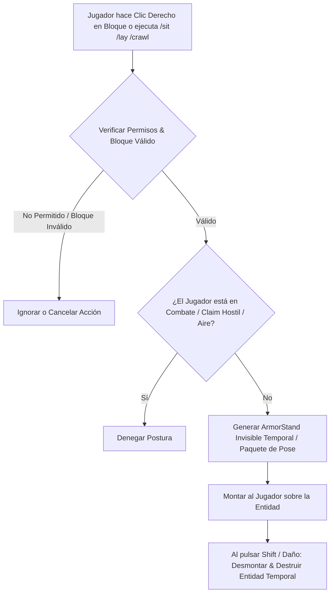

# 🪑 GSit - Documentación Técnica

- **Categoría**: Animaciones de Jugador / Posturas / Calidad de Vida (QoL)
- **Versión Core Soportada**: Minecraft 1.13.x - 1.21.x (Paper / Purpur)
- **Desarrollador**: Gecolay
- **Dependencias**: ProtocolLib (Opcional), PlaceholderAPI
- **Ruta de Configuración**: `plugins/GSit/`

---

## 🏛️ 1. Arquitectura y Funcionamiento Interno

GSit crea entidades virtuales temporales invisibles (Armor Stands o entidades Rideable) a las cuales monta el jugador como pasajero (`Entity#addPassenger`), o manipula los paquetes de pose del protocolo (Swimming/Gliding Pose) para permitir que el jugador se siente, acueste, gatee o gire en cualquier bloque.



### Características Principales:
1. **Poses Soportadas**:
   - `/sit`: Sentarse en escaleras, losas o cualquier bloque sólido.
   - `/lay`: Tumbarse sobre el suelo o camas.
   - `/crawl`: Gatear en pasadizos de 1 bloque de altura utilizando la pose nativa de nado.
   - `/spin`: Girar continuamente sobre un bloque (animación cosmética).
2. **Apilamiento de Jugadores (Player Stacking)**:
   - Capacidad para subirse a la cabeza de otros jugadores mediante clic derecho consensuado.

---

- **Parte de**: [[wiki/entities/thundermc/ecosistema-plugins|Ecosistema Plugins]] | [[wiki/synthesis/thundermc-master-synthesis|Síntesis Maestra]]
## ⚙️ 2. Configuración Crítica (`config.yml`)

```yaml
Options:
  # Interacción mediante clic derecho en escaleras/losas
  Sit-Click: true
  Sit-Blocks:
    - "*_STAIRS"
    - "*_SLAB"
    - "*_CARPET"

  # Restricciones de combate y protección
  Sit-In-Combat: false
  Sit-In-Air: false
  Check-WorldGuard: true
  Check-ProtectionStones: true

  # Comportamiento de gateo (Crawl)
  Crawl-Double-Sneak: true # Permitir doble sneak para empezar a gatear
```

---

## 💻 3. Comandos y Jerarquía de Permisos

### Comandos de Postura:
| Comando | Descripción | Permiso |
| :--- | :--- | :--- |
| `/sit` | Sienta al jugador en el bloque donde está parado. | `gsit.sit` |
| `/lay` | Acuesta al jugador en el suelo. | `gsit.lay` |
| `/crawl` | Activa la postura de gateo (1 bloque de altura). | `gsit.crawl` |
| `/spin` | Inicia la animación de giro. | `gsit.spin` |
| `/gsit reload` | Recarga las configuraciones del plugin. | `gsit.admin` |

### Jerarquía de Permisos:
- `gsit.admin`: Acceso a recargas y bypasses.
- `gsit.sit.click`: Permite sentarse haciendo clic derecho en bloques.
- `gsit.stack`: Permite apilarse encima de otros jugadores.
- `gsit.bypass.*`: Bypass de restricciones en zonas protegidas o combate.

---

## 🧩 4. Integración con PlaceholderAPI (PAPI)

| Placeholder | Descripción |
| :--- | :--- |
| `%gsit_is_sitting%` | Devuelve `true` si el jugador está actualmente sentado. |
| `%gsit_is_laying%` | Devuelve `true` si el jugador está tumbado. |
| `%gsit_is_crawling%` | Devuelve `true` si el jugador está gateando. |

---

## 🛡️ 5. Modos de Fallo, Exploits y Prevención

> [!CAUTION]
> **Exploit de Evasión de Daño y Glitch de Paredes con `/crawl`**:
> El modo de gateo puede usarse para atravesar puertas cerradas, trampillas de claims enemigos o sofocarse intencionalmente dentro de bloques protegidos.
> **Mitigación**:
> 1. Asegurar la integración activa con `WorldGuard` y `ProtectionStones`.
> 2. Mantener `Sit-In-Combat: false` para evitar que los jugadores evadan flechas o combos de espada sentándose en el suelo.

---

## Referencias Cruzadas
- [[wiki/entities/thundermc/core-infrastructure/luckperms|LuckPerms]]
- [[wiki/entities/thundermc/ecosistema-plugins|Ecosistema Plugins]]
