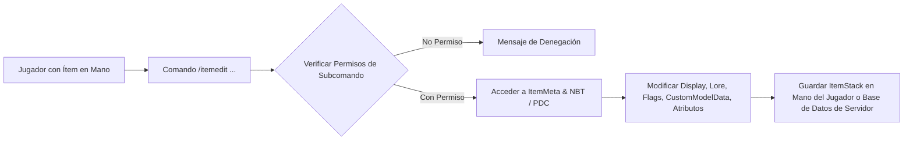

# 🛠️ ItemEdit - Documentación Técnica

- **Categoría**: Herramientas de Administración / Modificación de NBT & Meta
- **Versión Core Soportada**: Minecraft 1.8.x - 1.21.x (Paper / Purpur)
- **Desarrollador**: Emanon
- **Dependencias**: Vault (Opcional para economía en comandos), ProtocolLib (Opcional)
- **Ruta de Configuración**: `plugins/ItemEdit/`

---

## 🏛️ 1. Arquitectura y Funcionamiento Interno

ItemEdit es un plugin utilitario de manipulación directa sobre la estructura de `ItemStack` y `ItemMeta` de Spigot/Paper en tiempo de ejecución.



### Características Técnicas:
1. **Modificación NBT sin reinicios**: Permite alterar campos complejos como `CustomModelData`, `ItemFlags`, `Enchantments` con niveles fuera de los límites vanilla (unsafe enchants) y `AttributeModifiers` (Damage, Armor, Speed, Knockback Resistance, Attack Speed).
2. **Servidor de Almacenamiento (Server-side Item Storage)**:
   - Capacidad para registrar ítems globales en base de datos local y serializarlos como plantillas reutilizables mediante `/ie serveritem`.
3. **Soporte de Colores Hexadecimales y Minimessage**:
   - Formatos legacy `&x&r&g&b` y MiniMessage `<gradient:#ff0000:#0000ff>Texto</gradient>`.

---

- **Parte de**: [[wiki/entities/thundermc/ecosistema-plugins|Ecosistema Plugins]] | [[wiki/synthesis/thundermc-master-synthesis|Síntesis Maestra]]
## ⚙️ 2. Configuración Crítica (`config.yml`)

```yaml
# Configuración esencial de ItemEdit para entornos Survival 1.21.x
check-updates: false
enable-metrics: false

# Configuración de límites y seguridad
limits:
  max-lore-lines: 30
  max-name-length: 64
  max-enchant-level: 255 # Control de niveles inseguros
  allow-unsafe-enchants: false # Forzar límites vanilla en Survival si es requerido

# Integración de economía para jugadores (si se habilita edición pública)
economy:
  enabled: false
  cost-per-rename: 500.0
  cost-per-lore-line: 250.0

# Base de datos para ServerItems
database:
  type: SQLITE # O MYSQL
  sqlite:
    file: "items.db"
```

---

## 💻 3. Comandos y Jerarquía de Permisos

### Comandos de Modificación:
| Comando | Descripción | Permiso |
| :--- | :--- | :--- |
| `/ie rename <nombre>` | Cambia el display name del ítem soportando colores Hex. | `itemedit.rename` |
| `/ie lore add <línea>` | Añade una línea al final del Lore. | `itemedit.lore.add` |
| `/ie lore set <línea_idx> <texto>` | Edita una línea específica del Lore. | `itemedit.lore.set` |
| `/ie lore remove <línea_idx>` | Elimina una línea concreta del Lore. | `itemedit.lore.remove` |
| `/ie custommodeldata <id>` | Asigna el valor `CustomModelData` para paquetes de recursos. | `itemedit.custommodeldata` |
| `/ie flag add <flag>` | Oculta atributos, encantamientos, etc. (`HIDE_ENCHANTS`, `HIDE_ATTRIBUTES`). | `itemedit.flag` |
| `/ie attribute add <attr> <valor> <slot>` | Inyecta modificadores de atributos específicos por slot. | `itemedit.attribute` |
| `/ie unbreakable <true/false>` | Define la propiedad irrompible. | `itemedit.unbreakable` |
| `/ie serveritem save <id>` | Guarda el ítem en la base de datos global del servidor. | `itemedit.serveritem.save` |
| `/ie serveritem give <jugador> <id>` | Otorga un ítem guardado global a un usuario. | `itemedit.serveritem.give` |

### Jerarquía de Permisos:
- `itemedit.admin`: Acceso completo a todos los subcomandos y utilidades.
- `itemedit.bypass.*`: Ignora costos económicos y límites de caracteres.

---

## 🧩 4. Integración con PlaceholderAPI (PAPI)

ItemEdit soporta parseo de Placeholders en tiempo de ejecución al aplicar nombres o lore:
- Puede evaluar variables como `%player_name%`, `%vault_eco_balance%`, etc., al ejecutar `/ie lore add %player_name%`.
- Integración en GUI / Mensajes mediante placeholders internos de estado de ítems guardados.

---

## 🛡️ 5. Modos de Fallo, Exploits y Prevención

> [!CAUTION]
> **Exploit de Atributos Overpowered (NBT Crash / Insta-Kill)**:
> Modificadores de atributos extremos (ej: `GENERIC_ATTACK_DAMAGE: 999999999` o `GENERIC_MOVEMENT_SPEED: NaN`) pueden corromper el cálculo de entidades de Paper o provocar desconexiones masivas por paquetes inválidos.
> **Mitigación**: Limitar el permiso `itemedit.attribute` estrictamente a Administradores y validar los rangos en `config.yml`.

> [!WARNING]
> **Exploit de Falsificación de Nombres de Ranks o Cajas**:
> Los jugadores con permisos de `/ie rename` pueden intentar falsificar ítems de llaves de cajas o vouchers de rango.
> **Mitigación**: Los plugins receptores de llaves (CrazyCrates, ExcellentCrates) deben validar tags NBT/PDC personalizados y no confiar únicamente en el `DisplayName`.

---

## Referencias Cruzadas
- [[wiki/concepts/calidades-y-lore-items|Calidades y Lore de Ítems]]
- [[wiki/concepts/estandar-calidades-items|Estándar Oficial de Calidades]]
- [[wiki/entities/thundermc/gameplay-mechanics/executableitems|ExecutableItems]]
- [[wiki/entities/thundermc/ecosistema-plugins|Ecosistema Plugins]]
