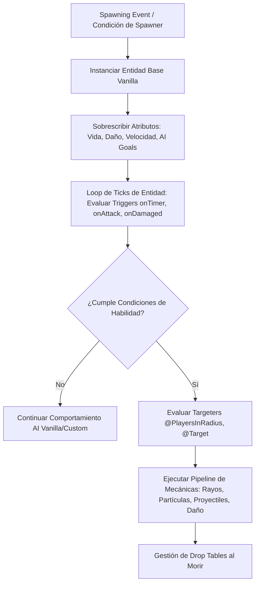

# 🐉 MythicMobs - Documentación Técnica

- **Categoría**: Mecánicas RPG / Entidades, Jefes y Habilidades Personalizadas
- **Versión Core Soportada**: Minecraft 1.20.x - 1.21.x (Paper / Purpur)
- **Desarrollador**: MythicCraft (Xikage & Team)
- **Dependencias**: ModelEngine, ProtocolLib, PlaceholderAPI, WorldGuard, Vault
- **Ruta de Configuración**: `plugins/MythicMobs/`

---

## 🏛️ 1. Arquitectura y Funcionamiento Interno

MythicMobs implementa un motor de Inteligencia Artificial (AI Goal Selectors & Targeters), un árbol de habilidades declarativas (Mechanics & Conditions) y un gestor de spawners volumétricos avanzados para entidades de Minecraft.



### Componentes Fundamentales:
1. **Triggers**:
   - Eventos de activación (`~onSpawn`, `~onCombat`, `~onAttack`, `~onDamaged`, `~onTimer:20`, `~onDeath`).
2. **Targeters**:
   - Selectores de objetivo con coordenadas y entidades (`@Self`, `@Target`, `@PlayersInRadius{r=15}`, `@NearestPlayer`).
3. **Mecánicas & Condiciones**:
   - Acciones ejecutables (`message`, `damage`, `heal`, `velocity`, `potion`, `totem`, `particle`, `sound`, `summon`).
   - Filtros de ejecución (`hascurrency`, `worldguardflag`, `inbiome`, `crouching`, `altitude`).

---

- **Parte de**: [[wiki/entities/thundermc/ecosistema-plugins|Ecosistema Plugins]] | [[wiki/synthesis/thundermc-master-synthesis|Síntesis Maestra]]
## ⚙️ 2. Configuración Crítica (`Mobs/Boss_Trueno.yml`)

```yaml
ReyDelTrueno:
  Type: WITHER_SKELETON
  Display: "&6⚡ &lRey del Trueno &8[&c%mythicmobs_mob_hp%&7/&c%mythicmobs_mob_max_hp%&8]"
  Health: 1500
  Damage: 25
  Armor: 10
  Faction: "TruenoBoss"
  Options:
    AlwaysShowName: true
    PreventOtherDrops: true
    PreventSunburn: true
    MovementSpeed: 0.32
    KnockbackResistance: 0.8
    Despawn: false
  AIGoalSelectors:
    - 0 clear
    - 1 meleeattack
    - 2 randomstroll
  AITargetSelectors:
    - 0 clear
    - 1 players
  Skills:
    - message{m="&e¡Sentiréis el poder de la tormenta celestial!"} @PlayersInRadius{r=25} ~onSpawn
    - skill{s=HabilidadRayoTormenta} @Target ~onAttack 0.35
    - skill{s=FaseFuria} @Self ~onDamaged <500 1
  Drops:
    - diamond 16-32 1.0
    - netherite_ingot 2-4 0.8
    - thunder_sword 1 0.15 # Drop de ExecutableItems
```

---

## 💻 3. Comandos y Jerarquía de Permisos

### Comandos de Administración:
| Comando | Descripción | Permiso |
| :--- | :--- | :--- |
| `/mm mobs spawn <id> [cant] [mundo,x,y,z]` | Spawnea una entidad personalizada. | `mythicmobs.admin.mobs` |
| `/mm mobs kill <id/all>` | Elimina entidades activas en los mundos. | `mythicmobs.admin.mobs` |
| `/mm spawners create <nombre> <mob>` | Crea un spawner de área en la posición actual. | `mythicmobs.admin.spawners` |
| `/mm items get <id>` | Otorga un ítem configurado en MythicMobs. | `mythicmobs.admin.items` |
| `/mm reload` | Recarga todas las configuraciones, mobs, skills y drops. | `mythicmobs.admin.reload` |

### Jerarquía de Permisos:
- `mythicmobs.admin`: Acceso maestro total a la gestión de MythicMobs.

---

## 🧩 4. Integración con PlaceholderAPI (PAPI)

| Placeholder | Descripción |
| :--- | :--- |
| `%mythicmobs_mob_hp%` | Vida actual de la entidad objetivo. |
| `%mythicmobs_mob_max_hp%` | Vida máxima total de la entidad. |
| `%mythicmobs_mob_name%` | Nombre visual asignado al mob. |

---

## 🛡️ 5. Modos de Fallo, Exploits y Optimización

> [!CAUTION]
> **Exploit de Granja de Jefes por Spawners Saturados**:
> Si se usan spawners automáticos con radio de detección mal calibrado o sin límite de entidades concurrentes (`maxmobs`), los jugadores pueden acumular cientos de jefes y colapsar el TPS.
> **Mitigación**: Siempre configurar `MaxMobs: 1` o `2` y `LeashRange: 32` en los spawners de MythicMobs.

> [!WARNING]
> **Lag por Partículas Masivas en Habilidades `~onTimer`**:
> Habilidades periódicas con intervalos reducidos (`~onTimer:1`) que invocan cientos de partículas por tick saturan el ancho de banda del cliente y aumentan el tick time del servidor.
> **Optimización**: Usar intervalos mayores a 10 ticks y condensar partículas mediante librerías de render eficientes.

---

## Referencias Cruzadas
- [[wiki/entities/thundermc/mobs-mazmorras|Mobs de Mazmorras]]
- [[wiki/concepts/dungeons-y-jefes|Dungeons y Jefes]]
- [[wiki/entities/thundermc/gameplay-mechanics/executableitems|ExecutableItems]]
- [[wiki/entities/thundermc/world-protection/worldguard|WorldGuard]]
- [[wiki/entities/thundermc/ecosistema-plugins|Ecosistema Plugins]]
