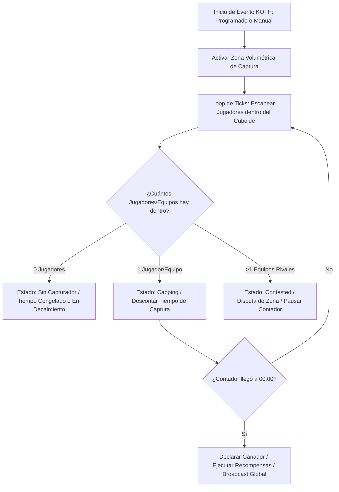

# 👑 UltimateKoth - Documentación Técnica

- **Categoría**: Eventos PvP Competitivos / King of the Hill (KOTH)
- **Versión Core Soportada**: Minecraft 1.16.x - 1.21.x (Paper / Purpur)
- **Desarrollador**: VoxelShop / Ome_R
- **Dependencias**: WorldEdit / FAWE, PlaceholderAPI, Vault, ZelTeams / Factions / Clans (Hooks)
- **Ruta de Configuración**: `plugins/UltimateKoth/`

---

## 🏛️ 1. Arquitectura y Funcionamiento Interno

UltimateKoth administra zonas volumétricas delimitadas para la captura de colinas en tiempo real, procesando la posición de los jugadores por tick y gestionando estados de control (Capping, Knocked, Contested).



### Características Técnicas:
1. **Lógica de Equipos (Team-based Cap)**:
   - Permite asociar las capturas a Clanes, Factions o ZelTeams, permitiendo que varios miembros del mismo clan mantengan la colina sin disputarse entre sí.
2. **Sistema Anti-Camping y Modos de Captura**:
   - Modo **Standard**: Mantener la zona de forma consecutiva durante X minutos.
   - Modo **Decay**: Si el capturador es derribado (knocked), el tiempo acumulado decae progresivamente en lugar de reiniciarse a 0.
3. **Distribución de Recompensas y Loot Tables**:
   - Soporte para cajas de recompensas automáticas (Loot Chests), comandos personalizados y dinero.

---

## ⚙️ 2. Configuración Crítica (`koths/volcano_koth.yml`)

```yaml
name: "Volcano"
display-name: "&c&lKOTH del Volcán"
world: "world"
capture-zone:
  min: {x: 500, y: 80, z: 500}
  max: {x: 510, y: 86, z: 510}

capture-time-seconds: 300 # 5 minutos de captura
decay:
  enabled: true
  rate: 1 # Segundos perdidos por segundo fuera de la zona

loot:
  chest-location: {x: 505.5, y: 81.0, z: 505.5}
  commands:
    - "eco give {winner} 25000"
    - "crate givekey {winner} legendaria 2"
    - "broadcast &6[KOTH] &f¡El clan &e{winner_team}&f ha conquistado el &cKOTH del Volcán&f!"

schedule:
  cron: "0 18 * * 5,6,0" # Todos los viernes, sábados y domingos a las 18:00
```

---

## 💻 3. Comandos y Jerarquía de Permisos

### Comandos de Administración & Jugador:
| Comando | Descripción | Permiso |
| :--- | :--- | :--- |
| `/koth start <nombre>` | Inicia manualmente un evento KOTH. | `ultimatekoth.admin.start` |
| `/koth stop <nombre>` | Detiene inmediatamente un evento activo. | `ultimatekoth.admin.stop` |
| `/koth list` | Muestra los KOTHs disponibles y el horario del próximo evento. | `ultimatekoth.user.list` |
| `/koth loot <nombre>` | Abre la GUI para previsualizar las recompensas del evento. | `ultimatekoth.user.loot` |
| `/koth create <nombre>` | Crea un nuevo KOTH a partir de la selección de WorldEdit. | `ultimatekoth.admin.create` |
| `/koth reload` | Recarga las configuraciones del plugin. | `ultimatekoth.admin.reload` |

### Jerarquía de Permisos:
- `ultimatekoth.admin`: Acceso completo a gestión de zonas, horarios y comandos.
- `ultimatekoth.user`: Permiso para ver información, horarios y loot.

---

## 🧩 4. Integración con PlaceholderAPI (PAPI)

| Placeholder | Descripción |
| :--- | :--- |
| `%ultimatekoth_active%` | Devuelve `true` si hay al menos un evento KOTH en curso. |
| `%ultimatekoth_capping_player%` | Nombre del jugador que está capturando actualmente. |
| `%ultimatekoth_capping_team%` | Nombre del clan / equipo que domina la zona. |
| `%ultimatekoth_time_left%` | Tiempo restante para que el capturador actual gane la colina. |
| `%ultimatekoth_next_name%` | Nombre del siguiente KOTH programado. |
| `%ultimatekoth_next_time%` | Tiempo restante para el inicio del próximo KOTH. |

---

## 🛡️ 5. Modos de Fallo, Exploits y Prevención

> [!CAUTION]
> **Exploit de Captura en Invisibilidad / Vuelo (Fly & Godmode)**:
> Jugadores en modo espectador, invisibles o con godmode/fly podrían intentar capturar zonas sin interactuar en combate.
> **Mitigación**: Habilitar en la configuración global:
> ```yaml
> restrictions:
>   disable-flying: true
>   disable-invisibility: true
>   disable-godmode: true
>   disable-spectator: true
> ```

> [!WARNING]
> **Bloqueo de Recompensas si el Inventario está Lleno**:
> Si el jugador vencedor tiene el inventario saturado, las llaves físicas o ítems dropeados al suelo pueden ser robados por rivales cercanos.
> **Mitigación**: Usar cofres virtuales o ejecutar drop en el safe-spawn del jugador ganador.
