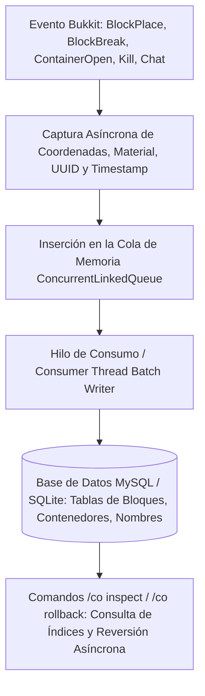

# 🛡️ CoreProtect - Documentación Técnica

- **Categoría**: Registro de Auditoría / Rollback Anti-Grief / Inspección de Bloques
- **Versión Core Soportada**: Minecraft 1.14.x - 1.21.x (Paper / Purpur)
- **Desarrollador**: PlayPro
- **Dependencias**: MySQL / MariaDB (Recomendado para entornos de alta carga) / SQLite
- **Ruta de Configuración**: `plugins/CoreProtect/`

---

## 🏛️ 1. Arquitectura y Funcionamiento Interno

CoreProtect implementa un sistema asíncrono no bloqueante de captura y persistencia de eventos de bloques, inventarios de contenedores, interacciones de entidades y comandos de chat utilizando una cola de escritura por lotes (Batch Queueing) para no impactar los ticks del servidor.



### Registros Principales:
1. **Bloques**: Colocación, destrucción, flujo de lava/agua, ignición, explosiones.
2. **Contenedores**: Retiro y depósito de ítems en cofres, shulkers, tolvas y barriles.
3. **Entidades**: Asesinato de mobs/jugadores, daño a marcos de ítems (ItemFrames) y armaduras.
4. **Chat y Comandos**: Auditoría de mensajes y ejecución de comandos por jugador.

---

- **Parte de**: [[wiki/entities/thundermc/ecosistema-plugins|Ecosistema Plugins]] | [[wiki/synthesis/thundermc-master-synthesis|Síntesis Maestra]]
## ⚙️ 2. Configuración Crítica (`config.yml`)

```yaml
# Uso de MySQL / MariaDB para rendimiento óptimo
use-mysql: true
table-prefix: "co_"
mysql-host: "127.0.0.1"
mysql-port: 3306
mysql-database: "coreprotect"
mysql-username: "minecraft"
mysql-password: "password_segura"

# Registro granular de eventos
log-block-place: true
log-block-break: true
log-player-interactions: true
log-container-transactions: true
log-entity-kills: true
log-chat: true
log-commands: true

# Control de límites de purga y rollback
max-radius: 100
rollback-items: true
rollback-entities: true
```

---

## 💻 3. Comandos y Jerarquía de Permisos

### Comandos de Inspección y Reversión:
| Comando | Descripción | Permiso |
| :--- | :--- | :--- |
| `/co inspect` o `/co i` | Activa la varita de inspección de bloques y contenedores. | `coreprotect.inspect` |
| `/co lookup <parámetros>` | Realiza una búsqueda avanzada en el historial de registros. | `coreprotect.lookup` |
| `/co rollback <parámetros>` | Revierte los cambios de grieffing según criterios especificados. | `coreprotect.rollback` |
| `/co restore <parámetros>` | Restaura una reversión previa efectuada con rollback. | `coreprotect.restore` |
| `/co purge <tiempo>` | Purga registros antiguos para liberar espacio en base de datos. | `coreprotect.purge` |
| `/co reload` | Recarga la configuración del plugin. | `coreprotect.reload` |

### Sintaxis de Parámetros:
- `u:<usuario>`: Filtra por jugador o entidad.
- `t:<tiempo>`: Filtro de tiempo (`10m`, `2h`, `7d`, `30d`).
- `r:<radio>`: Radio en bloques o `r:#world_nether` / `r:global`.
- `a:<acción>`: Acción (`+block`, `-block`, `click`, `container`, `kill`, `chat`).
- `b:<bloque>`: Filtrado por materiales concretos (`diamond_ore`, `tnt`).

Ejemplo de Rollback de Griefing:
```bash
/co rollback u:GrieferUser t:3h r:50
```

---

## 🧩 4. Jerarquía de Permisos

- `coreprotect.admin`: Acceso total a purgas, recargas y operaciones globales.
- `coreprotect.inspect`: Permiso para inspeccionar con clic izquierdo/derecho.
- `coreprotect.lookup`: Acceso a consultas de historial mediante texto.
- `coreprotect.rollback`: Permiso para ejecutar reversiones de terreno.

---

## 🛡️ 5. Modos de Fallo y Mantenimiento de Base de Datos

> [!CAUTION]
> **Colapso de Almacenamiento por Registro de Tolvas / Granjas Masivas**:
> Si se habilita el registro de movimientos de tolvas (`log-hopper-transactions: true`), la base de datos puede registrar millones de inserciones por hora, saturando el disco.
> **Mitigación**: Mantener desactivado el logging de tolvas salvo auditorías específicas y programar purgas periódicas (`/co purge 30d`).

---

## Referencias Cruzadas
- [[wiki/entities/thundermc/core-infrastructure/luckperms|LuckPerms]]
- [[wiki/entities/thundermc/world-protection/litebans|LiteBans]]
- [[wiki/entities/thundermc/world-protection/inventoryrollbackplus|InventoryRollbackPlus]]
- [[wiki/entities/thundermc/ecosistema-plugins|Ecosistema Plugins]]
