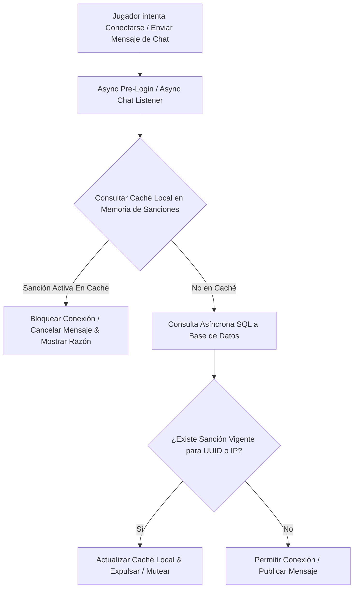

# ⚖️ LiteBans - Documentación Técnica

- **Categoría**: Moderación / Sanciones de Seguridad Globales (Bans, Mutes, Kicks, Warns)
- **Versión Core Soportada**: Spigot / Paper / Purpur / Velocity / BungeeCord (1.8.x - 1.21.x)
- **Desarrollador**: Ruan
- **Dependencias**: MySQL / MariaDB (Recomendado para networks), PlaceholderAPI, Vault
- **Ruta de Configuración**: `plugins/LiteBans/`

---

## 🏛️ 1. Arquitectura y Funcionamiento Interno

LiteBans opera un motor asíncrono de verificación de sanciones conectado a una base de datos relacional (MySQL/MariaDB/PostgreSQL/H2/SQLite) con soporte para sincronización entre múltiples instancias de servidores (Cross-Server Punishment Sync).



### Características Técnicas:
1. **Verificación Dual por UUID e IP**:
   - Soporte para baneo de cuentas (`/ban`), baneos de red de área local/IP (`/banip`) y detección de cuentas secundarias (`/dupeip`).
2. **Escalado Automático de Advertencias (Warn Actions)**:
   - Configuración de castigos acumulativos automáticos (ej: 3 warns = mute 2 horas, 5 warns = ban 7 días).
3. **Página Web de Sanciones (LiteBans Web Interface)**:
   - Conexión directa a interfaz web PHP para visualización pública de tablas de baneos en tiempo real.

---

## ⚙️ 2. Configuración Crítica (`config.yml`)

```yaml
# Sincronización SQL multi-servidor
driver: "org.mariadb.jdbc.Driver"
address: "127.0.0.1:3306"
database: "thundermc_litebans"
username: "minecraft"
password: "password_segura"

sync:
  # Tiempo de sondeo para actualizar caché entre proxies y backends (segundos)
  interval: 10

# Configuración de Seguridad y Notificaciones
security:
  dupeip_on_join: true
  prevent_same_ip_evasion: true

# Configuración de advertencias progresivas (Warn Actions)
warn_actions:
  3: "tempmute {player} 2h 3 Advertencias Acumuladas"
  5: "tempban {player} 1d 5 Advertencias Acumuladas"
  7: "ban {player} Acumulación crítica de infracciones"
```

---

## 💻 3. Comandos y Jerarquía de Permisos

### Comandos Principales:
| Comando | Descripción | Permiso |
| :--- | :--- | :--- |
| `/ban <jugador> [tiempo] [razón]` | Aplica un baneo temporal o permanente. | `litebans.ban` |
| `/ipban <jugador/IP> [razón]` | Bloquea la dirección IP de la red. | `litebans.ipban` |
| `/mute <jugador> [tiempo] [razón]` | Silencia al jugador en el chat global. | `litebans.mute` |
| `/warn <jugador> [razón]` | Aplica una advertencia formal acumulativa. | `litebans.warn` |
| `/kick <jugador> [razón]` | Expulsa al jugador de la sesión actual. | `litebans.kick` |
| `/unban <jugador>` | Retira la sanción de baneo. | `litebans.unban` |
| `/dupeip <jugador>` | Escanea todas las cuentas vinculadas a la misma IP. | `litebans.dupeip` |
| `/history <jugador>` | Muestra el historial completo de sanciones. | `litebans.history` |

### Jerarquía de Permisos:
- `litebans.admin`: Control total y recarga de configuraciones.
- `litebans.exempt`: Inmunidad ante sanciones (para administradores).
- `litebans.notify.broadcast`: Recibe alertas globales de sanciones en tiempo real.

---

## 🧩 4. Integración con PlaceholderAPI (PAPI)

| Placeholder | Descripción |
| :--- | :--- |
| `%litebans_mutes%` | Cantidad total de mutes activos o históricos del jugador. |
| `%litebans_bans%` | Número de baneos registrados para la cuenta. |
| `%litebans_warns%` | Cantidad de advertencias vigentes. |
| `%litebans_history_total%` | Conteo total de infracciones cometidas. |

---

## 🛡️ 5. Modos de Fallo y Seguridad

> [!CAUTION]
> **Falso Positivo de DupeIP por Proxies Inseguros / Floodgate**:
> Si se usa Velocity / Bungee / Floodgate sin `player-info-forwarding-mode: MODERN` (Velocity) o `bungeecord: true`, todos los jugadores pueden compartir la IP interna del proxy (`127.0.0.1`), provocando que un `/banip` banee a todo el servidor.
> **Mitigación**: Verificar siempre el reenvío seguro de IPs reales en el proxy y configurar `ignored_ips: ["127.0.0.1"]` en LiteBans.
