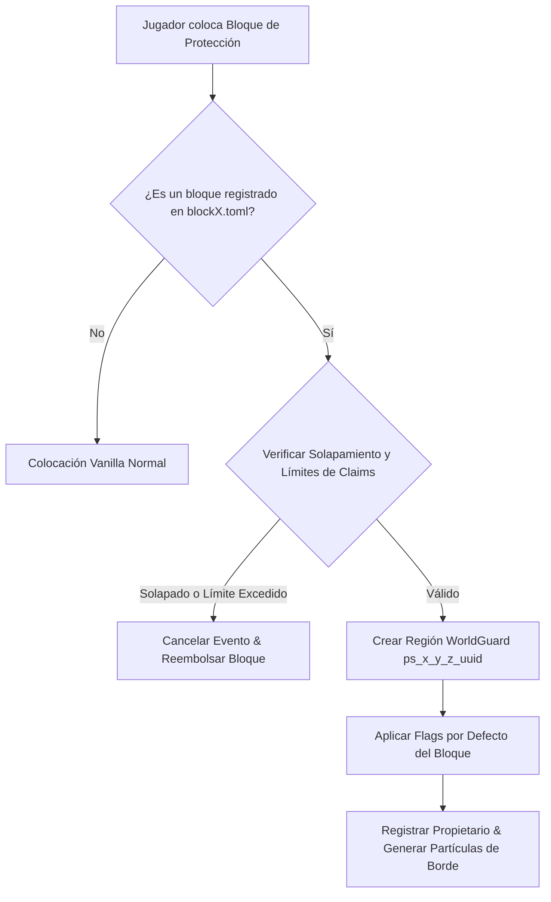

# 💎 ProtectionStones (PS) - Documentación Técnica

- **Categoría**: Protección de Terrenos / Claims Basados en Bloques
- **Versión Core Soportada**: Minecraft 1.13.x - 1.21.x (Paper / Purpur)
- **Desarrollador**: EspiDev
- **Dependencias**: WorldGuard 7.x, WorldEdit / FAWE, Vault, PlaceholderAPI
- **Ruta de Configuración**: `plugins/ProtectionStones/`

---

## 🏛️ 1. Arquitectura y Funcionamiento Interno

ProtectionStones actúa como una capa de abstracción amigable sobre la API de regiones de **WorldGuard**, permitiendo a los jugadores crear y gestionar regiones simplemente colocando o rompiendo bloques específicos en el mundo.



### Características Técnicas:
1. **Regiones Nativas WorldGuard**:
   - Cada claim genera una región formal en el gestor de WorldGuard, lo que garantiza el 100% de compatibilidad con flags, rendimiento nativo y compatibilidad con plugins de terceros.
2. **Configuraciones Modulares en TOML**:
   - Cada tipo de piedra (ej: Carbón 10x10, Oro 25x25, Diamante 50x50, Netherita 100x100) tiene su propio archivo de configuración con radio de protección en X, Y, Z, flags permitidas y costes de mantenimiento (rent/tax).
3. **Control de Miembros y Flags en GUI**:
   - Interfaz visual para añadir miembros (`/ps add`), inquilinos y alternar flags como `pvp`, `mob-spawning`, `chest-access`.

---

- **Parte de**: [[wiki/entities/thundermc/ecosistema-plugins|Ecosistema Plugins]] | [[wiki/synthesis/thundermc-master-synthesis|Síntesis Maestra]]
## ⚙️ 2. Configuración Crítica (`blocks/block_diamond.toml`)

```toml
# Definición de Piedra de Diamante (50x50)
type = "DIAMOND_BLOCK"
alias = "diamante"
description = "&bProtección Diamante (50x50)"

[region]
distance_x = 25
distance_y = 25
distance_z = 25
y_radius_mode = "AUTO" # Cubre desde Y_MIN hasta Y_MAX si se desea
priority = 10

[flags]
# Flags asignadas por defecto al colocar la piedra
default = [
    "pvp deny",
    "creeper-explosion deny",
    "tnt deny",
    "mob-spawning allow",
    "greeting &aEntrando a la protección de &f%player%",
    "farewell &cSaliendo de la protección de &f%player%"
]
# Flags que el jugador tiene permiso de alternar en su menú
allowed = [
    "pvp",
    "mob-spawning",
    "greeting",
    "farewell",
    "entry",
    "use"
]

[economy]
price = 5000.0
tax_period = 0 # 0 = sin impuestos periódicos
```

---

## 💻 3. Comandos y Jerarquía de Permisos

### Comandos de Usuario y Administración:
| Comando | Descripción | Permiso |
| :--- | :--- | :--- |
| `/ps home <id>` | Teletransporta a la piedra de protección indicada. | `protectionstones.home` |
| `/ps add <jugador>` | Añade un miembro con permisos de construcción al claim actual. | `protectionstones.members` |
| `/ps remove <jugador>` | Elimina un miembro del claim actual. | `protectionstones.members` |
| `/ps flag <flag> <valor>` | Modifica una flag permitida en la región actual. | `protectionstones.flags` |
| `/ps view` | Visualiza los bordes tridimensionales mediante partículas. | `protectionstones.view` |
| `/ps give <tipo> <jugador>` | Otorga un bloque de protección a un usuario. | `protectionstones.admin` |
| `/ps reload` | Recarga las configuraciones TOML en caliente. | `protectionstones.admin` |

### Jerarquía de Permisos:
- `protectionstones.admin`: Acceso a administración de todos los claims del servidor.
- `protectionstones.create`: Permiso base para colocar bloques de protección.
- `protectionstones.limit.<tipo>.<cantidad>`: Límite máximo de piedras que puede poseer un grupo.

---

## 🧩 4. Integración con PlaceholderAPI (PAPI)

| Placeholder | Descripción |
| :--- | :--- |
| `%protectionstones_current_region%` | ID de la región en la que se encuentra el jugador. |
| `%protectionstones_current_owner%` | Nombre del propietario de la región actual. |
| `%protectionstones_count%` | Cantidad total de claims que posee el jugador. |
| `%protectionstones_count_<tipo>%` | Cantidad de piedras colocadas de un tipo específico. |

---

## 🛡️ 5. Modos de Fallo, Exploits y Prevención

> [!CAUTION]
> **Exploit de Solapamiento y Bloqueo de Regiones Públicas**:
> Si no se configura una distancia mínima entre regiones o zonas de exclusión (ej: spawn/caminos), los usuarios pueden encerrar claims vecinos o estructuras públicas.
> **Mitigación**:
> 1. Configurar `prevent-overlap: true` en `config.toml`.
> 2. Proteger spawns con una región padre de mayor prioridad (`priority: 100`) con flag `passthrough deny`.

> [!WARNING]
> **Pérdida de Rendimiento por Visualización Masiva de Partículas (`/ps view`)**:
> Spamear partículas de borde en regiones gigantes (100x100) puede causar lag de red en clientes modestos.
> **Mitigación**: Limitar la densidad de partículas y tiempo de render en `config.toml` (`view_time: 15`).

---

## Referencias Cruzadas
- [[wiki/entities/thundermc/world-protection/worldguard|WorldGuard]]
- [[wiki/entities/thundermc/core-infrastructure/vault|Vault]]
- [[wiki/entities/thundermc/ecosistema-plugins|Ecosistema Plugins]]
