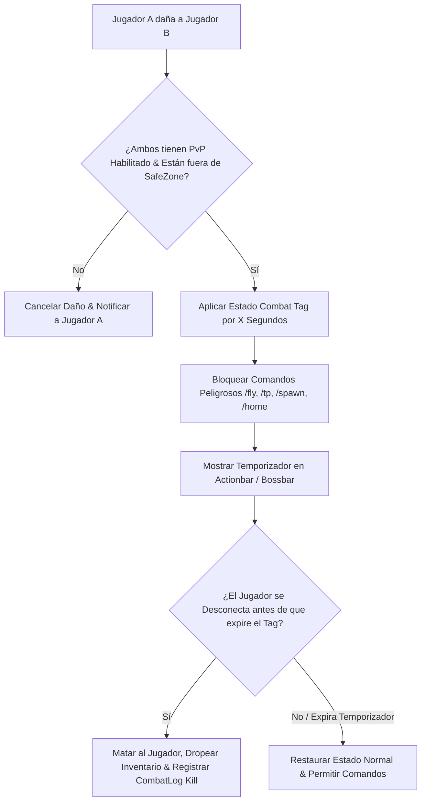

# ⚔️ PvPManager - Documentación Técnica

- **Categoría**: Gestión de Combate / Anti-CombatLog / PvP Toggle & Protección de Novatos
- **Versión Core Soportada**: Minecraft 1.8.x - 1.21.x (Paper / Purpur)
- **Desarrollador**: NoChanceSD
- **Dependencias**: WorldGuard, PlaceholderAPI, Vault, EssentialsX (Hooks)
- **Ruta de Configuración**: `plugins/PvPManager/`

---

## 🏛️ 1. Arquitectura y Funcionamiento Interno

PvPManager intercepta los eventos de daño entre jugadores (`EntityDamageByEntityEvent`), gestionando estados de combate (Tagged / In-Combat), aplicando bloqueos de comandos y teletransporte, sancionando la desconexión durante combate (Combat Logging) y ofreciendo un interruptor voluntario de PvP (`/pvp on/off`).



### Características Técnicas:
1. **Sanción Instantánea por Combat Log**:
   - Mata inmediatamente al jugador que se desconecte en combate, dropeando su inventario o generando un NPC de reemplazo si se configura.
2. **Protección de Novatos (Newbie Protection)**:
   - Inmunidad temporal durante los primeros minutos de juego del usuario (ej: 30 minutos de juego).
3. **Control Anti-Abuso y Anti-Farming**:
   - Detección de asesinatos reiterados al mismo jugador para evitar farmeo de dinero o KDR.

---

- **Parte de**: [[wiki/entities/thundermc/ecosistema-plugins|Ecosistema Plugins]] | [[wiki/synthesis/thundermc-master-synthesis|Síntesis Maestra]]
## ⚙️ 2. Configuración Crítica (`config.yml`)

```yaml
Combat:
  Time: 15 # Duración del Combat Tag (segundos)
  Block-Commands: true
  Blocked-Commands:
    - "/spawn"
    - "/tp"
    - "/tpa"
    - "/home"
    - "/warp"
    - "/pwarp"
    - "/team home"
    - "/fly"
    - "/ec"
  Disable-Fly: true
  Disable-Gamemode: true
  Disable-Disguise: true
  Punishments:
    Kill-On-Logout: true
    Drop-Inventory: true

PvP:
  Default: true # PvP habilitado por defecto
  Allow-Toggle: true
  Cooldown: 60 # Cooldown tras alternar /pvp

Newbie-Protection:
  Enabled: true
  Time: 1800 # 30 minutos de inmunidad inicial
```

---

## 💻 3. Comandos y Jerarquía de Permisos

### Comandos de Combate:
| Comando | Descripción | Permiso |
| :--- | :--- | :--- |
| `/pvp [on/off]` | Alterna el estado personal de combate PvP. | `pvpmanager.pvp` |
| `/pvp status [jugador]` | Consulta si un jugador tiene el PvP activado. | `pvpmanager.pvp.status` |
| `/pvpmanager reload` | Recarga las configuraciones del plugin. | `pvpmanager.admin` |
| `/pvp info` | Muestra estadísticas personales de combate (Kills, Deaths, KDR). | `pvpmanager.user` |

### Jerarquía de Permisos:
- `pvpmanager.admin`: Control total y bypass administrativo.
- `pvpmanager.bypass.combat`: Inmunidad ante el Combat Tag (para moderadores).
- `pvpmanager.bypass.commands`: Permite ejecutar comandos bloqueados durante el combate.
- `pvpmanager.nodisable.fly`: Evita que el modo vuelo sea desactivado al recibir daño.

---

## 🧩 4. Integración con PlaceholderAPI (PAPI)

| Placeholder | Descripción |
| :--- | :--- |
| `%pvpmanager_pvp_status%` | Estado de PvP del jugador (`Enabled`/`Disabled`). |
| `%pvpmanager_in_combat%` | Devuelve `true` si el jugador está actualmente en combate. |
| `%pvpmanager_combat_time%` | Segundos restantes del Combat Tag. |
| `%pvpmanager_newbie%` | Devuelve `true` si el jugador está bajo protección de novato. |

---

## 🛡️ 5. Modos de Fallo, Exploits y Prevención

> [!CAUTION]
> **Exploit de Fuga a Regiones Seguras (SafeZone Running)**:
> Jugadores que inician un combate en zona salvaje y retroceden corriendo al Spawn para que la región de WorldGuard bloquee el contraataque rival.
> **Mitigación**: Habilitar en `config.yml`:
> ```yaml
> WorldGuard:
>   Prevent-Entering-SafeZone-In-Combat: true
> ```

---

## Referencias Cruzadas
- [[wiki/entities/thundermc/world-protection/worldguard|WorldGuard]]
- [[wiki/entities/thundermc/gameplay-mechanics/ultimatekoth|UltimateKoth]]
- [[wiki/entities/thundermc/world-protection/litebans|LiteBans]]
- [[wiki/entities/thundermc/ecosistema-plugins|Ecosistema Plugins]]
